This document provides comprehensive Mermaid diagrams visualizing the architecture of the QuickLink VPN Cloud system based on the Docker Compose configurations.

## Table of Contents
1. [High-Level Architecture Overview](#high-level-architecture-overview)
2. [Network Topology](#network-topology)
3. [Service Dependencies](#service-dependencies)
4. [Traefik Routing Architecture](#traefik-routing-architecture)
5. [Data Flow Diagrams](#data-flow-diagrams)
6. [DERP Manager Integration](#derp-manager-integration)
7. [Observability Stack](#observability-stack)

---

## High-Level Architecture Overview

```mermaid
graph TB
    subgraph "External Access"
        Client[Client Browser/Device]
        VPNClient[VPN Client]
    end

    subgraph "Edge Layer - traefik-public network"
        Traefik[Traefik Edge Router<br/>:80, :443]
        CertGen[cert-generator<br/>SSL Certificates]
    end

    subgraph "Load Balancer Layer - app-net network"
        NginxWeb[nginx-web<br/>Backend LB]
        NginxMQTT[nginx-mqtt<br/>MQTT LB]
        NginxVPN[nginx-vpn<br/>VPN LB]
    end

    subgraph "Application Services - app-net network"
        Backend[backend<br/>Node.js/Express<br/>:3000]
        Frontend[frontend<br/>Static Assets<br/>:80]
        SQSHandler[sqs-handler<br/>Go Message Handler]
        Cronjob[cronjob<br/>Go Scheduled Tasks]
    end

    subgraph "VPN Services - app-net network"
        HS1[headscale-1<br/>Control Plane<br/>:8080]
        HS2[headscale-2<br/>Control Plane<br/>:8080]
        HSHandler[headscale-handler<br/>Go Handler]
        DerpMgr[derp-manager<br/>DERP Relay<br/>:8080, :443, :3478/udp]
    end

    subgraph "MQTT Services - app-net network"
        MQTTSrv[mqtt-service<br/>EMQX Broker<br/>:1883, :8883, :8083, :18083]
        MQTTHandler[mqtt-service-handler<br/>Status Handler<br/>:8000]
        MQTTPub[mqtt-publish-handler<br/>Publisher]
    end

    subgraph "Data Layer - app-net network"
        Postgres[(postgres<br/>PostgreSQL 12<br/>:5432)]
        DBInit[db-init<br/>Migration Service]
        LocalStack[localstack<br/>AWS Mock<br/>:4566]
    end

    subgraph "Observability - app-net network"
        Grafana[grafana<br/>Dashboards<br/>:3000]
        Loki[loki<br/>Log Aggregation<br/>:3100]
        Promtail[promtail<br/>Log Shipper<br/>:9080]
        Renderer[renderer<br/>Image Renderer<br/>:8081]
    end

    subgraph "Utilities"
        CAGen[ca-generator<br/>Certificate Authority]
        ConfigGen[config-generator<br/>Nginx Configs]
    end

    Client -->|HTTP/HTTPS| Traefik
    VPNClient -->|DERP/STUN| Traefik
    
    Traefik --> NginxWeb
    Traefik --> NginxMQTT
    Traefik --> NginxVPN
    Traefik --> Grafana
    Traefik --> DerpMgr

    NginxWeb --> Backend
    NginxWeb --> Frontend
    NginxMQTT --> MQTTSrv
    NginxVPN --> HS1
    NginxVPN --> HS2

    Backend --> Postgres
    Backend --> LocalStack
    SQSHandler --> Postgres
    SQSHandler --> LocalStack
    Cronjob --> Postgres
    Cronjob --> LocalStack
    HSHandler --> Postgres
    HSHandler --> HS1
    HSHandler --> HS2
    DerpMgr --> Postgres
    DerpMgr --> HS1
    DerpMgr --> HS2

    MQTTHandler --> MQTTSrv
    MQTTPub --> MQTTSrv
    MQTTHandler --> Postgres

    DBInit --> Postgres
    CAGen --> Postgres
    CAGen --> LocalStack

    Promtail --> Loki
    Grafana --> Loki
    Grafana --> Renderer

    CertGen -.->|provides certs| Traefik
    ConfigGen -.->|provides configs| NginxWeb
    ConfigGen -.->|provides configs| NginxMQTT
    ConfigGen -.->|provides configs| NginxVPN

    style Traefik fill:#ff6b6b
    style Postgres fill:#4ecdc4
    style LocalStack fill:#95e1d3
    style Grafana fill:#f38181
    style DerpMgr fill:#aa96da
```

---

## Network Topology

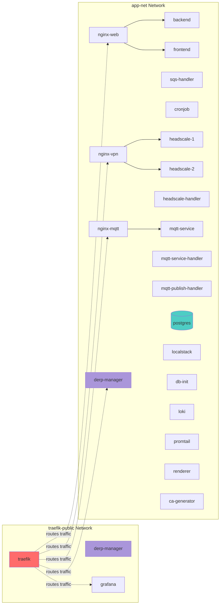

---

## Service Dependencies

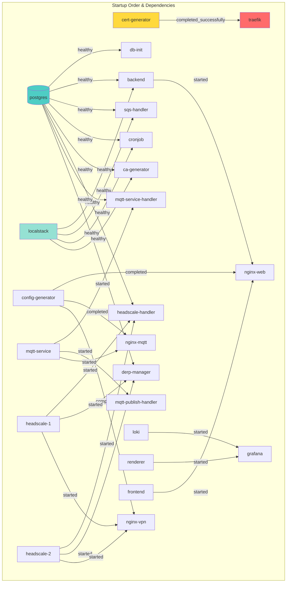

---

## Traefik Routing Architecture

```mermaid
graph TB
    subgraph "Traefik Entrypoints"
        Web[":80 (web)"]
        WebSecure[":443 (websecure)"]
    end

    subgraph "Traefik Routers & Services"
        subgraph "Backend Routes"
            WebRouter1["server.*.traefik.me<br/>(HTTP)"]
            WebRouter1S["server.*.traefik.me<br/>(HTTPS/TLS)"]
            WebSvc[nginx-web:80]
        end

        subgraph "Frontend Routes"
            WebRouter2["frontend.*.traefik.me<br/>(HTTP)"]
            WebRouter2S["frontend.*.traefik.me<br/>(HTTPS/TLS)"]
        end

        subgraph "MQTT Routes"
            MQTTRouter["mqtt.*.traefik.me<br/>(HTTP)"]
            MQTTRouterS["mqtt.*.traefik.me<br/>(HTTPS/TLS)"]
            MQTTRouterWS["mqttws.*.traefik.me<br/>(WebSocket)"]
            MQTTRouterWSS["mqttws.*.traefik.me<br/>(WebSocket/TLS)"]
            MQTTSvc[nginx-mqtt:80]
        end

        subgraph "VPN Routes"
            VPNRouter["vpn.*.traefik.me<br/>(HTTP)"]
            VPNRouterS["vpn.*.traefik.me<br/>(HTTPS/TLS)"]
            VPNSvc[nginx-vpn:80]
        end

        subgraph "DERP Manager Routes"
            DerpAPIRouter["manager.*.traefik.me<br/>(HTTP)"]
            DerpAPIRouterS["manager.*.traefik.me<br/>(HTTPS/TLS)"]
            DerpRelayRouter["derp-manager.*.traefik.me<br/>(HTTPS/TLS)"]
            DerpAPISvc["derp-manager:8080"]
            DerpRelaySvc["derp-manager:443<br/>(HTTPS backend)"]
        end

        subgraph "Observability Routes"
            GrafanaRouter["grafana.*.traefik.me<br/>(HTTP)"]
            GrafanaRouterS["grafana.*.traefik.me<br/>(HTTPS/TLS)"]
            GrafanaSvc[grafana:3000]
        end
    end

    subgraph "Backend Services"
        NginxWeb[nginx-web]
        NginxMQTT[nginx-mqtt]
        NginxVPN[nginx-vpn]
        DerpManager[derp-manager]
        Grafana[grafana]
        
        Backend1[backend-1:3000]
        Backend2[backend-2:3000]
        Frontend[frontend:80]
        MQTT[mqtt-service]
        HS1[headscale-1:8080]
        HS2[headscale-2:8080]
    end

    Web --> WebRouter1
    Web --> WebRouter2
    Web --> MQTTRouter
    Web --> MQTTRouterWS
    Web --> VPNRouter
    Web --> DerpAPIRouter
    Web --> GrafanaRouter

    WebSecure --> WebRouter1S
    WebSecure --> WebRouter2S
    WebSecure --> MQTTRouterS
    WebSecure --> MQTTRouterWSS
    WebSecure --> VPNRouterS
    WebSecure --> DerpAPIRouterS
    WebSecure --> DerpRelayRouter
    WebSecure --> GrafanaRouterS

    WebRouter1 --> WebSvc
    WebRouter1S --> WebSvc
    WebRouter2 --> WebSvc
    WebRouter2S --> WebSvc
    
    MQTTRouter --> MQTTSvc
    MQTTRouterS --> MQTTSvc
    MQTTRouterWS --> MQTTSvc
    MQTTRouterWSS --> MQTTSvc
    
    VPNRouter --> VPNSvc
    VPNRouterS --> VPNSvc
    
    DerpAPIRouter --> DerpAPISvc
    DerpAPIRouterS --> DerpAPISvc
    DerpRelayRouter --> DerpRelaySvc
    
    GrafanaRouter --> GrafanaSvc
    GrafanaRouterS --> GrafanaSvc

    WebSvc --> NginxWeb
    MQTTSvc --> NginxMQTT
    VPNSvc --> NginxVPN
    DerpAPISvc --> DerpManager
    DerpRelaySvc --> DerpManager
    GrafanaSvc --> Grafana

    NginxWeb --> Backend1
    NginxWeb --> Backend2
    NginxWeb --> Frontend
    NginxMQTT --> MQTT
    NginxVPN --> HS1
    NginxVPN --> HS2

    style Web fill:#ffe66d
    style WebSecure fill:#ff6b6b
```

---

## Data Flow Diagrams

### Message Processing Flow

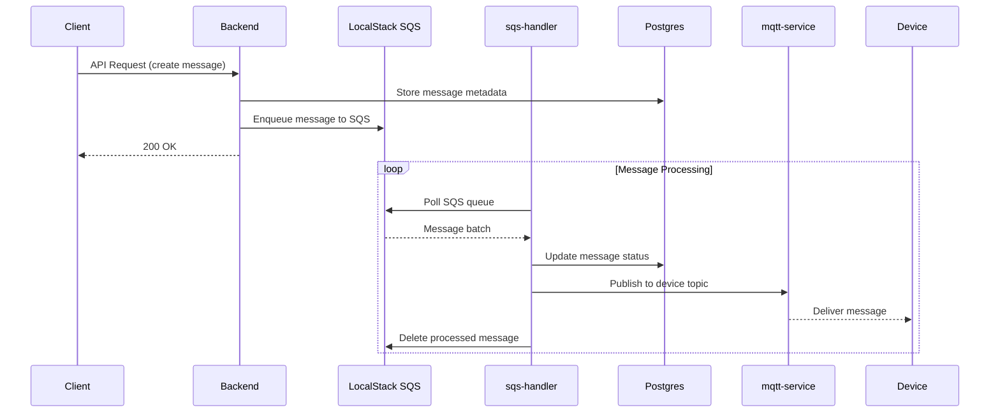

### VPN Connection Flow

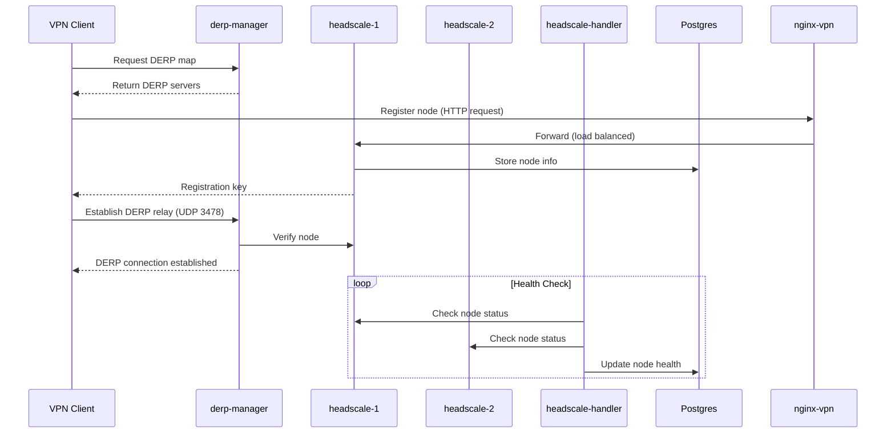

### Observability Flow

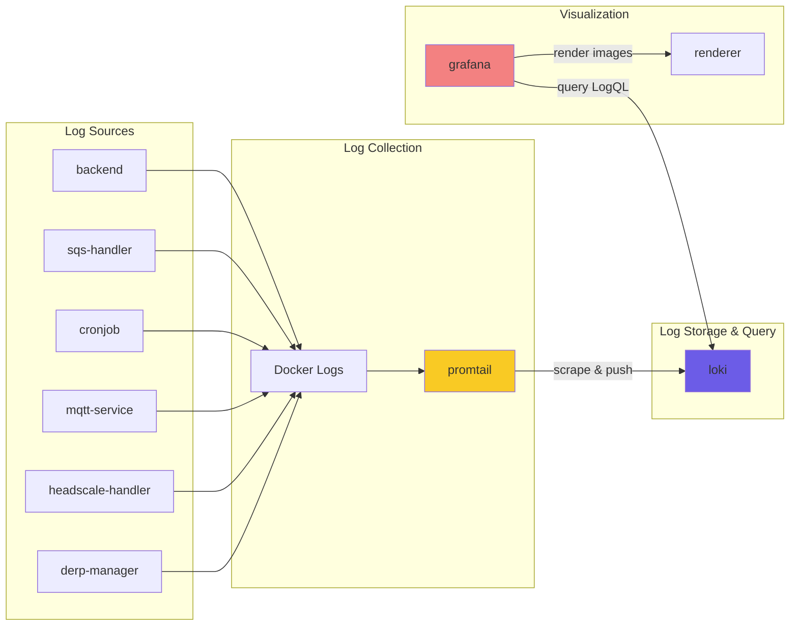

---

## DERP Manager Integration

```mermaid
graph TB
    subgraph "DERP Manager Service"
        DerpMain[derp-manager<br/>Main Container]
        
        subgraph "ENV_TYPE Routing"
            EnvCheck{ENV_TYPE?}
            LocalMode[startup_local.sh<br/>Docker/Local Mode]
            CloudMode[startup.sh<br/>Cloud Production Mode]
        end

        subgraph "Local Mode Components"
            LocalCerts[mkcert/self-signed certs]
            LocalDNS[*.traefik.me DNS]
            LocalDerp[DERP Relay :443]
            LocalAPI[DERP Map API :8080]
            LocalSTUN[STUN Server :3478/udp]
        end

        subgraph "Cloud Mode Components"
            Tailscale[Tailscale Auth]
            AWSMeta[AWS Instance Metadata]
            LetsEncrypt[LetsEncrypt Certs]
            CloudDerp[DERP Relay :443]
            CloudAPI[DERP Map API :8080]
            CloudSTUN[STUN Server :3478/udp]
        end
    end

    subgraph "Dependencies"
        Postgres[(postgres)]
        NginxVPN[nginx-vpn<br/>Headscale LB]
        HS1[headscale-1]
        HS2[headscale-2]
    end

    subgraph "Traefik Routing"
        TraefikWeb[":80 (web)"]
        TraefikSecure[":443 (websecure)"]
        
        APIRoute["manager.*.traefik.me"]
        RelayRoute["derp-manager.*.traefik.me"]
    end

    subgraph "External Clients"
        VPNClient1[VPN Client 1]
        VPNClient2[VPN Client 2]
        Browser[Web Browser]
    end

    DerpMain --> EnvCheck
    EnvCheck -->|env_docker/env_local| LocalMode
    EnvCheck -->|env_cloud_*| CloudMode

    LocalMode --> LocalCerts
    LocalMode --> LocalDNS
    LocalMode --> LocalDerp
    LocalMode --> LocalAPI
    LocalMode --> LocalSTUN

    CloudMode --> Tailscale
    CloudMode --> AWSMeta
    CloudMode --> LetsEncrypt
    CloudMode --> CloudDerp
    CloudMode --> CloudAPI
    CloudMode --> CloudSTUN

    DerpMain --> Postgres
    DerpMain --> NginxVPN
    NginxVPN --> HS1
    NginxVPN --> HS2

    TraefikWeb --> APIRoute
    TraefikSecure --> APIRoute
    TraefikSecure --> RelayRoute

    APIRoute --> LocalAPI
    APIRoute --> CloudAPI
    RelayRoute --> LocalDerp
    RelayRoute --> CloudDerp

    Browser -->|HTTP/HTTPS| TraefikWeb
    Browser -->|HTTPS| TraefikSecure
    VPNClient1 -->|DERP/STUN| LocalSTUN
    VPNClient1 -->|DERP/STUN| CloudSTUN
    VPNClient2 -->|DERP/STUN| LocalSTUN
    VPNClient2 -->|DERP/STUN| CloudSTUN

    style EnvCheck fill:#ffd93d
    style LocalMode fill:#95e1d3
    style CloudMode fill:#aa96da
    style Postgres fill:#4ecdc4
```

### DERP Manager Hostname Pattern

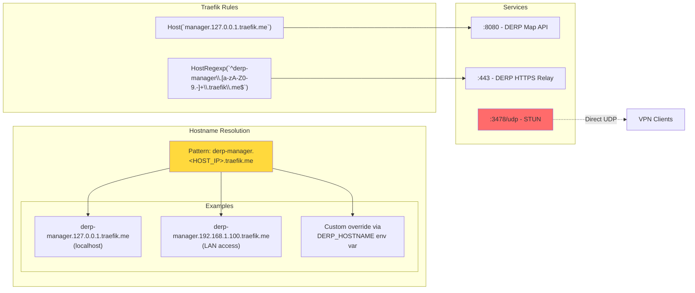

---

## Observability Stack

```mermaid
graph TB
    subgraph "Data Sources"
        AllServices["All Services<br/>(labeled with logging=promtail)"]
        DockerEngine[Docker Engine<br/>Container Logs]
    end

    subgraph "Log Collection Layer"
        Promtail[promtail:9080<br/>Log Shipper]
        PromtailConfig["/etc/promtail/docker-config.yaml"]
        DockerSocket["/var/run/docker.sock"]
    end

    subgraph "Storage Layer"
        Loki[loki:3100<br/>Log Aggregation]
        LokiConfig["/etc/loki/local-config.yaml"]
        LokiStorage["/loki<br/>Time-series data"]
    end

    subgraph "Visualization Layer"
        Grafana[grafana:3000<br/>Dashboards]
        GrafanaDatasource["Loki Datasource<br/>(pre-configured)"]
        Renderer[renderer:8081<br/>Image Renderer<br/>(headless Chrome)"]
    end

    subgraph "Access"
        Browser[Web Browser]
        TraefikRoute["grafana.*.traefik.me"]
    end

    AllServices --> DockerEngine
    DockerEngine --> DockerSocket
    DockerSocket --> Promtail
    PromtailConfig --> Promtail
    
    Promtail -->|Push logs| Loki
    LokiConfig --> Loki
    Loki --> LokiStorage
    
    GrafanaDatasource --> Loki
    Grafana --> GrafanaDatasource
    Grafana --> Renderer
    
    Browser --> TraefikRoute
    TraefikRoute --> Grafana

    style Promtail fill:#f9ca24
    style Loki fill:#6c5ce7
    style Grafana fill:#f38181
    style Renderer fill:#a29bfe
```

---

## Environment Type Architecture

```mermaid
graph TB
    subgraph "ENV_TYPE Decision Tree"
        EnvVar[ENV_TYPE<br/>Environment Variable]
        
        subgraph "Docker/Local Environments"
            EnvDocker[env_docker]
            EnvLocal[env_local]
            
            subgraph "Docker/Local Stack"
                LocalStack[LocalStack<br/>AWS Mock]
                TraefikMe[*.traefik.me DNS]
                MkcertSSL[mkcert/self-signed SSL]
                VersionedDB[Versioned DB Migrations]
            end
        end

        subgraph "Cloud Environments"
            EnvCloudDev[env_cloud_dev]
            EnvCloudSQA[env_cloud_sqa]
            EnvCloudStaging[env_cloud_staging]
            EnvCloudProd[env_cloud_prod]
            
            subgraph "Cloud Stack"
                AWSSQS[AWS SQS]
                AWSS3[AWS S3]
                AWSMeta[AWS Instance Metadata]
                LetsEncrypt[LetsEncrypt SSL]
                CustomDomain[Custom Domain]
                Tailscale[Tailscale Integration]
                LegacyDB[Legacy DB Data Files]
            end
        end
    end

    subgraph "Services Using ENV_TYPE"
        Backend[backend<br/>Node.js]
        Cronjob[cronjob<br/>Go]
        Message[message handler<br/>Go]
        VPNHandler[vpn handler<br/>Go]
        DerpMgr[derp-manager<br/>Go]
        DBInit[db-init<br/>Shell]
    end

    EnvVar --> EnvDocker
    EnvVar --> EnvLocal
    EnvVar --> EnvCloudDev
    EnvVar --> EnvCloudSQA
    EnvVar --> EnvCloudStaging
    EnvVar --> EnvCloudProd

    EnvDocker --> LocalStack
    EnvDocker --> TraefikMe
    EnvDocker --> MkcertSSL
    EnvDocker --> VersionedDB
    
    EnvLocal --> LocalStack
    EnvLocal --> TraefikMe
    EnvLocal --> MkcertSSL

    EnvCloudDev --> AWSSQS
    EnvCloudDev --> AWSS3
    EnvCloudDev --> AWSMeta
    EnvCloudDev --> LetsEncrypt
    EnvCloudDev --> CustomDomain
    EnvCloudDev --> Tailscale
    
    EnvCloudSQA --> AWSSQS
    EnvCloudSQA --> AWSS3
    EnvCloudStaging --> AWSSQS
    EnvCloudStaging --> AWSS3
    EnvCloudProd --> AWSSQS
    EnvCloudProd --> AWSS3
    EnvCloudProd --> LegacyDB

    Backend -.->|switches| EnvVar
    Cronjob -.->|switches| EnvVar
    Message -.->|switches| EnvVar
    VPNHandler -.->|switches| EnvVar
    DerpMgr -.->|switches| EnvVar
    DBInit -.->|switches| EnvVar

    style EnvVar fill:#ffd93d
    style EnvDocker fill:#95e1d3
    style EnvCloudProd fill:#ff6b6b
```

---

## Service Port Mapping

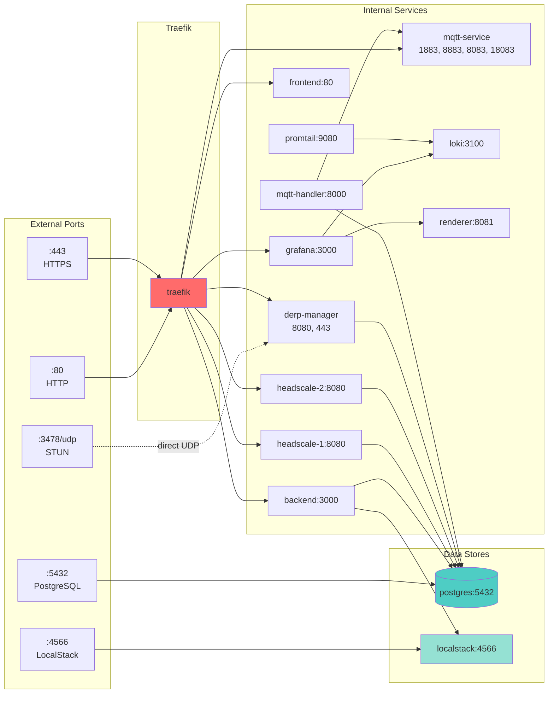

---

## Volume Mounts & Persistence

```mermaid
graph TB
    subgraph "Named Volumes"
        V1[traefik-certificates]
        V2[shared-ssl]
        V3[nginx-configs]
        V4[derp-manager-data]
        V5[postgres data volume]
        V6[loki data volume]
    end

    subgraph "Host Bind Mounts"
        H1[./scripts/ca-management/ca]
        H2[./vpncloud-service-db/data]
        H3[./scripts/observability/promtail]
        H4[./scripts/observability/loki]
        H5[/var/run/docker.sock]
    end

    subgraph "Services"
        Traefik[traefik]
        NginxWeb[nginx-web]
        NginxMQTT[nginx-mqtt]
        NginxVPN[nginx-vpn]
        Postgres[postgres]
        DerpMgr[derp-manager]
        Loki[loki]
        Promtail[promtail]
        CAGen[ca-generator]
        ConfigGen[config-generator]
        CertGen[cert-generator]
    end

    V1 --> Traefik
    V2 --> CertGen
    V2 --> Traefik
    V3 --> ConfigGen
    V3 --> NginxWeb
    V3 --> NginxMQTT
    V3 --> NginxVPN
    V4 --> DerpMgr
    V5 --> Postgres
    V6 --> Loki

    H1 --> CAGen
    H2 --> Postgres
    H3 --> Promtail
    H4 --> Loki
    H5 --> Promtail

    style V1 fill:#f9ca24
    style V2 fill:#f9ca24
    style V3 fill:#f9ca24
    style V4 fill:#f9ca24
    style H5 fill:#ff6b6b
```

---

## Summary

### Key Architectural Decisions

1. **Edge Routing**: Traefik serves as the single entry point for all HTTP/HTTPS traffic with dynamic routing based on host patterns (`*.traefik.me`)

2. **Load Balancing**: Nginx containers provide internal load balancing for backend, MQTT, and VPN services

3. **Network Segmentation**: Two networks isolate concerns:
   - `traefik-public`: Edge routing layer
   - `app-net`: Internal service communication

4. **Environment Flexibility**: `ENV_TYPE` variable enables seamless switching between local Docker development and cloud production deployments

5. **Observability**: Centralized logging with Promtail → Loki → Grafana stack, all services labeled for automatic log collection

6. **Service Independence**: Services are loosely coupled using message queues (SQS/LocalStack), MQTT pub/sub, and API calls

7. **Health Checks**: Critical services (postgres, localstack, mqtt-service) have health checks to ensure proper startup order

8. **DERP Integration**: derp-manager provides DERP relay and STUN for NAT traversal in VPN connections, supporting both local and cloud deployment modes

### Service Counts

- **Total Services**: 28
- **Go Services**: 7 (cronjob, sqs-handler, headscale-handler, mqtt-status-handler, mqtt-publisher-handler, headscale-1, headscale-2)
- **Node.js Services**: 1 (backend)
- **Static Services**: 1 (frontend)
- **Infrastructure Services**: 11 (traefik, nginx-web, nginx-mqtt, nginx-vpn, postgres, localstack, mqtt-service, loki, promtail, grafana, renderer)
- **Utility Services**: 3 (cert-generator, ca-generator, config-generator)
- **VPN Services**: 5 (headscale-1, headscale-2, headscale-handler, derp-manager, vpn-related Go handlers)

### External Access URLs (Local Development)

- **Frontend**: http://frontend.127.0.0.1.traefik.me or http://frontend.{LAN_IP}.traefik.me
- **Backend API**: http://server.127.0.0.1.traefik.me or http://server.{LAN_IP}.traefik.me
- **MQTT WebSocket**: http://mqttws.127.0.0.1.traefik.me or http://mqttws.{LAN_IP}.traefik.me
- **MQTT Dashboard**: http://mqtt.127.0.0.1.traefik.me or http://mqtt.{LAN_IP}.traefik.me
- **VPN Control Plane**: http://vpn.127.0.0.1.traefik.me or http://vpn.{LAN_IP}.traefik.me
- **DERP Map API**: http://manager.127.0.0.1.traefik.me or http://manager.{LAN_IP}.traefik.me
- **DERP Relay**: https://derp-manager.127.0.0.1.traefik.me or https://derp-manager.{LAN_IP}.traefik.me
- **Grafana**: http://grafana.127.0.0.1.traefik.me or http://grafana.{LAN_IP}.traefik.me
- **PostgreSQL**: localhost:5432
- **LocalStack**: localhost:4566

---

## Related Documentation

- [ENV_TYPE Refactor Analysis](./ENV_TYPE_REFACTOR_ANALYSIS.md)
- [ENV_TYPE Migration Guide](./ENV_TYPE_MIGRATION_GUIDE.md)
- [AGENTS.md](../AGENTS.md) - Project structure and development guidelines

---

**Generated**: Based on `docker-compose.traefik.yml` and `docker-compose.derp-manager.yml`

**Last Updated**: Current session
