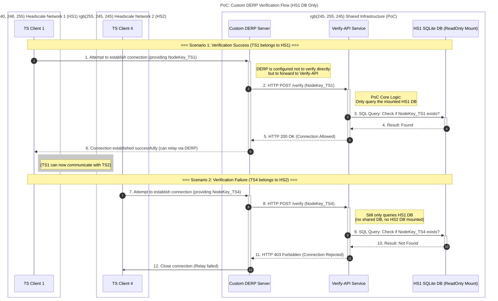

## 1. Objective

The goal of this Proof of Concept (PoC) is to demonstrate a high-availability (HA) architecture for Headscale using a custom DERP server that delegates client verification to an external HTTP service (`verify-api`). This PoC specifically showcases a simplified verification logic where only nodes registered with a primary Headscale instance (HS1) are considered valid by the DERP server, even when other Headscale instances (HS2) are present.

## 2. Architecture Topology

This architecture will be implemented using Docker Compose and will consist of the following components:

### 2.1. Control Planes

*   **HS1 (Headscale Instance 1):** Manages its own independent Tailscale network. Its SQLite database will be used by `verify-api`.
*   **HS2 (Headscale Instance 2):** Manages a completely separate Tailscale network, distinct from HS1. Its database will NOT be accessed by `verify-api` in this PoC.

### 2.2. Clients

*   **TS1, TS2:** Tailscale clients registered to HS1.
*   **TS3, TS4:** Tailscale clients registered to HS2.

### 2.3. Relay Infrastructure

*   **derper:** A standalone custom DERP server. This `derper` instance will be configured to delegate client verification to the `verify-api` service rather than directly querying a Headscale instance.
*   **verify-api:** A custom, lightweight HTTP service that I will develop. This service acts as an intermediary verification layer for the `derper`.
    *   **Connection:** The `derper` will be configured to use `verify-api` to validate clients.

## 3. PoC Logic (The "Why")

In a future HA implementation, the `verify-api` would query a shared, highly available database (e.g., PostgreSQL, DynamoDB) to validate clients across multiple active Headscale instances. However, for this specific PoC, the logic is simplified to demonstrate the core concept:

*   The `verify-api` will represent a scenario where *only* HS1 nodes are considered valid on this DERP server.
*   The `verify-api` will directly access HS1's SQLite database file (mounted read-only into the `verify-api` container) to check for the existence of a client's Node Key.
*   HS2 does not share this database with HS1. Therefore, `verify-api` will *not* find Node Keys belonging to HS2 clients and must reject them.

## 4. `verify-api` Specifications

The `verify-api` service will be a minimal HTTP server exposing a single endpoint:

*   **Endpoint:** `POST /verify`
*   **Request Body:** A JSON object containing the `NodeKey` of the client attempting to connect to the DERP server.
    ```json
    {
        "NodeKey": "nodekey-from-tailscale-client"
    }
    ```
*   **Logic:**
    1.  Receive `NodeKey` from the `derper` via a `POST /verify` request.
    2.  Query the mounted HS1 SQLite database (read-only) to check if the `NodeKey` exists in HS1's registered nodes.
    3.  If the `NodeKey` is found in the HS1 database:
        *   Respond with `HTTP 200 OK`.
        *   Optionally, include a JSON body indicating success (e.g., `{ "status": "allowed" }`).
    4.  If the `NodeKey` is *not* found in the HS1 database:
        *   Respond with `HTTP 403 Forbidden`.
        *   Optionally, include a JSON body indicating rejection (e.g., `{ "status": "rejected", "reason": "NodeKey not found in HS1 DB" }`).

## 5. Expected Behavior

### 5.1. Path A (Verify OK - TS1 under HS1)

1.  **TS1 (client under HS1)** attempts to connect to the `derper`.
2.  `derper` forwards the `NodeKey_TS1` to `verify-api` via `POST /verify`.
3.  `verify-api` queries the mounted HS1 database.
4.  `verify-api` finds `NodeKey_TS1` in the HS1 database.
5.  `verify-api` responds to `derper` with `HTTP 200 OK`.
6.  `derper` allows the connection for TS1.
7.  **Result:** TS1 and TS2 (also under HS1) can communicate via DERP.

### 5.2. Path B (Verify Fail - TS4 under HS2)

1.  **TS4 (client under HS2)** attempts to connect to the `derper`.
2.  `derper` forwards the `NodeKey_TS4` to `verify-api` via `POST /verify`.
3.  `verify-api` queries the mounted HS1 database.
4.  `verify-api` does *not* find `NodeKey_TS4` in the HS1 database (because it belongs to HS2 and HS2's DB is not queried).
5.  `verify-api` responds to `derper` with `HTTP 403 Forbidden`.
6.  `derper` closes the connection for TS4.
7.  **Result:** TS4 cannot establish a relay connection through this DERP server.

## 6. Docker Compose Requirements

The `docker-compose.yml` file will need to:

*   Define services for `hs1`, `hs2`, `derper`, and `verify-api`.
*   Configure `derper` to use `verify-api` for node verification. This typically involves specific `derper` command-line flags or environment variables (e.g., `--verify-url`).
*   Mount the HS1 SQLite database file as read-only into the `verify-api` container.
*   Ensure proper networking for all services to communicate.

## 
```mermaid
graph TD
    %% 定義樣式
    classDef container fill:#f9f,stroke:#333,stroke-width:2px;
    classDef client fill:#d4edda,stroke:#28a745,stroke-width:1px;
    classDef db fill:#fff5ad,stroke:#ffc107,stroke-width:2px,stroke-dasharray: 5 5;

    %% 基礎設施區域 (共用元件)
    subgraph Infrastructure [共用基礎設施]
        direction TB
        derp[DERP Server]:::container
        v_api{{Verify API\n自定義驗證服務}}:::container
        
        %% 驗證流程
        derp -- "1. POST /verify (Client Key)" --> v_api
        v_api -- "2a. 查詢 Key 是否存在" --> hs1_db
    end

    %% Headscale Network 1 區域
    subgraph Net1 [Headscale Network 1 (允許通過)]
        hs1[Headscale 1\n(HS1)]:::container
        hs1_db[(HS1 DB\nSQLite)]:::db
        ts1(Client TS1):::client
        ts2(Client TS2):::client

        %% 控制平面連接
        ts1 <--> hs1
        ts2 <--> hs1
        hs1 ~~~ hs1_db

        %% 資料平面連接 (成功路徑)
        ts1 -.- |"嘗試連接 (帶 HS1 Key)"| derp
        v_api -- "2b. 200 OK (Key Found)" --> derp
        derp === |"DERP 通道建立成功"| ts1
        derp === |"DERP 通道建立成功"| ts2
    end

    %% Headscale Network 2 區域
    subgraph Net2 [Headscale Network 2 (將被拒絕)]
        hs2[Headscale 2\n(HS2)]:::container
        ts3(Client TS3):::client
        ts4(Client TS4):::client

        %% 控制平面連接
        ts3 <--> hs2
        ts4 <--> hs2

        %% 資料平面連接 (失敗路徑)
        ts4 -.- |"嘗試連接 (帶 HS2 Key)"| derp
        v_api -- "2c. 403 Forbidden (Key Not Found)" x derp
        derp -.-x |"連接被拒"| ts4
    end

    %% 圖例說明
    subgraph Legend [圖例]
        l1(Client) --- l2[Server/Service] --- l3[(Database)]
        l4 <-->|控制平面註冊| l5
        l6 -.-|資料/驗證請求| l7
        l8 ===|DERP 連線成功| l9
    end

    %% 連結樣式調整 (讓圖更易讀)
    linkStyle 2,6 stroke:blue,stroke-width:2px,color:blue;
    linkStyle 10 stroke:red,stroke-width:2px,color:red;
```

## 7. Sequence Diagram


