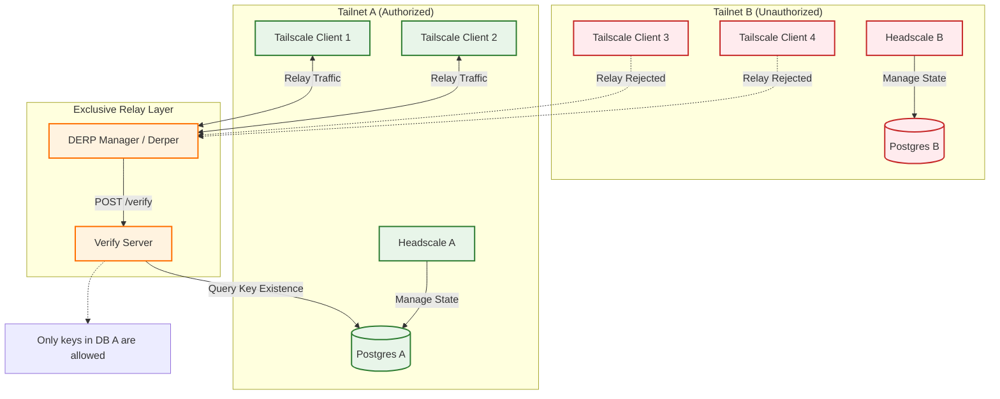

**Date:** November 27, 2025
**Status:** Successful POC
**Context:** QuickLink VPN Cloud - DERP Integration Testing & Multi-Tenancy Architecture

## 1. Executive Summary

This report details the successful implementation and validation of a **Decoupled DERP Verification Architecture**. By analyzing the internal communication between Tailscale's `derper` and the Control Plane (Headscale), we successfully replaced the embedded verification dependency with a standalone **Verify Service** backed by a shared database.

This architecture enables a **Private, Exclusive Relay** model. A specific DERP server can be configured to authenticate clients against a specific Headscale database, effectively preventing unauthorized usage from other Tailnets (e.g., a "Free Tier" Tailnet trying to use "Premium Tier" DERP resources, or simply isolating enterprise tenants).

## 2. Multi-Tenancy Architecture Diagram

The following diagram illustrates a multi-tailnet scenario. **Tailnet A** is the authorized tenant for the custom DERP Relay, while **Tailnet B** is an unauthorized tenant.

## 3. Technical Findings

### 3.1. The Verification Contract
The `derper` component relies on a simple HTTP contract to admit clients for relaying traffic.

*   **Protocol:** `POST /verify`
*   **Input:** `{"NodePublic": "nodekey:<hex_key>"}`
*   **Output:** `{"Allow": true}` or `{"Allow": false}`

### 3.2. The "Mock Verify Server" Solution
We implemented a stateless Go service that connects to the PostgreSQL database of **Tailnet A**.

1.  **Intercept:** Receives the node key from the DERP server.
2.  **Lookup:** Executes `SELECT EXISTS(SELECT 1 FROM nodes WHERE machine_key = $1)` against **DB A**.
3.  **Decide:**
    *   If found in **DB A**: Returns `Allow: true`. **Tailscale 1 & 2** can use the relay.
    *   If NOT found in **DB A** (even if valid in **DB B**): Returns `Allow: false`. **Tailscale 3 & 4** are rejected.

## 4. Test Validation

The environment was validated using the following steps:

| Step | Action | Expected Result | Status |
|------|--------|-----------------|--------|
| **1** | **Configure** | Point `derp-manager` to `mock-verify-server` connected to **DB A**. | Configured |
| **2** | **Register Client A** | Register `tailscale-1` to **Headscale A**. | Key stored in **DB A**. |
| **3** | **Force Relay** | Configure `tailscale-1` to force DERP usage. | **Success:** Ping passes via DERP. |
| **4** | **Simulate Client B** | Attempt to verify a random/unknown key (simulating **Tailscale 3** from **Tailscale B**). | **Rejected:** Verify server logs `Allow: false`. |

**Result:** The DERP server effectively acted as a private resource for Tailnet A, rejecting any traffic from clients not present in the designated database.

## 5. Implications for High Availability & Isolation

This architecture provides two major benefits:

### 5.1. High Availability (HA)
*   **Decoupling:** The DERP layer does not depend on the Headscale application being responsive. It only needs access to the database (read-only replica recommended).
*   **Horizontal Scaling:** You can deploy multiple DERP nodes behind a load balancer, all authenticating against the shared "Verify Service".

### 5.2. Resource Isolation (Anti-Leeching)
*   **Exclusive Access:** By pointing the Verify Service to a specific tenant's database, you ensure that **only** that tenant's clients can consume the bandwidth and CPU of that DERP cluster.
*   **Security:** Even if the DERP map is public or leaked, unauthorized clients (from other Tailnets or the public internet) cannot use the relay because their keys will not exist in the authorized database.

## 6. Next Steps

1.  **Production Service:** Formalize `mock-verify-server` into `quicklink-verify-service`.
2.  **Caching Strategy:** Implement a Redis cache in the Verify Service to reduce database lookups (e.g., cache "Allow" decisions for 5 minutes).
3.  **Multi-DB Support:** (Optional) For a "Global Shared DERP," the Verify Service could query multiple tenant databases or a centralized "authorized keys" view.

---
*Report generated by Gemini CLI*
