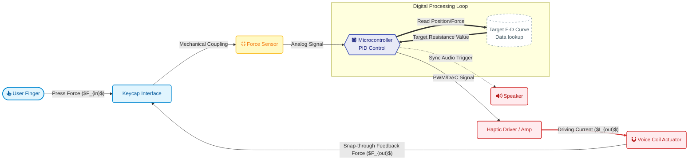

**1. The Physics: Snap-Through Buckling**
-**Core Mechanism:** Negative Stiffness Instability.
-**Key Metric:** **Snap Ratio > 40%** (Required for "Crisp" feel).
-**Target:** Simulate the sudden force drop ($F_{valley}$) of a metal dome.

###  System Sketch

**2. The Tech: Piezo-as-Sensor Architecture**
-**Actuator:** Piezoelectric (PZT) vs. LRA.
    --*Advantage:* **< 2ms Rise Time** (Instant shock).
    --*Control:* **Active Braking** (Eliminates "buzzing" ringing).
-**Sensing:** Zero-latency closed-loop.
    --*Method:* **CapDrive** (Piezo acts as both sensor & motor).

### References (Academic Papers)

 [1] Kim, S., & Lee, G. (2013). Haptic feedback design for a virtual button along force-displacement curves. UIST '13.
[2] Liao, Y.-C., et al. (2018). One button to rule them all: Rendering arbitrary force-displacement curves. UIST '18.
