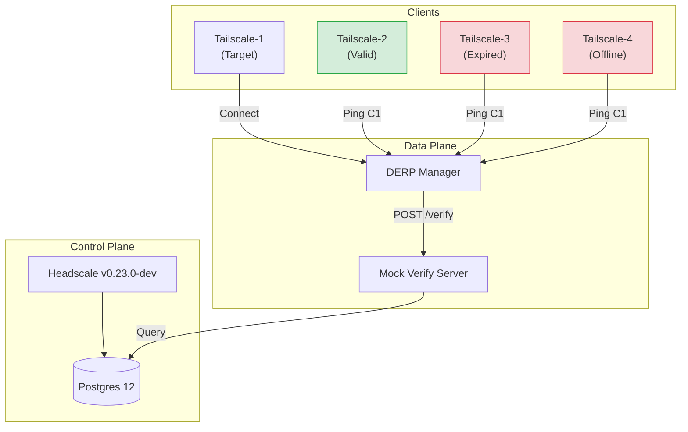
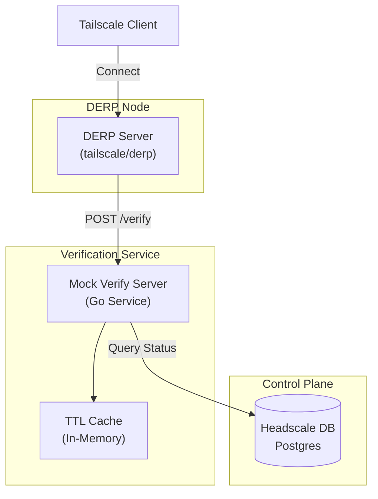
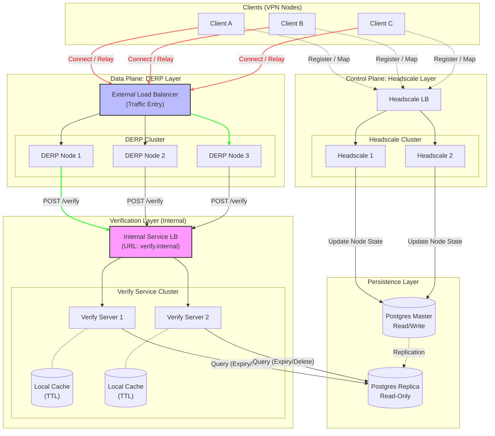

**Date:** 2025-12-04
**Component:** DERP Manager & Mock Verify Server
**Environment:** Docker Compose Integration Test

---

## Part 1: Integration Test Report

### 1.1 Executive Summary
This section documents the validation of the enhanced DERP node verification logic. The system was updated to verify DERP connections based on **Expiry**, **Online Status**, and **Deletion Status** from the Headscale database. Integration tests confirmed that the DERP server correctly rejects connections from invalid nodes while allowing valid ones.

### 1.2 Test Environment Architecture
The integration test environment simulates a complete VPN network within Docker.

#### Topology


#### Components
-   **Headscale**: `headscale-0.23.0-dev:latest`. Serves as the coordination server.
-   **Database**: `postgres:12`. Stores node state (`nodes` table).
-   **DERP Manager**: Custom DERP server that delegates client verification to an external URL.
-   **Mock Verify Server**: A Go service acting as the verification endpoint. It connects directly to the Headscale database to validate nodes.
-   **Tailscale Clients**: 4 instances of `tailscale/tailscale:latest` acting as nodes in the tailnet.

### 1.3 Verification Logic
The `mock-verify-server` enforces strict access control by querying the `nodes` table. A node is **Allowed** only if ALL the following conditions are met:

1.  **Not Deleted**: `deleted_at` column must be `NULL`.
2.  **Not Expired**: `expiry` column must be in the future OR be the zero value (`0001-01-01 00:00:00`).
3.  **Online**: `is_online` column must be `true`.

#### Code Logic Snippet
```go
// Check Expiry (Handle zero time as valid)
if expiry.Valid && !expiry.Time.IsZero() && expiry.Time.Before(time.Now()) {
    return VerifyResponse{Allow: false} // Expired
}

// Check Online Status
if !isOnline {
    return VerifyResponse{Allow: false} // Offline
}
```

### 1.4 Test Scenario Execution

#### Setup
The environment was initialized with 4 valid, online nodes.
-   **Target**: `tailscale-1`
-   **Testers**: `tailscale-2`, `tailscale-3`, `tailscale-4`

#### State Modification
We manually manipulated the database to simulate invalid states:

```sql
-- Expire tailscale-3
UPDATE nodes SET expiry = NOW() - INTERVAL '1 hour' WHERE given_name = 'tailscale-3';

-- Set tailscale-4 to Offline
UPDATE nodes SET is_online = false WHERE given_name = 'tailscale-4';
```

#### Verification Steps
We executed `tailscale ping` from each tester node to `tailscale-1` via the DERP relay.

### 1.5 Test Results

| Client Node | Condition | Expected Outcome | Ping Result | Verify Server Log | Pass/Fail |
| :--- | :--- | :--- | :--- | :--- | :--- |
| **Tailscale-2** | **Valid** | **Allow** | ✅ `pong` | `Verified node ...: Allowed` | **PASS** |
| **Tailscale-3** | **Expired** | **Deny** | ❌ `timeout` | `Node ... is expired` | **PASS** |
| **Tailscale-4** | **Offline** | **Deny** | ❌ `timeout` | `Node ... is offline` | **PASS** |

#### Detailed Logs

**Tailscale-2 (Success):**
```
pong from tailscale-1 (100.64.0.2) via DERP(moxa) in 1ms
```
*Server:* `Node ... status - Expiry: 0001-01-01..., Online: true... Verified: Allowed`

**Tailscale-3 (Expired):**
```
ping "100.64.0.2" timed out
```
*Server:* `Node ... status - Expiry: 2025-12-04 03:16:09..., Online: true... Node is expired`

**Tailscale-4 (Offline):**
```
ping "100.64.0.2" timed out
```
*Server:* `Node ... status - Expiry: 0001-01-01..., Online: false... Node is offline`

### 1.6 Conclusion
The enhanced verification logic is functioning correctly. The system effectively prevents expired or offline nodes from utilizing the DERP relay resources, improving the security and reliability of the network.

---

## Part 2: Cache Optimization & Implementation

This section details the implementation of the DERP client verification system, with a specific focus on the **Cache Optimization** strategy used to ensure high performance and reduced database load.

### 2.1 Architecture Overview

The system consists of three main components: the DERP Server (running `tailscale/derp`), a custom Mock Verify Server, and the Headscale PostgreSQL database.



### 2.2 Cache Optimization Strategy

To prevent the Verification Server from becoming a bottleneck and to protect the database from excessive queries during high connection volumes, we implemented an **In-Memory TTL (Time-To-Live) Cache**.

#### Why Cache?
-   **Reduce Latency**: Verification requests are served instantly from memory for repeated connections.
-   **Database Protection**: Prevents "thundering herd" issues if many clients reconnect simultaneously.
-   **Efficiency**: Static node properties (like keys) rarely change, making them ideal candidates for caching.

#### Implementation Details
-   **Cache Type**: In-Memory Map with Mutex locking.
-   **TTL Duration**: Default **5 minutes**.
-   **Key**: Node Key (Public Key).
-   **Value**: Verification Result (Allow/Deny) + Timestamp.

#### Caching Logic
1.  **Check Cache**: On every request, check if the Node Key exists in the cache.
2.  **Validate TTL**: If found, check if the cached entry is younger than 5 minutes.
    -   *Hit*: Return cached result immediately.
    -   *Miss/Expired*: Proceed to database query.
3.  **Update Cache**: After a database query, store the result in the cache with the current timestamp.

### 2.3 Component Details

#### DERP Server
The DERP server is the standard `tailscale.com/cmd/derper` binary (v1.78.1). It is configured to delegate client verification to an external HTTP endpoint.

-   **Binary**: `tailscale/derp`
-   **Configuration Flags**:
    -   `--verify-client-url`: The URL of the verification service (e.g., `http://mock-verify-server:8080/verify`).
    -   `--verify-client-url-fail-open`: (Optional) If set to `true`, allows clients to connect if the verification server is unreachable. Default is `false` (fail closed).

**Behavior**:
When a client attempts to connect, the DERP server sends a JSON POST request to the configured URL:
```json
{
  "NodePublic": "nodekey:..."
}
```

#### Mock Verify Server
This is a custom Go service designed to bridge the DERP server and the Headscale database. It implements the verification logic required by our specific environment.

-   **Source**: `integration-tests/mock-verify-server/main.go`
-   **Endpoint**: `POST /verify`

**Verification Logic**:
A node is allowed access **only if** all the following conditions are met:
1.  **Exists**: The node key exists in the `nodes` table.
2.  **Not Deleted**: The `deleted_at` column is `NULL`.
3.  **Not Expired**: The `expiry` column is either:
    -   `NULL` (or zero time `0001-01-01`)
    -   In the future (`expiry > NOW()`)
4.  **Online Status**: *Note: The check for `is_online` is currently implemented but commented out in the source code.*

**Response**:
The server returns a JSON response indicating whether the connection should be allowed:
```json
{
  "Allow": true
}
```

#### Database Schema
The verification server queries the `nodes` table in the Headscale PostgreSQL database.

**Key Columns**:
-   `machine_key`: The machine identifier.
-   `node_key`: The node identifier (used for lookup).
-   `expiry`: Timestamp when the node's key expires.
-   `is_online`: Boolean indicating if the node is currently connected to the control plane.
-   `deleted_at`: Timestamp when the node was deleted (soft delete).

### 2.4 Configuration & Deployment

#### Environment Variables
The system is configured via environment variables passed to the `derp-manager` container (which launches `derp`) and the `mock-verify-server`.

**DERP Manager (`derp-manager-test`):**
| Variable | Description | Default |
| :--- | :--- | :--- |
| `DERP_VERIFY_CLIENT_URL` | URL for the verification endpoint | `http://mock-verify-server:8080/verify` |
| `DERP_VERIFY_CLIENT_URL_FAIL_OPEN` | Allow access on verify error | `false` |

**Mock Verify Server (`mock-verify-server`):**
| Variable | Description |
| :--- | :--- |
| `POSTGRES_HOST` | Database hostname |
| `POSTGRES_PORT` | Database port (5432) |
| `POSTGRES_USER` | Database username |
| `POSTGRES_PASSWORD` | Database password |
| `POSTGRES_DB` | Database name (`vpncloud`) |

#### Startup Flow
1.  **DERP Manager** starts and executes `startup.sh`.
2.  It detects `DERP_VERIFY_CLIENT_URL` is set.
3.  It constructs the `derp` command with `--verify-client-url`.
4.  **DERP Server** launches and begins accepting connections, validating each against the **Mock Verify Server**.

