> 整合 OpenCode、oh-my-openagent、Ghidra-MCP、VulnClaw 四個開源專案

---

## 1. 專案概述

本專案旨在建構一個以 AI 驅動的資安分析系統，透過整合四個開源專案，實現多模型、多 Agent 協作的資安防禦與攻擊分析能力。

系統以 **OpenCode** 為基礎引擎，透過 **oh-my-openagent** plugin 擴充為多 Agent 編排架構，在其中新增一個名為 **Hades** 的資安專屬 primary agent。Hades 結合 **VulnClaw** 提供的 21 個資安 skill（180 個參考文件）以及 **Ghidra-MCP** 提供的 193 個逆向工程工具，並能將這些能力透過任務委派機制傳遞給下屬 subagent，實現多面向的平行資安分析。

### 1.1 核心理念

傳統的資安分析工具各自獨立，分析師需要在多個工具之間手動切換、複製貼上資料。本專案的核心思路是：**讓 AI Agent 成為資安分析的統一入口**，透過自然語言描述意圖，Agent 自動編排適當的工具鏈與知識庫，完成從偵察到報告的完整分析流程。

### 1.2 四個開源專案的角色

| 專案 | 角色 | 整合方式 |
|------|------|----------|
| **OpenCode** | 基礎引擎 | 直接使用，提供 LLM 對話迴圈、工具系統、MCP 客戶端 |
| **oh-my-openagent** | 編排層 plugin | 直接使用 + config 新增 Hades agent，提供多 Agent 協作 |
| **Ghidra-MCP** | 逆向工程工具 | 透過 skill_mcp 嵌入，提供 193 個 binary 分析工具 |
| **VulnClaw** | 資安知識庫 | 21 個 skill 作為 Hades 專屬 skill 來源 |

### 1.3 關鍵特色

- **零代碼整合**：完全透過 oh-my-openagent 的 config 系統實現 agent、skill、MCP 的組合，無需修改任何原始碼
- **多模型協作**：不同 Agent 可使用不同 LLM 模型（Claude、GPT、Gemini、Kimi 等），依任務特性自動路由
- **知識傳遞**：Hades 委派任務時可透過 `load_skills` 將資安 skill 傳遞給 subagent，使通用 agent 獲得資安分析能力
- **四層權限分級**：從頂層 orchestrator 到終端 subagent 的嚴格權限控管

---

## 2. 動機與背景

### 2.1 問題陳述

隨著 AI 技術快速發展，大型語言模型（LLM）在程式碼生成、自動化測試等領域展現了強大能力。然而，在資訊安全領域，現有的 AI 工具面臨以下挑戰：

1. **工具碎片化**：逆向工程（Ghidra）、滲透測試（各種框架）、漏洞分析（CVE 資料庫）等工具各自獨立，缺乏統一的操作介面
2. **知識孤島**：資安領域的知識分散在不同的 skill、playbook 和參考文件中，AI agent 難以有效利用
3. **單一模型限制**：單一 LLM 無法同時擅長邏輯推理、程式碼分析、安全評估等所有面向
4. **缺乏編排能力**：現有工具缺乏多 agent 協作機制，無法平行執行不同面向的分析

### 2.2 解決方案

本專案透過整合四個開源專案，構建一個分層架構來解決上述問題：

- **統一介面**：以 OpenCode 的自然語言對話作為統一入口
- **知識整合**：透過 VulnClaw 的 skill 系統整合 21 個資安領域知識
- **多模型分工**：透過 oh-my-openagent 的 agent 系統讓不同模型各司其職
- **工具整合**：透過 MCP 協定整合 Ghidra 的 193 個分析工具

### 2.3 MCP (Model Context Protocol)

MCP 是本專案的核心整合協定。它是一個開放標準，讓 AI 應用能夠透過統一的協定連接外部工具和資料來源。MCP 支援三種傳輸方式：

- **stdio**：標準輸入輸出，適合本地 MCP server
- **SSE (Server-Sent Events)**：HTTP 長連接
- **Streamable HTTP**：標準 HTTP 請求

在本專案中，Ghidra-MCP 透過 MCP 協定將 Ghidra 的逆向工程能力暴露給 AI agent，而 oh-my-openagent 的 skill_mcp 機制則讓 skill 可以攜帶自己的 MCP server。

---

## 3. 技術基礎

### 3.1 OpenCode — 基礎引擎

OpenCode 是一個開源的 AI coding agent，作為本系統的基礎引擎。它提供以下核心能力：

**核心架構：**

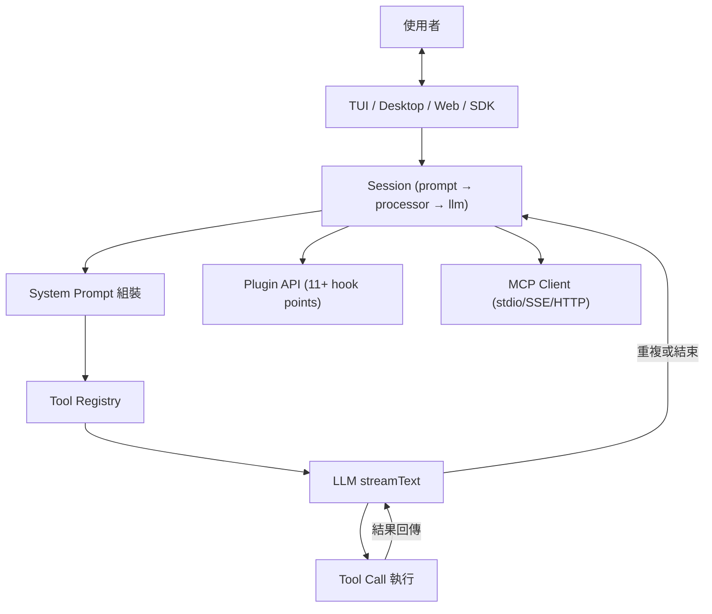

**關鍵模組：**

| 模組 | 功能 |
|------|------|
| Session | 對話生命週期管理、prompt loop、LLM streaming、context compaction |
| Agent | 3 個內建 agent（build、plan、general）|
| Tool Registry | 20+ 內建工具 + MCP 動態註冊 |
| Plugin System | 11+ hook points，支援 npm 套件形式的 plugin |
| MCP Client | stdio/SSE/HTTP 三種傳輸，OAuth 支援 |
| Permission System | 規則式權限（allow/ask/deny）|
| Config | JSONC 格式，多層合併（global → project → local）|

**技術棧：** Bun / TypeScript / Effect-TS 4.0 / Vercel AI SDK v6 / SQLite + Drizzle ORM

在本專案中，OpenCode 提供了 LLM 對話迴圈、工具執行框架、Plugin API（讓 oh-my-openagent 能掛載）、MCP 客戶端（消費 ghidra-mcp 的工具），以及基礎的權限控制系統。

### 3.2 oh-my-openagent — 編排層 Plugin

oh-my-openagent 是 OpenCode 的 plugin（非 fork），將單一 agent 升級為多模型多 agent 協作系統。類比關係：「Ubuntu on top of Debian」——OpenCode 是核心，oh-my-openagent 是意見導向的發行版。

**整合方式：** 透過 `opencode.json` 中的 plugin 註冊，使用 `@opencode-ai/plugin` SDK 與 `@opencode-ai/sdk`。

**四層權限分級：**

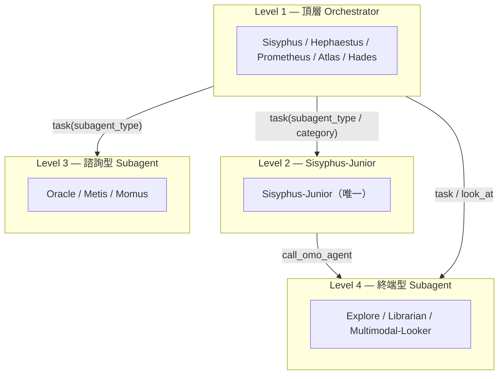

**三種 Agent 調用方式：**

| 方式 | 工具 | 可調用對象 | Skill 傳遞 |
|------|------|-----------|-----------|
| `task(subagent_type="...")` | delegate-task | 所有 subagent | 支援 load_skills |
| `task(category="...")` | delegate-task | Sisyphus-Junior（自動路由模型）| 支援 load_skills |
| `call_omo_agent(...)` | call_omo_agent | 僅 explore / librarian | 不支援 |

**Category 路由系統：**

當 primary agent（如 Hades）使用 `task(category="deep")` 委派任務時，系統透過兩層機制將任務路由到 Sisyphus-Junior，並根據 category 自動選擇最適合的模型：

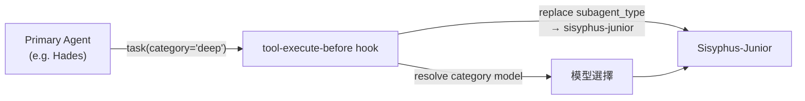

模型選擇遵循嚴格的優先順序：(1) 使用者 config 中的 category 模型覆蓋 → (2) 全域 Junior 模型覆蓋 → (3) Category 內建預設模型 → (4) Fallback chain → (5) 系統預設模型。

8 個內建 Category 與其預設模型：

| Category | 預設模型 | 用途 |
|----------|----------|------|
| `visual-engineering` | gemini-3.1-pro (high) | 前端 UI/UX、設計、動畫 |
| `ultrabrain` | gpt-5.5 (xhigh) | 困難邏輯、架構決策 |
| `deep` | gpt-5.5 (medium) | 自主研究 + 端到端實作 |
| `artistry` | gemini-3.1-pro (high) | 創意性問題解決 |
| `quick` | gpt-5.4-mini | 單檔修改、typo 修正 |
| `unspecified-low` | claude-sonnet-4-6 | 低強度回退 |
| `unspecified-high` | claude-opus-4-7 (max) | 高強度回退 |
| `writing` | kimi-k2p5 | 文件、散文、技術寫作 |

Category 與 `subagent_type` 互斥——同一呼叫中只能指定其一。使用者也可在 config 中定義自訂 category，設定專屬的模型、fallback chain 和溫度。

**關鍵機制：**

- **Skill 系統**：Markdown 格式的指令集，可攜帶嵌入式 MCP server，透過 `load_skills` 按需注入
- **skill_mcp**：Skill 在 SKILL.md 的 YAML frontmatter 中宣告 MCP server，由 SkillMcpManager 管理，每個 session 獨立隔離
- **54+ Lifecycle Hooks**：從意圖分類（IntentGate）到自我迴圈（ralph-loop）的完整行為控制
- **5 個內建 MCP**：websearch、context7、grep_app、LSP、AST-Grep（runtime 注入）

### 3.3 Ghidra-MCP — 逆向工程能力

Ghidra-MCP 是一個 MCP server，將 Ghidra 的逆向工程能力暴露給 AI coding agent。它提供 193 個 MCP tools，是目前最完整的 Ghidra-MCP 整合方案。

**三層架構：**

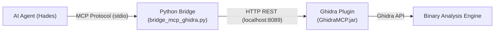

**技術棧：** Python 3.10+ / FastMCP + Java 21 / Ghidra 12.1 API

**193 個 MCP Tools 分類：**

| 類別 | 功能 | 工具數 |
|------|------|--------|
| 核心分析 | 反編譯、反組譯、call graph、xrefs | ~20 |
| 資料型別 | struct/union/enum 建立、修改、套用 | ~20 |
| 符號與註解 | 重新命名、標籤、批次註解 | ~15 |
| 跨 binary 比對 | SHA-256 函數雜湊、文件傳播 | ~8 |
| 動態分析 | P-code 模擬、live debugger (dbgeng/gdb/lldb) | ~25 |
| 安全分析 | 惡意行為偵測、IOC 提取、API 呼叫鏈分析 | ~5 |
| 專案管理 | 專案/版本控制、多人協作 | ~15 |

**在本專案中的角色：** 透過 oh-my-openagent 的 skill_mcp 機制，Ghidra-MCP 被嵌入到 Hades agent 專屬的 skill 中。當 Hades 需要進行 binary 分析時，MCP server 自動啟動，分析完成後自動清理，不佔用 context window。

Ghidra-MCP 包含 12 個核心 service class：

| Service Class | 用途 |
|---------------|------|
| ListingService | 列舉函數、字串、segments、imports、exports |
| FunctionService | 反編譯、重新命名、prototype 管理、變數型別 |
| CommentService | decompiler / 反組譯 / plate 註解 |
| SymbolLabelService | 標籤、data 重新命名、globals、external locations |
| XrefCallGraphService | cross-references 與 call graph |
| DataTypeService | struct / enum / union CRUD、驗證、field 分析 |
| AnalysisService | 完整度分析、control flow、相似度、Ghidra analyzers |
| DocumentationHashService | 函數雜湊、跨 binary 文件傳播 |
| MalwareSecurityService | 反分析偵測、IOC 提取、惡意行為偵測、API 呼叫鏈分析 |
| ProgramScriptService | 程式管理、腳本、記憶體、書籤、metadata |
| BinaryComparisonService | 跨 binary 比對 |
| ServiceUtils | 共用工具（JSON、分頁、型別解析）|

### 3.4 VulnClaw — 滲透測試引擎

VulnClaw 是一個獨立的 AI 滲透測試引擎，有自己的 agent loop、skill 系統和 MCP 編排。在本專案中作為**資安知識庫**使用，而非直接執行。

**架構：**

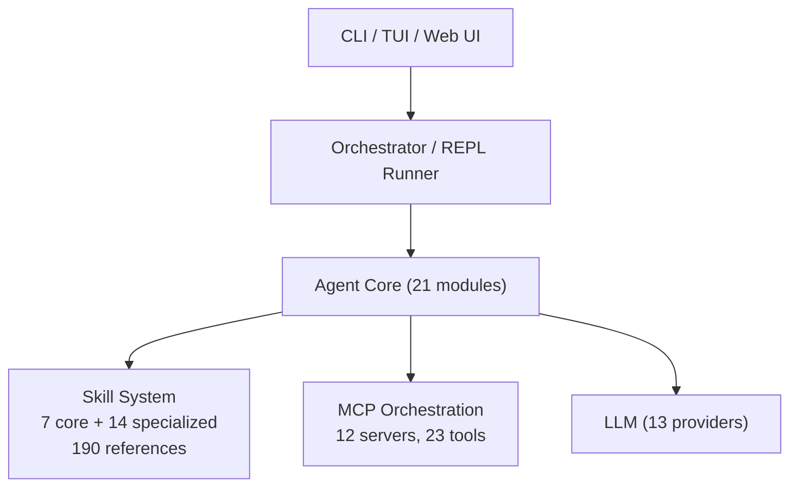

**21 個 Skills：**

核心 Skills（7 個）：

| Skill | 用途 |
|-------|------|
| pentest-flow | 全流程編排（偵察→發現→利用→後滲透→報告）|
| recon | 被動+主動偵察 |
| vuln-discovery | 漏洞掃描（CVE, SQLi, XSS, SSRF 等）|
| exploitation | 漏洞利用（PoC 構造, WAF bypass）|
| post-exploitation | 後滲透（提權, 橫向移動）|
| reporting | 結構化報告 + Python PoC 生成 |
| waf-bypass | WAF 繞過技巧庫 |

特化 Skills（14 個，共 180 個參考文件）：

| Skill | 參考文件數 | 用途 |
|-------|-----------|------|
| secknowledge-skill | 39 | Web+AI 安全知識庫（WooYun、先知、GAARM、OWASP）|
| web-security-advanced | 34 | 24 個 playbook（SQLi, XSS, SSRF, SSTI, XXE 等）|
| client-reverse | 20 | 客戶端逆向（Android/Browser/Desktop）|
| pentest-tools | 18 | 14 類工具速查 |
| intranet-pentest-advanced | 15 | 內網滲透（AD, ADCS, 憑證竊取）|
| ctf-web | 9 | CTF Web 攻擊知識 |
| android-pentest | 9 | Android APK 滲透 |
| osint-recon | 7 | OSINT 四維模型 |
| ai-mcp-security | 7 | AI/MCP 安全測試 |
| ctf-crypto | 6 | 密碼學攻擊 |
| ctf-misc | 6 | CTF 雜項 |
| web-pentest | 4 | Web 滲透基本 |
| crypto-toolkit | 3 | 編解密工具（29 種操作）|
| rapid-checklist | 3 | 快速 Payload 速查 |

**在本專案中的角色：** VulnClaw 的 21 個 skill（含 180 個參考文件）作為 Hades agent 的專屬 skill 來源。透過 oh-my-openagent 的 skill agent 限制機制，這些資安 skill 只會在 Hades 及其委派的 subagent 中載入。

VulnClaw 的 SkillDispatcher 透過 `SKILL_INTENT_MAP` 進行關鍵字路由：使用者輸入轉為小寫後，比對 70+ 中英文關鍵字模式，特化 skill 獲得 1.5x 權重加成，無匹配時 fallback 到 `pentest-flow`。

### 3.5 模型選擇：GLM-5.1 與多供應商策略

本專案選擇 GLM-5.1 作為 Hades agent 的主要模型，並透過 OpenCode 的多供應商支援實現模型層面的分工。

#### 3.5.1 GLM-5.1 選擇理由

GLM-5.1 是智譜 AI（Z.AI）於 2026 年 4 月發布的 754B MoE 開源模型，採 MIT 授權。它在軟體工程和資安相關基準測試中表現突出：

| 基準測試 | GLM-5.1 | 排名 | 領先者對比 |
|----------|---------|------|-----------|
| **SWE-Bench Pro** | **58.4%** | **#1** | 超越 GPT-5.4（57.7%）、Claude Opus 4.6（57.3%）|
| **CyberGym** | **68.7%** | **#5（開源 #1）** | 閉源領先：Claude Mythos Preview（83.1%）；開源領先：GLM-5.1 |
| NL2Repo | 42.7% | #2 | Claude Opus 4.6 以 49.8% 領先 |
| Terminal-Bench 2.0 | 63.5% | #3 | Gemini 3.1 Pro 以 68.5% 領先 |
| AIME 2026 | 95.3% | 競爭 | GPT-5.4 以 98.7% 領先 |

選擇 GLM-5.1 的核心理由：

1. **SWE-Bench Pro 全球第一**：軟體工程能力是資安分析的基礎——理解程式碼結構、追蹤資料流、定位漏洞，都需要強大的程式碼理解能力
2. **CyberGym 開源模型最強**：在 1,507 個真實漏洞場景中取得 68.7%，超越同為開源的 GLM-5（48.3%，+20.4 分）和 Kimi K2.5（41.3%），且是唯一超越部分閉源模型的開源模型（超越 Claude Opus 4.6 的 66.6%）
3. **MIT 開源授權**：可自由部署、修改、商用，無閉源模型的法律與供應商鎖定風險
4. **成本優勢**：API 定價 $1.40/$4.40（輸入/輸出 per M tokens），遠低於 Claude Opus 4.6 的 $5.00/$25.00

值得注意的是，CyberGym 的整體領先者是閉源的 Claude Mythos Preview（83.1%）和 GPT-5.5（81.8%），但 GLM-5.1 作為開源模型達到了 68.7%，顯示開源模型在資安領域已具備與閉源模型競爭的實力。獨立安全研究者的測試也驗證了這一點：GLM-5.1 在自主滲透測試評估中超越了 Claude Opus 4.6，成為首個在 25M token 預算內完成銀行場景攻擊的模型。

#### 3.5.2 OpenCode 多供應商架構

OpenCode 支援 75+ LLM 供應商，透過統一的 provider config 介面切換模型。這意味著 Hades 可以使用 GLM-5.1 進行主要分析，同時讓不同 subagent 使用各自適合的模型：

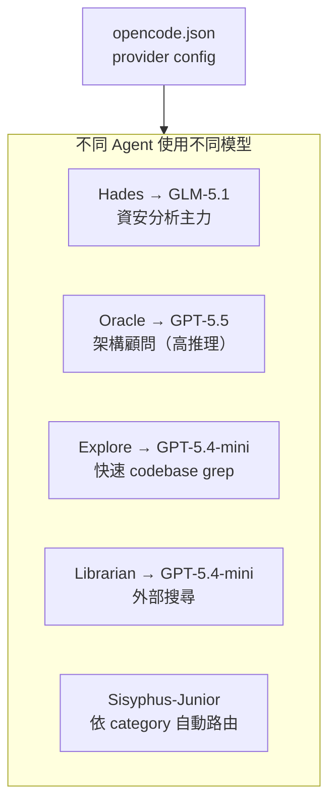

Category 系統進一步自動化了模型選擇：當 Hades 使用 `task(category="deep")` 委派深度分析任務時，系統自動為 Sisyphus-Junior 選擇適合的模型，無需 Hades 手動指定。這種多模型協作架構確保每個子任務都由最適合的模型執行。

---

## 4. 系統架構設計

### 4.1 整體架構

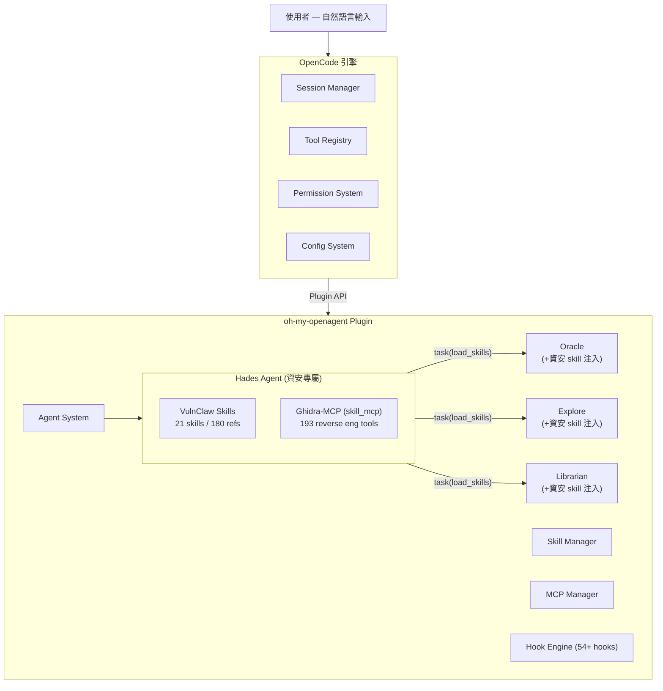

### 4.2 Hades Agent 設計

Hades 是本專案透過 oh-my-openagent config 新增的 primary agent，專責資安分析。

**設計原則：**

1. **純配置實現**：透過 `opencode.json` 定義，無需修改任何原始碼
2. **專屬 Skill 限制**：VulnClaw 的 21 個資安 skill 透過 `agent` 欄位限制為 Hades 專用
3. **嵌入式 MCP**：Ghidra-MCP 透過 skill_mcp 機制嵌入，按需啟動，用完自動清理
4. **委派與知識傳遞**：Hades 可透過 `task(load_skills=[...])` 將資安 skill 傳遞給 subagent

**配置範例（概念性）：**

```jsonc
// opencode.json（節錄）
{
  "agent": {
    "hades": {
      "model": "glm-5.1",     // SWE-Bench Pro #1、CyberGym 開源 #1
      "permission": {
        "task": "allow",        // 可委派給 subagent
        "call_omo_agent": "deny" // 強制走 task 統一路徑
      }
    }
  }
}
```

**Skill 限制範例（概念性）：**

```yaml
# skill 的 SKILL.md frontmatter
---
description: AI/MCP security testing skill
agent: hades                # ← 限制只有 Hades 能使用此 skill
mcp:
  ghidra-mcp:               # ← 嵌入式 MCP server
    command: python
    args: ["bridge_mcp_ghidra.py", "--transport", "stdio"]
---
```

### 4.3 多面向平行分析流程

Hades 的核心能力在於同時分派多個 subagent 執行不同面向的分析：

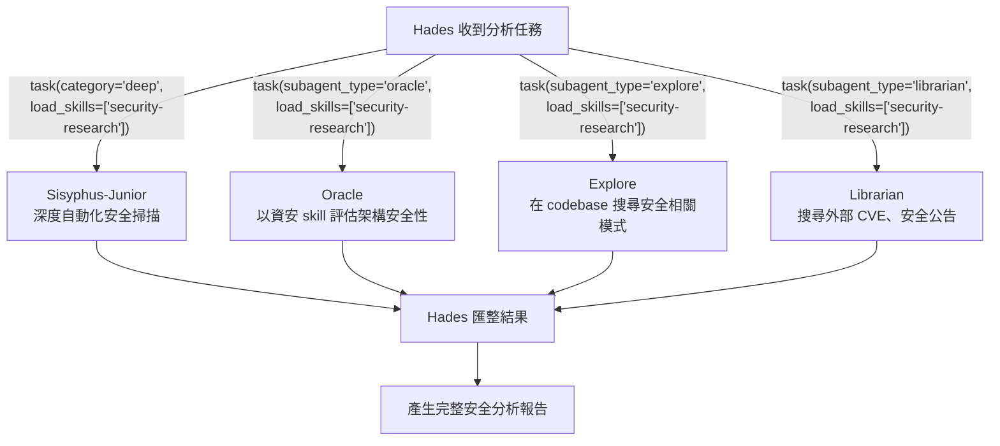

每個 subagent 在被委派時透過 `load_skills` 獲得資安 skill 的上下文，使其能以資安專業的角度執行原本通用的任務。這就是本專案的核心創新：**不是為每個分析面向建立專門的 agent，而是讓通用 agent 在接收任務時動態獲得領域知識**。

---

## 5. 整合實作

### 5.1 零代碼整合方式

本專案的最大特色是完全透過配置完成整合，無需修改任何開源專案的原始碼。整合工作分為三個層面：

**層面一：Agent 定義**

在 `opencode.json` 中定義 Hades agent，包括模型選擇、權限設定、系統 prompt。

**層面二：Skill 配置**

將 VulnClaw 的 21 個 skill 轉換為 oh-my-openagent 的 skill 格式（SKILL.md + references/），放置在適當的 skill scope 目錄中，並透過 `agent` 欄位限制為 Hades 專用。

oh-my-openagent 的 skill scope 優先順序：

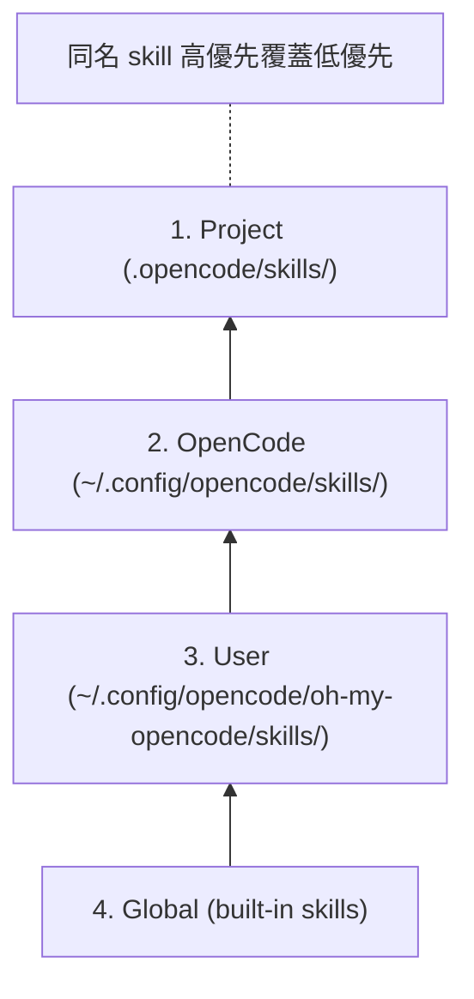

**層面三：MCP 配置**

透過 skill_mcp 機制，在 skill 的 SKILL.md frontmatter 中宣告 Ghidra-MCP server。SkillMcpManager 會在 skill 被載入時自動啟動 MCP server，並在 session 結束時清理。每個 session 的 MCP client 以 `${sessionID}:${skillName}:${serverName}` 為 key 隔離，確保並行安全。

### 5.2 整合過程中的挑戰

| 挑戰 | 解決方案 |
|------|---------|
| 不同專案使用不同語言（Python / TypeScript / Java）| MCP 協定作為統一溝通層 |
| VulnClaw 的 skill 格式需轉換 | 轉換為 oh-my-openagent 的 SKILL.md 格式 |
| Ghidra-MCP 需要本地 Ghidra 安裝 | Docker headless mode，透過 MCP stdio 傳輸 |
| Skill 限制只有 Hades 能使用 | SKILL.md 的 `agent` 欄位限制 |
| 多個 MCP server 的 context 佔用 | skill_mcp 按需啟動，session 隔離，用完清理 |
| Subagent 需要獲得資安知識 | `load_skills` 在委派時注入 skill 內容 |

### 5.3 Skill 傳遞機制

oh-my-openagent 的 skill 傳遞透過 `delegate-task` 的 `load_skills` 參數實現：

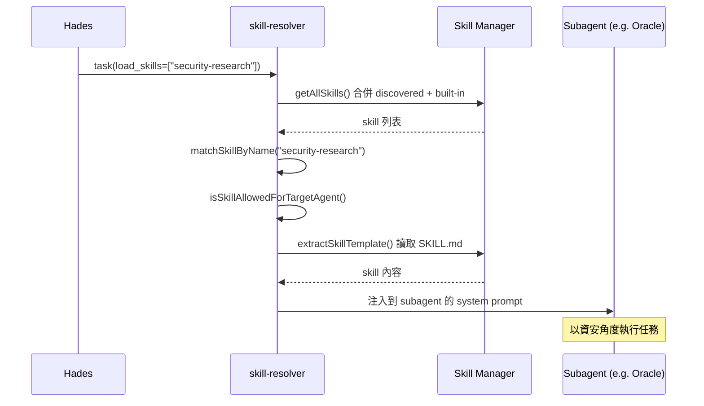

---

## 6. 測試與驗證

### 6.1 驗證項目

| 項目 | 驗證方式 | 預期結果 |
|------|---------|---------|
| Hades agent 註冊 | opencode 啟動後可切換至 Hades | Hades 出現在 agent 列表 |
| Skill 限制 | 非 Hades agent 嘗試載入資安 skill | 被拒絕，返回 agent 限制錯誤 |
| Skill 傳遞 | Hades 委派任務給 Oracle | Oracle 的 system prompt 包含資安 skill 內容 |
| MCP 啟動 | Hades 載入含 Ghidra-MCP 的 skill | MCP server 自動啟動，193 個工具可用 |
| MCP 隔離 | 兩個並行 Hades session | MCP client 以不同 key 隔離，互不干擾 |
| 多面向分析 | 對目標執行完整安全分析 | 多個 subagent 平行執行，結果匯整 |

### 6.2 測試場景

**場景一：Binary 安全分析**

Hades 收到一個 binary 檔案，需要進行安全分析：

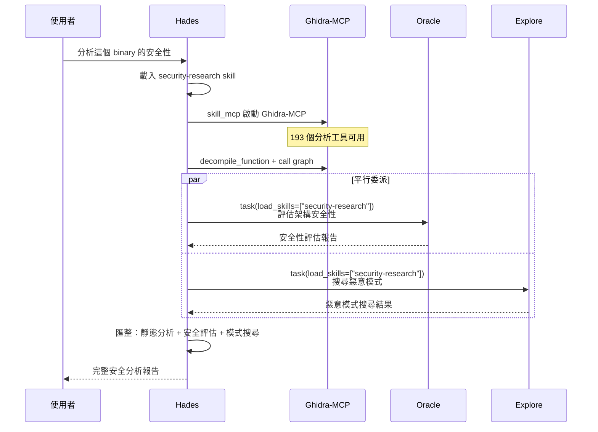

**場景二：Web 應用滲透測試**

Hades 收到 Web 應用的滲透測試任務：

1. Hades 載入 VulnClaw 的 `pentest-flow` skill → 獲得完整 pentest 流程知識
2. Hades 委派 Librarian 搜尋相關 CVE 和安全公告（帶 `security-research` skill）
3. Hades 委派 Explore 在目標原始碼中搜尋注入點（帶 `web-security-advanced` skill）
4. 多面向結果匯整後產生結構化報告

**場景三：自主攻擊與報告生成**

使用者提供一個目標，Hades 透過 `task(category="deep")` 委派 Sisyphus-Junior 自主執行完整的攻擊流程並產生結構化報告：

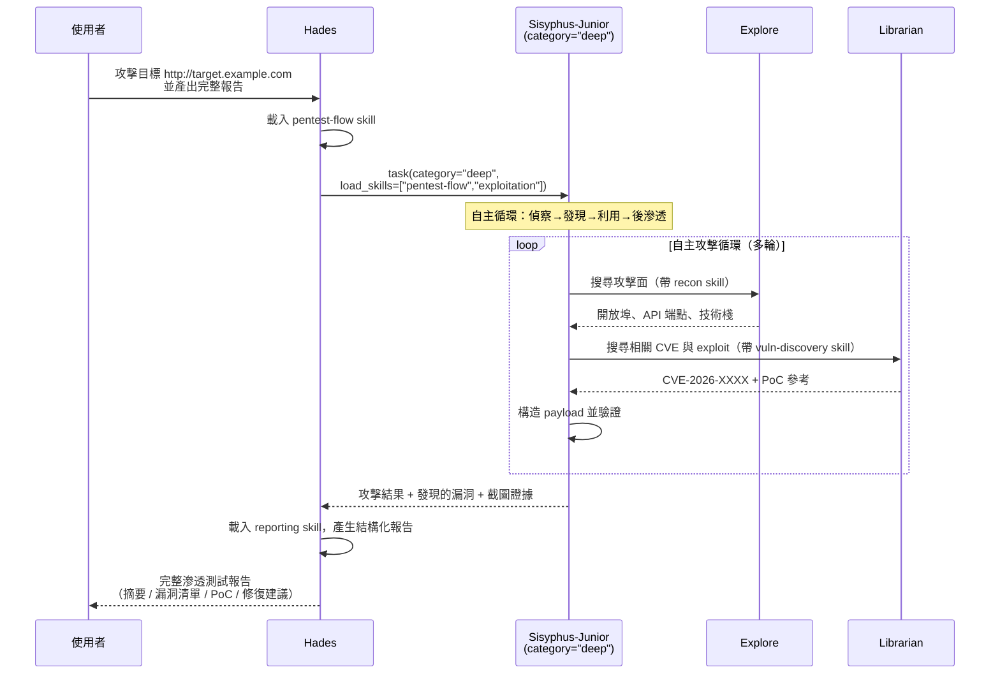

此場景展示 `category="deep"` 的核心價值：Sisyphus-Junior 以 GLM-5.1 的長時間推理能力，在單一委派中自主完成從偵察到報告的完整流程，無需 Hades 逐步指示。Hades 只需在最后匯整結果並產出報告。

**場景四：CTF Challenge 解題**

使用者提交一個 CTF Web 題目，Hades 自動規劃解題策略並取得 flag：

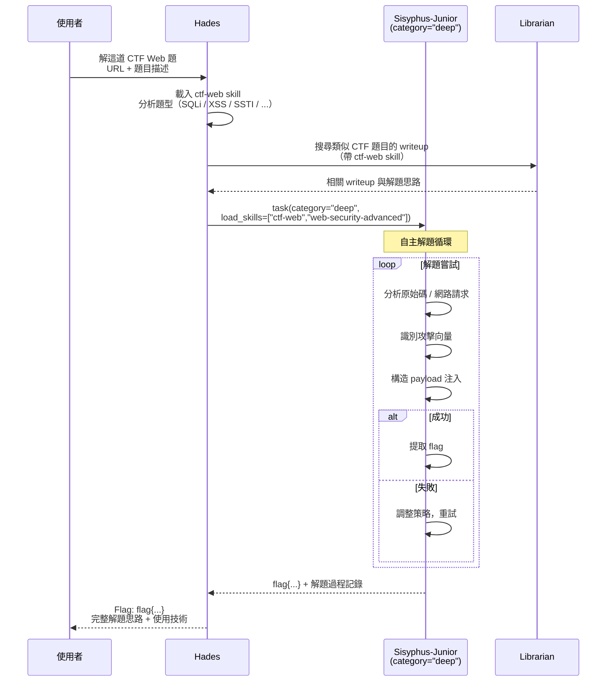

此場景中，Hades 先透過 Librarian 獲取歷史 writeup 的解題思路（知識檢索），再委派 Sisyphus-Junior 以 `ctf-web` + `web-security-advanced` 雙 skill 組合進行自主解題。VulnClaw 的 34 份 playbook（涵蓋 SQLi、XSS、SSRF、SSTI、XXE 等 24 種攻擊類型）為 Junior 提供了豐富的攻擊模式知識庫。

---

## 7. 結論與未來展望

### 7.1 結論

本專案成功整合了四個開源專案，建構了一個基於多 Agent 協作的 AI 資安分析系統。主要成果包括：

1. **零代碼架構整合**：透過 oh-my-openagent 的 config 系統，在不修改任何原始碼的前提下，成功將四個獨立專案組合為一個統一的資安分析平台
2. **動態知識傳遞**：實現了「通用 agent + 領域 skill 注入」的模式，讓原本不具備資安知識的 subagent 在接收任務時動態獲得領域專業能力
3. **多模型協作**：不同 Agent 依任務特性使用不同 LLM，實現模型層面的分工合作
4. **統一工具介面**：透過 MCP 協定整合 Ghidra 的 193 個逆向工程工具，使 AI agent 能直接操作專業級的 binary 分析能力

### 7.2 未來展望

| 方向 | 說明 |
|------|------|
| 更多 MCP 整合 | 將 VulnClaw 的 12 個 MCP server（chrome-devtools, burp, frida 等）也透過 skill_mcp 整合 |
| Team Mode 應用 | 利用 oh-my-openagent 的 Team Mode，讓 Hades 作為 lead agent 帶領多個資安專門成員平行分析 |
| 自動化測試流程 | 建立 CTF / 靶場的自動化測試 pipeline，驗證 Hades 的分析準確性 |
| 更多 Skill 來源 | 整合 OWASP、MITRE ATT&CK 等外部知識庫 |
| 報告自動化 | Hades 分析完成後自動產生結構化的資安報告 |

---

## 附錄

### A. 四個開源專案資訊

| 專案 | 原始碼位置 | 授權 |
|------|-----------|------|
| OpenCode | `/home/g36maid/Code/AI/opencode` | 開源 |
| oh-my-openagent | `/home/g36maid/Code/AI/oh-my-openagent` | SUL-1.0 |
| Ghidra-MCP | `/home/g36maid/Code/AI/ghidra-mcp` | Apache 2.0 |
| VulnClaw | `/home/g36maid/Code/AI/vulnclaw` | MIT |

### B. oh-my-openagent Agent 完整列表

| Agent | 類型 | 預設模型 | 用途 |
|-------|------|----------|------|
| Sisyphus | primary | claude-opus-4-7 max | 主控 orchestrator |
| Hephaestus | primary | gpt-5.5 medium | 自主深度工作 |
| Atlas | primary | claude-sonnet-4.6 | Todo 清單 orchestrator |
| Prometheus | primary | claude-opus-4-7 max | 策略規劃師 |
| **Hades** | **primary** | **（依配置）** | **資安分析（本專案新增）** |
| Oracle | subagent | gpt-5.5 high | 唯讀架構顧問 |
| Sisyphus-Junior | subagent | claude-sonnet-4.6 | 分類委派執行器 |
| Librarian | subagent | gpt-5.4-mini-fast | 文件/OSS 搜尋 |
| Explore | subagent | gpt-5.4-mini-fast | codebase grep |
| Metis | subagent | claude-sonnet-4.6 | 缺口分析 |
| Momus | subagent | gpt-5.5 xhigh | 計畫審查 |
| Multimodal-Looker | subagent | gpt-5.5 medium | PDF/圖片分析 |

### C. 技術棧總覽

| 層 | 技術 |
|----|------|
| 基礎引擎 | Bun / TypeScript / Effect-TS 4.0 / Vercel AI SDK v6 |
| 編排層 | @opencode-ai/plugin / MCP SDK / AST-Grep |
| 逆向工程 | Java 21 / Ghidra 12.1 API / Python FastMCP |
| 滲透測試 | Python 3.10+ / Typer / FastAPI / React |
| 整合協定 | MCP (stdio/SSE/HTTP) / OpenAI-compatible API |
