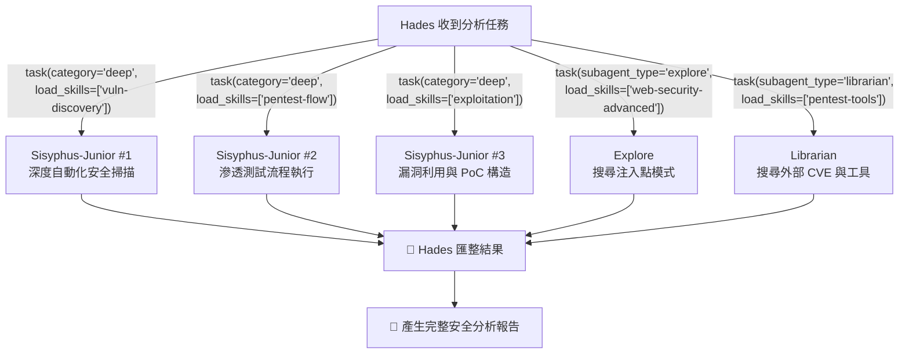
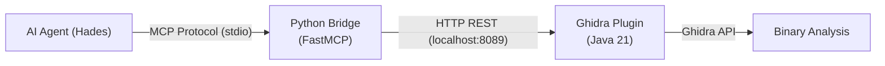
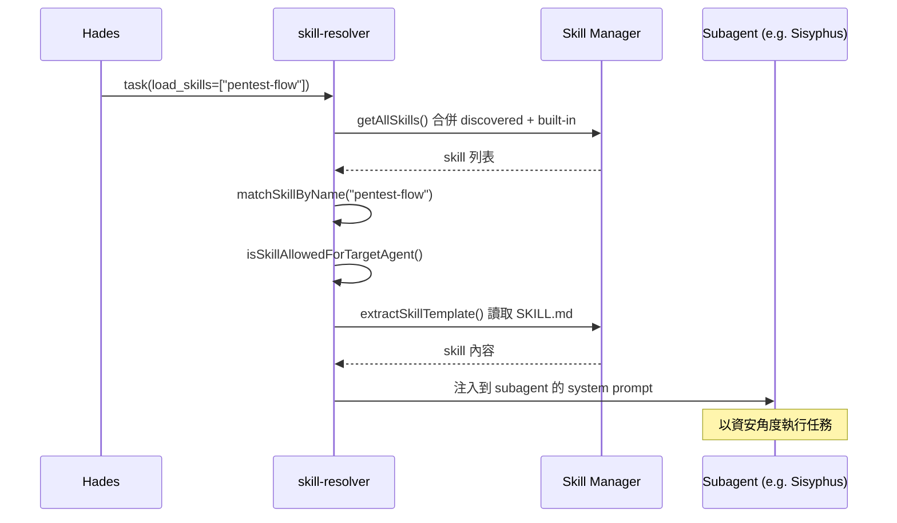
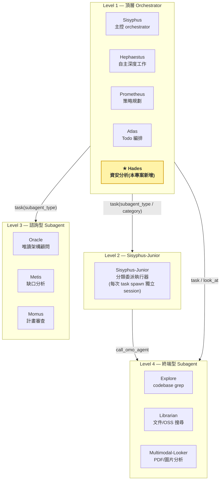
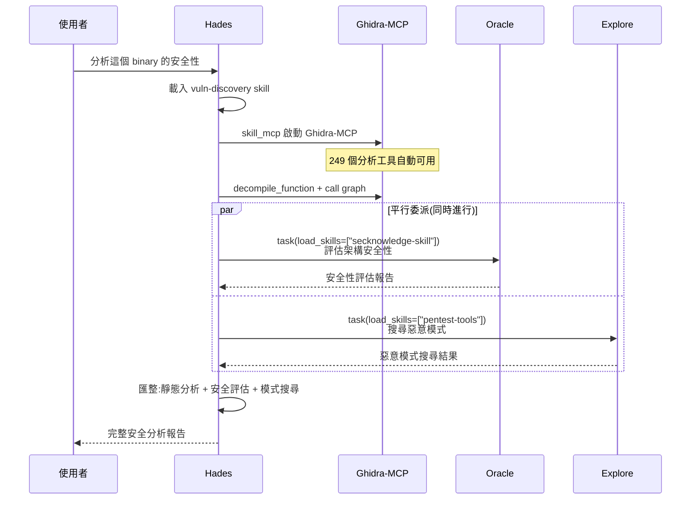

> **零代碼整合四開源專案 × Hades 多面向平行資安分析**
> OpenCode · oh-my-openagent · Ghidra-MCP · VulnClaw

**作者:** [姓名] · **學號:** [學號] · **指導教授:** [教授] · **課程:** [課程名稱] · 國立臺灣師範大學

---

## 🎯 TL;DR — 快速看懂這份專案

- **一句話主張:** 讓 AI Agent 成為資安分析的統一入口,使用者用自然語言描述意圖,Agent 自動編排工具鏈與知識庫,完成從偵察到報告的完整流程。
- **怎麼做:** 以 OpenCode 為引擎、oh-my-openagent 為編排層、VulnClaw 為資安知識庫、Ghidra-MCP 為逆向工程工具,**完全透過 config 整合**。
- **核心創新:** 新增 **Hades** 資安專屬 primary agent,**同時 spawn 多個 subagent 各自帶不同 skill 組合平行分析**,讓通用 Agent 在接收任務時動態獲得領域專業能力。
- **模型選擇:** 主力採用 **GLM-5.1**(SWE-Bench Pro 58.4%、CyberGym 68.7% 開源最強),也支援任何配置，透過 Category 系統讓不同子任務自動路由到最適合的 LLM。

---

## ❓ 問題陳述 — 現有 AI 資安工具的四大困境

| 痛點 | 說明 |
|------|------|
| 🔧 **工具碎片化** | 逆向工程(Ghidra)、滲透測試(各種框架)、漏洞分析(CVE 資料庫)各自獨立,分析師需手動切換、複製貼上 |
| 📚 **知識孤島** | 資安知識分散在不同的 skill、playbook 與參考文件中,AI Agent 難以有效利用 |
| 🧠 **單一模型限制** | 單一 LLM 無法同時擅長邏輯推理、程式碼分析、安全評估等所有面向 |
| 🌀 **缺乏編排能力** | 現有工具缺乏多 Agent 協作機制,無法平行執行不同面向的分析 |

---

## ⭐ 核心創新 — Hades 多面向平行資安分析

**Hades** 是本專案透過 config 新增的資安專屬 primary agent。核心能力在於**同時分派多個 subagent 執行不同面向的分析,每個 subagent 獨立載入不同的 skill 組合,平行推進互不阻塞**。

> **設計精髓:** 不是為每個分析面向建立專門的 Agent,而是讓**通用 Agent 在接收任務時動態獲得領域知識**;Sisyphus-Junior 並非單例,每次 `task(category=...)` 都會 spawn 獨立 session,因此可同時開啟多個 Junior 以不同 skill 組合平行工作。

---

### 四個開源專案的角色分工

| 專案 | 角色 | 整合方式 | 關鍵能力 |
|------|------|----------|----------|
| ⚙️ **OpenCode** | 基礎引擎 | 直接使用 | LLM 對話迴圈、工具系統、MCP 客戶端、Plugin API |
| 🧩 **oh-my-openagent** | 編排層 Plugin | 直接使用 + 新增 Hades agent | 多 Agent 協作、Skill 系統、54+ lifecycle Hooks |
| 🔧 **Ghidra-MCP** | 逆向工程工具 | 透過 skill_mcp 嵌入 | 249 個 binary 分析工具(反編譯、call graph、IOC 提取) |
| 📚 **VulnClaw** | 資安知識庫 | 21 個 skill 作為 Hades 專屬 skill 來源 | 21 個 skill、180 份參考文件、覆蓋完整 pentest 生命週期 |

> **整合協定 — MCP (Model Context Protocol):** 開放標準,讓 AI 應用透過統一協定連接外部工具與資料來源,支援 stdio / SSE / Streamable HTTP 三種傳輸。Ghidra-MCP 透過它暴露 249 個分析工具,VulnClaw skill 則可攜帶自己的 MCP server。

---

## 🔧 領域知識與工具 — Layer 4 兩大支柱

Layer 4 是 Hades 戰力的來源:**VulnClaw** 提供 21 個 skill × 180 份參考文件構成的資安知識庫,**Ghidra-MCP** 提供 249 個逆向工程工具構成的分析能力。兩者皆透過 oh-my-openagent 的 skill 系統嵌入 Hades 專屬使用。

### 📚 VulnClaw — 21 個資安 Skill

**7 個核心 skill**(覆蓋完整 pentest 生命週期):

| Skill | 用途 |
|-------|------|
| `pentest-flow` | 全流程編排(偵察→發現→利用→後滲透→報告)|
| `recon` | 被動 + 主動偵察 |
| `vuln-discovery` | 漏洞掃描(CVE、SQLi、XSS、SSRF 等)|
| `exploitation` | 漏洞利用(PoC 構造、WAF bypass)|
| `post-exploitation` | 後滲透(提權、橫向移動)|
| `reporting` | 結構化報告 + Python PoC 生成 |
| `waf-bypass` | WAF 繞過技巧庫 |

**14 個特化 skill**(共 180 份參考文件,漸進式載入):

| Skill | 參考文件 | 用途 |
|-------|---------|------|
| `secknowledge-skill` | 39 | Web + AI 安全知識庫(WooYun、先知、GAARM、OWASP)|
| `web-security-advanced` | 34 | 24 個 playbook(SQLi、XSS、SSRF、SSTI、XXE 等)|
| `client-reverse` | 20 | 客戶端逆向(Android/Browser/Desktop)|
| `pentest-tools` | 18 | 14 類工具速查 |
| `intranet-pentest-advanced` | 15 | 內網滲透(AD、ADCS、憑證竊取)|
| `ctf-web` | 9 | CTF Web 攻擊知識 |
| `android-pentest` | 9 | Android APK 滲透 |
| `osint-recon` | 7 | OSINT 四維模型 |
| `ai-mcp-security` | 7 | AI/MCP 安全測試 |
| `ctf-crypto` | 6 | 密碼學攻擊 |
| `ctf-misc` | 6 | CTF 雜項 |
| `web-pentest` | 4 | Web 滲透基本 |
| `crypto-toolkit` | 3 | 編解密工具(29 種操作)|
| `rapid-checklist` | 3 | 快速 Payload 速查 |

> **Skill 專屬限制:** 透過 SKILL.md frontmatter 的 `agent: hades` 欄位,這 21 個 skill 僅 Hades 及其委派的 subagent 可載入,其他 primary agent(如 Sisyphus)看不到也用不了。

### 🔧 Ghidra-MCP — 249 個逆向工程 MCP 工具

**三層架構**將 Ghidra 的逆向能力暴露給 AI Agent:

**249 個工具依職責分類(精選 6 大類,完整共 13 類):**

| 類別 | 數量 | 功能 |
|------|------|------|
| 函數分析 | ~30 | 反編譯、call graph、xrefs、完整度評分、相似度比對 |
| 資料型別 | ~28 | struct/union/enum CRUD、匈牙利命名 |
| Bridge 管理 | ~28 | instance 管理、connect/disconnect、debugger proxy |
| 動態分析 | ~25 | P-code 模擬、live debugger(gdb / lldb / dbgeng)|
| 符號與標籤 | ~15 | imports、exports、strings、標籤 CRUD |
| 安全分析 | ~5 | 惡意行為偵測、IOC 提取、API 呼叫鏈分析、反分析偵測 |

> **嵌入式整合:** 透過 skill_mcp 機制,Ghidra-MCP server 在 Hades 載入含此 MCP 的 skill 時自動啟動(stdio transport),session 結束自動清理,以 `sessionID:skillName:serverName` 為 key 隔離確保並行安全。

---

## ⚙️ 機制支撐 — Skill 動態注入 × Agent 階層

### A. Skill 動態注入 — 通用 Agent 即時獲得資安能力

Skill 是 Markdown 格式的可攜式指令集,透過 `load_skills` 機制,Hades 在委派任務時可將資安 skill **動態注入** subagent 的 system prompt:

> **漸進式載入(Progressive Disclosure):** Agent 啟動時只看到 skill 名稱與描述(極少 context);需要時才載入完整 SKILL.md;更深層的 180 份參考文件只在 Agent 主動讀取時才進入 context。

### B. 四層 Agent 階層 — 從 Orchestrator 到終端 Subagent

> **階層規則:** 每一層只能向下調用,不可逆向委派。

---

## 🧠 模型選擇 — 為何選擇 GLM-5.1 開源模型

GLM-5.1 是智譜 AI (Z.AI) 2026 年 4 月發布的 **754B MoE 開源模型(MIT 授權)**,在軟體工程與資安基準測試中表現突出。

**CyberGym 排行榜(節錄前 10 名,來源 [cybergym.io](https://www.cybergym.io/#benchmarks)、[論文 arXiv:2506.02548](https://arxiv.org/abs/2506.02548)):**

| # | Agent | Model | Success Rate | 類型 |
|---|-------|-------|--------------|------|
| 1 | MDASH | Multi-model | 88.4% | 閉源 |
| 2 | Anthropic Agent | Claude Mythos Preview | 83.1% | 閉源 |
| 3 | OpenAI Agent | GPT-5.5 | 81.8% | 閉源 |
| 4 | OpenAI Agent | GPT-5.4 | 79.0% | 閉源 |
| **5** | **Claude Code** | **🟢 GLM-5.1** | **68.7%** | **開源 #1** |
| 6 | Anthropic Agent | Claude Opus 4.6 | 66.6% | 閉源 |
| 7 | Codex CLI | GPT-5.4 | 66.3% | 閉源 |
| 8 | Anthropic Agent | Claude Sonnet 4.6 | 65.2% | 閉源 |

**選擇理由:**

1. **CyberGym 開源最強** — 在 1,507 個真實漏洞場景中超越同為開源的 GLM-5(+20.4 分)、Kimi K2.5(41.3%),且**唯一超越部分閉源模型**(超越 Claude Opus 4.6 的 66.6%)。
2. **SWE-Bench Pro 58.4%** — 軟體工程能力是資安分析的基礎,理解程式碼結構、追蹤資料流、定位漏洞都依賴強大的程式碼理解。
3. **MIT 開源授權** — 可自由部署、修改、商用,無閉源模型的法律與供應商鎖定風險。
4. **成本優勢** — API 定價 $1.40/$4.40 per M tokens,僅 Claude Opus 4.6($5.00/$25.00)的 1/7。

**多模型協作:** 不同 Agent 依任務特性使用不同 LLM(Hades → GLM-5.1 資安主力;Oracle → GPT-5.5 高推理顧問;Explore → gpt-5.4-mini-fast 快速 grep),透過 **Category 系統**讓 `task(category="deep")` 自動選模,無需手動指定。

---

## 🚀 實戰場景 — Binary 安全分析完整流程

使用者交付一個 binary 檔案,Hades 自動完成從逆向到報告的全流程:

**其他支援場景:** Web 應用滲透測試( pentest-flow skill)、自主攻擊與報告生成(category="deep" 自主循環)、CTF Challenge 解題(ctf-web + web-security-advanced 雙 skill)。

---

## ✅ 結論與未來展望

### 主要成果

| 貢獻 | 說明 |
|------|------|
| 🔌 **零代碼架構整合** | 不修改任何原始碼,純 config 完成四個開源專案的組合 |
| 🎓 **動態知識傳遞** | 「通用 Agent + 領域 Skill 注入」模式,Subagent 在接收任務時動態獲得資安能力 |
| ⚡ **多面向平行分析** | 同時 spawn 多個 Subagent 以不同 Skill 組合平行分析,互不阻塞 |
| 🔧 **統一工具介面** | MCP 協定整合 Ghidra 249 個逆向工程工具,AI Agent 可直接操作專業級 binary 分析 |

### 未來展望

- 整合 VulnClaw 的 12 個 MCP server(chrome-devtools、burp、frida 等)到 skill_mcp
- 利用 oh-my-openagent 的 **Team Mode**,讓 Hades 作為 lead agent 帶領多個資安專門成員平行分析
- 建立 CTF / 靶場自動化測試 pipeline,驗證 Hades 分析準確性
- 整合 OWASP、MITRE ATT&CK 等外部知識庫
- 分析完成後自動產生結構化資安報告

---

## 📚 References

**四個開源專案:**

| 專案 | GitHub | 授權 |
|------|--------|------|
| OpenCode | [anomalyco/opencode](https://github.com/anomalyco/opencode) | MIT |
| oh-my-openagent | [code-yeongyu/oh-my-openagent](https://github.com/code-yeongyu/oh-my-openagent) | SUL-1.0 |
| Ghidra-MCP | [bethington/ghidra-mcp](https://github.com/bethington/ghidra-mcp) | Apache 2.0 |
| VulnClaw | [Unclecheng-li/VulnClaw](https://github.com/Unclecheng-li/VulnClaw) | MIT |

**模型與基準測試:**

- GLM-5.1 官方部落格 — [z.ai/blog/glm-5.1](https://z.ai/blog/glm-5.1)
- CyberGym Leaderboard — [cybergym.io/#benchmarks](https://www.cybergym.io/#benchmarks)
- CyberGym 論文 — [arXiv:2506.02548](https://arxiv.org/abs/2506.02548)
- SWE-Bench Pro 排行榜 — [swebench.com](https://www.swebench.com/)

**協定與規範:**

- Model Context Protocol (MCP) — [modelcontextprotocol.io](https://modelcontextprotocol.io/)
- Agent Skills 規範(可攜式 Markdown 指令集)

**本專案完整報告:**

- 期末報告主體 — [`report/report.md`](../report/report.md)
- 系統架構詳細文件 — [`report/architecture.md`](../report/architecture.md)
