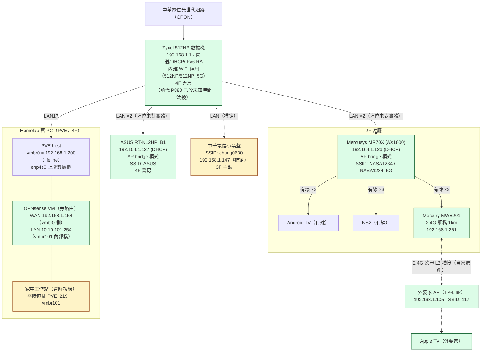

> 完成日期：2026-08-19。來源：使用者舊紙本紀錄 + 當日全系統實測（ping sweep / ARP+OUI 普查 / HTTP 探測 / 管理 SSH / 管理頁登入）。
> 本檔**不含任何帳密** — 憑證在 `secrets/home-network-credentials.md`（gitignored）。
> Homelab 側拓撲見 [`topology.md`](topology.md)。調查過程摘要見文末。

## 一、總覽

家中上網 = 中華電信光世代（GPON），由 **Zyxel 512NP** 數據機擔任閘道/DHCP（`192.168.1.1`），四個 LAN 埠分接：homelab（PVE）、書房 ASUS AP、客廳 Mercusys AP、3F 小黑盤。兩台主要 AP 均為 **bridge 模式**（不 NAT），全家 Wi-Fi 裝置與 homelab 的 PVE vmbr0 同在 `192.168.1.0/24` 單一 L2。客廳另有一台 Mercury MWB201 網橋把整個網段 L2 互橋到**外婆家（自家房產、同家庭）**的 AP。

**舊紀錄主要勘誤**：① 數據機早已從 ADSL 時代 P880 換成光世代 512NP ；② ASUS/Mercusys 兩台都誤記 `.105`（實為 `.127`/`.126`，`.105` 是外婆家 AP）；③ P880 內建 WiFi SSID `111` 不存在（實際設定 `512NP`/`512NP_5G` 且停用中）。

## 二、拓撲圖



## 三、裝置清單

| 裝置 | 型號／角色 | IP（皆可能變） | SSID | 位置 | 備註 |
|---|---|---|---|---|---|
| 中華電信數據機 | **Zyxel 512NP**（光世代 GPON，閘道/DHCP/v6 RA） | `192.168.1.1`（固定） | 內建 WiFi **停用** | 4F 書房 | LAN MAC `64:dd:68:f9:0e:f0`；管理 UI `https://192.168.1.1`（HTTPS only）；工程帳號被 2025-09 起的行動認證碼（QR）鎖擋（見 secrets） |
| ASUS 無線路由器 | RT-N12HP_B1（AP bridge） | `192.168.1.127`（DHCP 浮動） | `ASUS` | 4F 書房 | MAC `54:a0:50:e1:f7:18` |
| Mercusys 無線路由器 | MR70X / AX1800（AP bridge） | `192.168.1.126`（DHCP 浮動） | `NASA1234` / `NASA1234_5G` | 2F 客廳 | MAC `00:eb:d8:04:5e:5f`；~24 無線用戶端；訪客網路未啟用；3 個 LAN 埠滿（TV + NS2 + MWB201） |
| Mercury 網橋 | MWB201（2.4G，1km） | `192.168.1.251`（DHCP 浮動） | —（橋接用） | 2F 客廳 | MAC `4c:b7:e0:c8:77:63`；L2 橋接到外婆家 AP（跨屋、自家房產） |
| 外婆家 AP | TP-Link（經 MWB201 橋入） | `192.168.1.105`（持家中網段 IP，DHCP 浮動） | `117` | 外婆家（自家房產） | MAC `b8:fb:b3:73:22:8a`；同家庭信任網域；WiFi 密碼偏弱（見 §8-2） |
| 中華電信小黑盤 | 全屋通 Wi-Fi AP（型號未查，Zyxel OUI） | `192.168.1.147`（推定，DHCP） | `chung0630` | 3F 主臥 | ⚠️ 推定依據：`.147` 與數據機同 Zyxel OUI、已從上游 DHCP 正常拿 IP（repeater 模式運作中）；依使用者指示不再深究 |
| PVE host | Homelab 舊 PC | `192.168.1.200`（vmbr0，static） | — | 4F 書房 | lifeline 介面；唯一對家用網路的實體上聯（enp4s0） |
| OPNsense VM | homelab 旁路由 | `192.168.1.154`（WAN，DHCP 浮動） | — | PVE 內 | MAC `bc:24:11:23:e4:ce`（SSH 實證）；亦持全局 IPv6 `2001:b011:e009:1d03:...` |

## 四、定址與網段特性

- **單一 L2**：兩台 AP 皆 bridge 模式 → 全家 Wi-Fi 裝置、有線裝置、PVE vmbr0、外婆家（經網橋）全部同廣播域 `192.168.1.0/24`。
- **DHCP**：512NP 為 server。**所有 AP/VM 的管理 IP 皆浮動、無 reservation** → 重開機後可能漂移（本表 IP 為 2026-08-19 快照）。
- **IPv6**：512NP 發 RA，家用網段有全局 IPv6（OPNsense WAN 實證 `2001:b011:...` autoconf）。家人裝置可能直接拿 v6 對外，防火牆政策在 512NP。
- **工作站位於 vmbr101**：家中工作站平常直插 PVE I219（`enp0s31f6`）經 OPNsense 上網，不佔 512NP 埠；2026-08-19 實測為 NO-CARRIER（工作站**暫時拔線**，非故障）。

## 五、L2 裝置普查快照（2026-08-19）

> 手法：管理機 ping sweep /24 → ARP 表 → OUI（maclookup API）→ HTTP title。僅列有回應者；家庭終端裝置（手機/電腦）會隨在線狀態變動。

| IP | MAC | OUI | 身份 |
|---|---|---|---|
| `.1` | `64:dd:68:f9:0e:f0` | Zyxel | 512NP 數據機 |
| `.105` | `b8:fb:b3:73:22:8a` | TP-Link | 外婆家 AP（`117`） |
| `.109` | `e0:ef:bf:7b:70:d5` | Nintendo | 客廳 NS2 |
| `.126` | `00:eb:d8:04:5e:5f` | Mercusys | MR70X |
| `.127` | `54:a0:50:e1:f7:18` | ASUSTek | RT-N12HP_B1 |
| `.147` | `64:dd:68:01:fd:b2` | Zyxel | 小黑盤（推定） |
| `.154` | `bc:24:11:23:e4:ce` | Proxmox（VM MAC） | OPNsense WAN |
| `.173` | `c8:61:d0:63:38:53` | KTC | 客廳 Android TV（推定） |
| `.185` | `68:c6:ac:30:13:da` | Intel | 未列管裝置（筆電/NUC 類） |
| `.195` | `c8:1f:e8:1a:b1:f6` | Apple | 家人 Apple 裝置 |
| `.200` | `8c:0e:60:67:93:e9` | Juplink（RTL8125 貼牌） | **PVE vmbr0 lifeline** |
| `.251` | `4c:b7:e0:c8:77:63` | Mercury | MWB201 網橋 |

## 六、管理機存取路徑（操作員日常）

```text
管理機（筆電/桌機，wlan0 192.168.1.x + Tailscale 100.85.81.82）
    ↓ Tailscale（100.x CGNAT）
OPNsense subnet router（100.81.161.125，廣播 10.10.101.0/24）
    ↓
homelab 管理網段（PVE .200 / NAS .12 / Arch-prod .31）
```

管理機雖與 PVE vmbr0 同 L2，**homelab 管理流量一律走 Tailscale**；家用網段的直連保留給家人消費型服務（如 Immich 本地備份）。管理機另有 `wg0`（192.168.201/202/101/103）為實驗室 WireGuard，與家用網路無關。

## 七、可變動／未定事項

| 項目 | 說明 |
|---|---|
| AP/VM 管理 IP | `.105`/`.126`/`.127`/`.147`/`.154`/`.251` 全為浮動 DHCP，重開機會漂移（建議未來在 512NP 設 reservation；工程帳號被 QR 鎖擋前提下，可先用 `user/user` 試） |
| 小黑盤身份 | `.147` 為推定（Zyxel OUI + 正常上游 DHCP）；型號未查（依指示不深究） |
| 512NP LAN 埠位對應 | 四孔各接誰未逐一對實體（已推定四孔 = homelab + ASUS + Mercusys + 小黑盤） |
| `.173`/`.185`/`.195` 等終端 | 在線快照，身份為推定，會隨時間變動 |
| 512NP 何時換機 | 不明（ADSL P880 → 光世代 512NP 的確切時點無紀錄） |
| 工程/管理者登入 | 2025-09 起 CHT 韌體加行動認證碼（QR）鎖，`cht/12np0ef0` 等慣例密碼即使正確也被擋；正規途徑 = 電 123 |

## 八、安全備註

> 2026-08-19 更新：原列首位的「跨家庭 L2 橋接」議題**已解除** — MWB201 對端為**外婆家（自家房產、同家庭）**，屬同一信任網域，非外部人員。

1. **跨屋 L2 橋接（已解除）**：外婆家 AP（`.105`）與其 Apple TV 為家人裝置。既有防護（PVE/Arch-prod 強密碼、管理面只走 Tailscale）維持不變。
2. **`117` 弱 WiFi 密碼是僅剩的 L2 入口**：外婆家 AP 的 SSID `117` 密碼強度低（見 secrets），且該 AP 直接坐在家庭廣播域 — 密碼被猜中即等於加入 `192.168.1.0/24`（含 `.200` 管理面與未來任何明文服務）。低成本收斂：改強密碼即可。
3. **無訪客隔離**：MR70X 訪客網路未啟用，24 個無線用戶端全在主網段。
4. **IPv6**：512NP 發 RA，終端可能持全局 v6 對外；v6 防火牆政策在 512NP（目前不可考，工程模式被鎖）。

## 九、與 Immich 本地存取議題的結論

兩台 AP 皆 bridge → 家人在 4F（`ASUS`）與 2F（`NASA1234*`）連 Wi-Fi 時都在 `192.168.1.0/24`，與 PVE vmbr0 同 L2 → **「Arch-prod 加 vmbr0 第二 NIC」方案可行**：App 本地網路 URL 填 `http://192.168.1.<新固定IP>:2283`，在外仍走 `https://immich.g36maid.dev`（CF tunnel）。明文埠對外婆家裝置（家人）可達，可接受；對外部的唯一 L2 入口是 `117` 弱密碼（§8-2）。3F（`chung0630`）用戶待驗證（小黑盤推定為 repeater，若屬實同樣可用）。

## 十、調查歷程摘要（2026-08-19，單日完成）

| 時序 | 動作 | 關鍵結果 |
|---|---|---|
| 1 | 使用者舊紀錄落地 + Web 查證小黑盤背景 | 8 項待查清單（HN-01~08） |
| 2 | 登入 Mercusys 管理頁（客廳） | MR70X、`.126`、AP bridge 確認 |
| 3 | 客廳實體盤點 + 使用者說明 | TV + NS2 + MWB201；網橋→外婆家 AP `117`；NS1 移除 |
| 4 | 管理機 L2 普查（ping sweep + ARP/OUI + HTTP title） | ASUS=`.127`（bridge）、`.105`=TP-Link、`.251`=MWB201、`.154`=Proxmox VM MAC、`.147`=Zyxel、`.200` lifeline 在線 |
| 5 | 授權 SSH：OPNsense `ifconfig` + PVE `ip addr/link/neigh` | `.154`=OPNsense WAN 確解；I219 NO-CARRIER=工作站暫時拔線；發現 IPv6 |
| 6 | 使用者證實 | 外婆家 AP=TP-Link（`.105` 定案）；數據機=**512NP 光世代**（舊 P880 已換）；內建 WiFi 停用；工程登入被 QR 鎖（`https://192.168.1.1/passwordqrcode`） |
| 7 | 使用者澄清（同日） | MWB201 對端為外婆家（自家房產、同家庭）→ 跨家庭 L2 橋接安全議題解除（§8） |

> Raw 證據：`hosts/opnsense/raw/ifconfig-20260819.txt`、`hosts/proxmox/raw/vmbr0-i219-20260819.txt`（皆 gitignored）。
> 帳密與裝置憑證：`secrets/home-network-credentials.md`（gitignored）。
