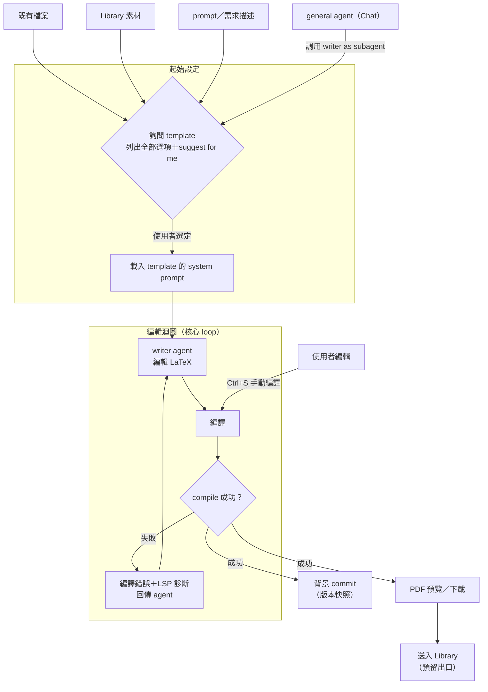
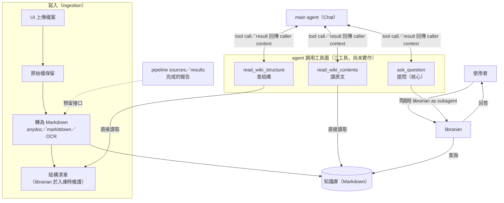

| 項目 | 連結 |
|---|---|
| 會議時間 | 2026-08-30（日） |
| Spec（drill-docs） | https://github.com/drill-research-lab/drill-docs |
| GitHub Board | https://github.com/orgs/drill-research-lab/projects/5/views/1 |

---

## 摘要

---

## 議題 / TODO

### 驗收與 review 

> 本次為各功能工作 demo；以下需求來自現場視覺 review，皆未完成。UI 相關項目需再次 demo 驗證（rebase 後 UI 可能變動）。

#### sandbox

[dsh#5](https://github.com/drill-research-lab/deepseek-harness/issues/5)（In review）

現況：沙盒與登入沒有問題。

Review 需求（未完成）：

- [x] pwd 對 agent 而言是一長串 per-user hash，用 bash 時是負擔（尤其建立多檔案專案），token usage 也變大
- [x] 待以類 chroot 方式處理：agent 不會去開（對其而言）不存在的目錄，就像自己的家目錄

#### writer

[spec](features/paper/spec.md)／[dsh#25](https://github.com/drill-research-lab/deepseek-harness/issues/25)（In review）

Review 需求（未完成）：

- [ ] 完成 issue 內需求
- [ ] 請以 plugin 方式完成
- [ ] 保存方式：手動存檔；Ctrl+S → 編譯
- [ ] LSP：LaTeX 語法與錯誤提示
- [ ] agent LSP enable（參考 opencode）
- [ ] Template 選擇：建立報告時 agent 主動詢問，列出全部選項＋suggest for me；選定後載入該 template 綁定的 system prompt
- [ ] diff：修改差異顯示
- [ ] UI 方向：
  - [ ] LaTeX UI 盡可能讓可視範圍變大
  - [ ] 聊天區浮在編輯＋預覽上
  - [ ] 聊天區放置在下方，跟原本 UI 設計語言一致
  - [ ] 寫作區放到左側工作區下方
- [ ] Non-blocking（可選後續）：可選 LaTeX 編譯器

Agent workflow（實作參考）：

#### wiki

[spec](features/wiki/spec.md)／[dsh#23](https://github.com/drill-research-lab/deepseek-harness/issues/23)（In review）

Review 需求（未完成）：

- [ ] 完成 issue 內需求
- [ ] 允許 main agent 調用（三個工具尚未實作）（參考 deepwiki mcp）
- [ ] UI 修正：工作區必須存在
- [ ] 聊天區放置在下方，跟原本 UI 設計語言一致

Agent workflow（實作參考）：

#### pipeline

[spec](features/pipeline/spec.md)／[dsh#24](https://github.com/drill-research-lab/deepseek-harness/issues/24)（In progress）

- 尚未完成
- 已在 hermes 內實現，驗證成功 → 可作為實作參考

#### 新的需求

1. 翻譯
2. 要等多久上一個人跑完
可能可以用 llm-proxy 

### 3. rebase 上游

| 版本 | 位置 |
|---|---|
| 0.1 rc5 | ⬅ 我們在這裡 |
| 0.1 rc7 | |
| 0.2 rc1 | |
| 0.2 rc2 | ⬅ 上游在這裡 |

- 對應 issue：[dsh#20](https://github.com/drill-research-lab/deepseek-harness/issues/20)（rebase fork master onto dsh-v0.1.0-rc.7）

### 4. 下一步（本次會後 → 下次會前）

- [ ] merge 所有需求
- [ ] rebase 上游
- [ ] 確認整合 → 對接
- [ ] 跑 end-to-end（demo 動線：pipeline → wiki → writer → latex reader → pdf）

---

## 下次開會

- **時間**：週日 8/30 晚上 10 點
- **議程**：issue review、嘗試對接

## 下下次目標

- 對接成功

---

## 老紀需求

> 完整原文與逐項討論結果見 [requirements/2026-08-19-neokent-followup.md](requirements/2026-08-19-neokent-followup.md)。
>
> **2026-08-26 更新**：#1 翻譯頁面已確認 **Pending（預計不實作）** — 維持外部工具方案，Board（[dsh#26](https://github.com/drill-research-lab/deepseek-harness/issues/26)）已同步；revisit 條件見 [translation spec](features/translation/spec.md)。

| # | 需求 | 說明 |
|---|---|---|
| 1 | 翻譯頁面 | 左側 UI 有獨立入口，不需要進聊天。上傳檔案 → 翻譯 → 直接預覽結果 → 可下載。本質上是 file-in / translated-file-out 的工具。 |
| 2 | 定時搜尋 | 設定關鍵字、搜尋來源、執行頻率，後端建立排程，定期搜尋相關資料集。屬 background scheduled job，不需要使用者一直開著頁面。 |
| 3 | PDF 預覽 | 在聊天裡，若 Agent 產生或修改了 PDF，訊息上直接提供「預覽」與「下載」；點預覽就在 DSH 裡看，不需要先下載到本機再開。 |
| 4 | 論文預覽 | 自行上傳的論文，或定時搜尋找到的論文／檔案，都能在左側 UI 直接選取並預覽。即「資料庫／論文庫 + viewer」。 |
| 5 | 工作區 | 屬 UI 組織層：把翻譯、論文、資料集、筆記等能力集中到一個 Workspace 區域，而不是全部塞在聊天頁。 |
| 6 | 共用資料集 | 過往已搜尋的部分可以直接取用，不需要重新跑。 |
| 7 | 筆記本 | 重點不是自由寫筆記，而是整理每個 conversation 的重點：session 結束後可得到本次討論的結論、重要資料、下一步，之後從 Notebook 回頭看。 |
