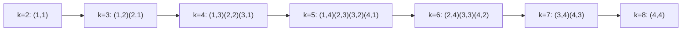

本文整理自 2025-09-26 的高等編譯器作業筆記（HackMD 原稿），題目是一道看似平凡的巢狀迴圈，問它能不能用 affine partitioning 平行化。原稿只有題解骨架，這裡補齊依賴建模、時間函式選擇與邊界推導，附上可直接編譯的 OpenMP 版本。

## 一道不能直接 `parallel for` 的迴圈

程式只有兩行：

```c
for (int j = 1; j <= n; ++j)
    for (int i = 1; i <= n; ++i) {
        A[i][j] = A[i][j] + B[i-1][j];   // S1
        B[i][j] = A[i][j-1] * B[i][j];   // S2
    }
```

直覺上這是 n² 個獨立的小算式，每個核心分一格就好。真的照做，答案就會錯：S1 讀的 `B[i-1][j]` 是上一個 i 迭代寫入的值，S2 讀的 `A[i][j-1]` 也是。只要下一格要用上一格的結果，外層兩個迴圈就都不能直接掛 `#pragma omp parallel for`——跑起來不會報錯，只會安靜地算出錯的資料。

## 依賴分析：誰擋住誰

把每個敘述的每個迭代看成迭代空間裡的一個點，依賴分析要找的是存取同一格記憶體、且至少一次是寫入的迭代對。這題寫入者很單純：`A[i][j]` 只有 S1 寫、`B[i][j]` 只有 S2 寫，跨迭代的依賴只有兩條真依賴（flow dependence，先寫後讀）：

- S2(i-1, j) 寫 `B[i-1][j]`，S1(i, j) 讀同一格 → S1(i, j) 依賴 S2(i-1, j)，距離向量 (1, 0)
- S1(i, j-1) 寫 `A[i][j-1]`，S2(i, j) 讀同一格 → S2(i, j) 依賴 S1(i, j-1)，距離向量 (0, 1)

（原筆記把第一條記成 S1(i-1, j)，但 S1 寫的是 A 不是 B，依賴來源精確講是 S2；距離向量與後續結論不變。）反依賴（先讀後寫）與輸出依賴（兩次寫同一格）在這個巢狀迴圈裡都沒有跨迭代出現，平行化只需處理這兩條。

兩條距離向量剛好指向座標軸兩個方向，這是 wavefront 型態的訊號：沿 i、沿 j 都有序列限制，但兩者夾出來的反對角線上互不依賴。

## Affine transform 的理論定位

Polyhedral model 把迴圈巢的迭代空間與依賴表示成整數線性不等式，「找平行化」於是變成「找一個合法的仿射轉換」。這條路最早能追到 Lamport 1974 年的 hyperplane method：對一類 DO 迴圈存在線性函式 t，把迭代切成一層層超平面，同層可並行 [1]。PluTo 把「自動找出好的仿射轉換」寫成整數線性規劃，同時顧平行度與資料局部性 [2]；LLVM 的 Polly 把這套模型做進 production compiler，它的 isl 排程最佳化器用的正是 Pluto 演算法 [3]。這題的人工推導，就是 Polly 編譯期自動做的事的縮影。

## 系統化步驟

**步驟一、建模依賴**：上節兩條，距離向量 (1, 0) 與 (0, 1)。

**步驟二、選時間函式**：找線性函式 $$t(i, j) = a i + b j$$，對每條距離向量 $$(d_i, d_j)$$ 要求源的 t 值嚴格小於目的，即 $$a d_i + b d_j > 0$$。(1, 0) 要求 a > 0，(0, 1) 要求 b > 0。波數越少、每波越寬，平行度越高；t 值沿 i 每步至少差 a、沿 j 至少差 b，t 值跨距的總和是 $$(a+b)(n-1)$$，波數至少為 $$(a+b)(n-1)/\min(a,b) + 1 \ge 2n-1$$，等號只在 a = b 時成立。取 a = b = 1：

$$t(i, j) = i + j$$

這就是「為什麼 wavefront 是最大平行度」的根據：任何合法的線性時間函式都切不出少於 2n-1 個波，而最寬的波（k = n+1）恰有 n 個迭代，n 執行緒正好用滿。

**步驟三、重寫程式碼**：外層跑 t（序列），內層跑同一波的所有點（平行）。

## Wavefront 圖解

n = 4 的迭代空間，每格標上 k = i+j：

```
i\j    1     2     3     4
 1    k=2   k=3   k=4   k=5
 2    k=3   k=4   k=5   k=6
 3    k=4   k=5   k=6   k=7
 4    k=5   k=6   k=7   k=8
```

同一條反對角線上的格子互不依賴，可以同時計算；每個格子的兩個輸入——`B[i-1][j]` 來自 S2(i-1, j)、`A[i][j-1]` 來自 S1(i, j-1)——都落在 k-1 那條線上，波與波之間同步一次即可：



## OpenMP 程式碼

```c
#include <stdio.h>
#define MAX(a, b) ((a) > (b) ? (a) : (b))
#define MIN(a, b) ((a) < (b) ? (a) : (b))

for (int k = 2; k <= 2*n; ++k) {                  // 波與波之間：序列
    #pragma omp parallel for
    for (int i = MAX(1, k - n); i <= MIN(n, k - 1); ++i) {
        int j = k - i;
        A[i][j] = A[i][j] + B[i-1][j];            // S1：使用上一波的 B[i-1][j]
        B[i][j] = A[i][j-1] * B[i][j];            // S2：使用上一波的 A[i][j-1]
    }                                             // 隱式 barrier：波前同步
}
```

`gcc -fopenmp` 即可編譯。`parallel for` 結束時的隱式 barrier 正好充當波與波之間的同步點（見 OpenMP 規格的 parallel construct 語意 [4]），不必自己寫 barrier。序列複雜度從 n² 個迭代壓到 2n-1 個波。

## 邊界條件的推導

原稿直接給了 `max`/`min`，這裡補上來由。內層要枚舉的是直線 i+j = k 落在迭代空間 $$\{1 \le i \le n,\ 1 \le j \le n\}$$ 內的整數點。把 j = k - i 代回 j 的範圍：

$$1 \le k - i \le n \;\Rightarrow\; k - n \le i \le k - 1$$

再與 i 自己的範圍 1 ≤ i ≤ n 取交集，得到：

$$\max(1,\, k-n) \;\le\; i \;\le\; \min(n,\, k-1)$$

k ≤ n+1 時下界是 1，波前從左上角冒出；k > n+1 時下界變成 k-n，波前從左下角收回。這也解釋了波前為什麼以菱形掃過迭代空間：寬度從 1 爬到 n，再縮回 1。

## 應用場景

同樣的結構到處都是。動態規劃裡 F[i][j] 依賴 F[i-1][j] 與 F[i][j-1]（最長共同子序列、Smith-Waterman 序列比對）就是距離向量 (1, 0)、(0, 1) 的原型，教學材料把這種對角掃描列為 DP 類計算的標準平行模式 [5]，GPU 序列比對實作普遍沿反對角線切分波前 [6]。數值方法裡 Gauss-Seidel、ILU 這類「新的 x 要用剛算出的鄰居」的鬆弛法，依賴是稀疏的，polyhedral 編譯器搭配 runtime inspector 也能自動做 wavefront 平行化 [7]。

反過來，判斷一個巢狀迴圈能不能這樣做，第一步是把距離向量寫出來：只要所有距離向量落在某個通過原點的開半平面裡——存在 (a, b) 使每條都滿足 $$a d_i + b d_j > 0$$——wavefront 排程就存在。

## 收尾

這題的答案：可以平行化，用 k = i+j 的 wavefront 分割，波數 2n-1，平行度上限 n。最值得帶走的是流程而非答案——依賴建模、找合法時間函式、算波數下界、重寫迴圈與邊界。人工做過一遍之後，再看 Polly 編譯時產生的 schedule 就不會覺得像魔法：它解的是同一題，只是把 a、b 與邊界交給整數線性規劃去算。

## 參考資料

1. Leslie Lamport, *The Parallel Execution of DO Loops*, CACM 17(2), 1974 — hyperplane method 原始論文（[作者網頁 PDF](https://lamport.azurewebsites.net/pubs/do-loops.pdf)）
2. U. Bondhugula et al., *A Practical Automatic Polyhedral Parallelizer and Locality Optimizer*, PLDI 2008 — PluTo（[PDF](https://www.ece.lsu.edu/jxr/Publications-pdf/pldi08.pdf)）
3. [Polly — LLVM 的 polyhedral loop optimizer](https://polly.llvm.org/docs/)（isl 排程器採 Pluto 演算法，`-mllvm -polly-parallel` 可自動產生 OpenMP 程式碼）
4. [OpenMP API Specification 5.2 — parallel Construct](https://openmp.org/spec-html/5.2/openmpse57.html)
5. [Wavefront Pattern（UIUC 教學講義）](https://snir.cs.illinois.edu/patterns/wavefront.pdf) — 動態規劃的波前平行模式
6. Y. Venkat et al., *Automating Wavefront Parallelization for Sparse Matrix Computations*, SC 2016（[PDF](https://repository.arizona.edu/bitstream/handle/10150/631128/Venkat2016.pdf?sequence=1)）
7. [ADEPT: a domain independent sequence alignment strategy for GPU architectures](https://pmc.ncbi.nlm.nih.gov/articles/PMC7493400/) — Smith-Waterman 的反對角線 wavefront 實作
