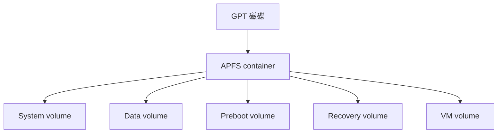

> 本文擴寫自 2025-10-09 的社群貼文，擴寫於 2026-11-03。

你猜 macOS 的檔案系統跟 Linux 上哪個近代檔案系統最像？不是 ext4，也不是 XFS——我賭你猜 Btrfs，而且會猜對一半以上。

原本我一直以為 macOS 的 APFS 就是一坨、畢竟它是從 BSD 衍生過來的系統，但自己改了一個 FS 出來，怎麼想都不會比 ZFS、Btrfs 現代吧。結果我稍微看了一下它的設計——其實滿「現代」的耶，甚至在不少地方超像 Btrfs。這篇就照我理解的順序，從 on-disk format 講到 API，把「像在哪、不像在哪」攤開來看。先說證據等級：以下整理自 Apple 文件與公開分析（WWDC session 投影片、[Hansen & Toolan 2017](https://www.semanticscholar.org/paper/Decoding-the-APFS-file-system-Hansen-Toolan/8cbaba5c0bd43f53081e69afa7e295d07b22088b) 的逆向、[Joe Sylve 的 APFS Internals 系列](https://jtsylve.blog/post/2022/12/06/APFS-NX-Superblock/)），**我沒挖過 APFS 原始碼**——反正也挖不到，這點後面會講。寫錯請留言糾正。

## 先講歷史：Apple 其實跟 ZFS 談過

這段歷史解釋了為什麼 Apple 最後「自己改了一個 FS 出來」。2007 年，Sun 執行長 Jonathan Schwartz 在 WWDC 前直接放話說 ZFS 會成為 Mac OS X 的檔案系統（[Macworld 的報導](https://www.macworld.com/article/185962/sun-7.html)）；Leopard（10.5）裡最後只進了唯讀的移植版，Apple 也在 Mac OS Forge 開了 ZFS 移植專案。到了 2009 年 Snow Leopard，ZFS 支援被整個抽掉，十月專案無聲關閉。Sun 的 Jeff Bonwick 之後在 zfs-discuss 郵件列表證實：雙方**沒有談成授權**——Apple 想要 private license 加上專利訴訟的 indemnity（當時 Sun 正被 NetApp 告 ZFS 專利侵權），Bonwick 原話是「I cannot disclose details, but that is the essence of it」（[Ars Technica 的整理](https://web.archive.org/web/20091114141634/http://arstechnica.com/apple/news/2009/10/apple-abandons-zfs-on-mac-os-x-project-over-licensing-issues.ars)）。CDDL 跟 Apple 的授權習慣不對盤，於是 Apple 選了第三條路：自己寫。APFS 在 2016 年 WWDC 公布（[session 701](https://devstreaming-cdn.apple.com/videos/wwdc/2016/701q0pnn0ietcautcrv/701/701_introducing_apple_file_system.pdf)），2017 年先在 [iOS 10.3 落地](https://devstreaming-cdn.apple.com/videos/wwdc/2017/715gk347h3udl/715/715_whats_new_in_apple_file_system.pdf)、同年秋天的 macOS 10.13 High Sierra 跟進（[時間線見 Wikipedia](https://en.wikipedia.org/wiki/Apple_File_System)）。諷刺的是，寫出來的東西處處有 ZFS 和 Btrfs 的影子——大概是被迫分手，但忘不掉。

## Container：一個「pool」被拆成兩層

APFS 的最底層不是檔案系統，是 **container**（對應 GPT 上的一個 partition）。Container 裡可以有多個 **volume**，每個 volume 是獨立的檔案系統，但共享同一份 free space。這在概念上幾乎就是 Btrfs 的「一個 filesystem、多個 subvolume」：Btrfs 的 [subvolume 本身沒有大小](https://btrfs.readthedocs.io/en/latest/Subvolumes.html)，共用整個 pool 的 chunk allocator；APFS 的 volume 也只是 container 裡的命名空間，空間隨要隨拿，還可以掛 reserve（保證下限）和 quota（上限）——功能上對應 Btrfs 的 qgroups。

（macOS 10.15 之後開機 container 至少長這樣，五個 volume 共享空間，System volume 甚至是以唯讀 snapshot 掛載開機的——見 [Apple Platform Security 文件](https://support.apple.com/guide/security/seca6147599e/web)。）

## Checkpoint：寫入一致性靠「多份 superblock + XID」

APFS 沒有 journal。它的 crash consistency 靠 checkpoint：container 的 block 0 是一份 `nx_superblock`（magic `'NXSB'`），裡面有 container 的大小、block size、下一個可用的 OID 和 XID，以及兩個環形緩衝區——checkpoint descriptor area 和 data area。每次交易（transaction）遞增 XID，寫新資料到 data area、把對應的 mapping 寫進 descriptor area、最後寫一份新的 NX superblock；掛載時掃 descriptor area，挑「checksum 正確且 XID 最大」的那份 superblock，就能還原出最新的一致狀態。崩潰了？退回上一個 XID 的 checkpoint，舊資料一個 byte 都不會壞。每個 object header 還帶 Fletcher-64 checksum。細節可以看 [Sylve 對 NX superblock](https://jtsylve.blog/post/2022/12/06/APFS-NX-Superblock/) 和 [checkpoint map](https://jtsylve.blog/post/2022/12/07/APFS-Checkpoint-Maps/) 的逆向筆記。

這套「全 metadata CoW、不覆寫舊塊、靠樹根指標原子切換」的思路，正是 Btrfs 的日常：Btrfs 每棵樹的節點都是 CoW 的，superblock 存兩份、靠 generation number 挑最新有效的。差別在組織方式——Btrfs 是一整顆 chunk/extent/樹的森林，APFS 則把 container 層的結構（spaceman、reaper、object map）做成一顆顆獨立 object。

## OID 與虛擬物件：snapshot 的基礎設施

APFS 裡所有結構都是 **object**：每個 object 有 32-byte header（`o_oid`、`o_xid`、`o_type`、checksum）。物件分三種：physical（位置寫死）、virtual（靠 **object map** 把 OID 對應到實體位址）、ephemeral（只活在 checkpoint 裡）。關鍵是 virtual objects：**OID 是穩定的，實體位址可以變**。FS-tree（存 inode、目錄、xattr 的那棵 B-tree）的每個節點都是 virtual object；snapshot 要回溯舊狀態時，只要沿著舊 XID 的 object map 走，同一批 OID 就會解析到舊的實體塊。所以 APFS 的 snapshot 幾乎免費——這跟 Btrfs「snapshot 就是多一個 subvolume root、subtree 節點共享」是同一招，只是 APFS 把「解參考」這件事做成了獨立的一層（[FS-Tree 的設計](https://jtsylve.blog/post/2022/12/15/APFS-FSTrees/)）。

而 B-tree 本身也一樣是 CoW 的：改一個 key，從 leaf 到 root 整條路徑都寫到新塊，舊塊留給還引用它的 snapshot。跟 Btrfs 唯一顯著的實作差異是節點內部結構——APFS 的 node 有固定的 key/value 區分佈和 sibling 指標，Btrfs 則是 item-based 的緊湊佈局。

## clonefile(2) 與「cp 一百次也不佔空間」

API 層最像的部分來了。macOS 10.12 起有 [`clonefile(2)`](https://github.com/apple-oss-distributions/xnu/blob/main/bsd/man/man2/clonefile.2)：clone 出來的檔案**共享資料塊**，只有 metadata 是自己的；任何一方寫入時才做 CoW，把改到的塊另配新址。目錄也能整棵 clone。之後 `cp`、Finder 複製、Time Machine 都走這條路。Btrfs 這邊的對應物是 reflink（`cp --reflink`），語意幾乎逐條相同，連「覆寫已共享的塊時可能 ENOSPC」這個 corner case 都一樣——man page 裡白紙黑字寫著。差別是 clonefile 是 Apple 的 syscall，Btrfs 走的是 [fan-out 的 generic reflink 路徑](https://btrfs.readthedocs.io/en/latest/Subvolumes.html)，後來 XFS、btrfs 一起把它標準化成 Linux 的 `FICLONE`。

## 誠實篇：不像的地方

寫到這裡像在幫 APFS 打廣告，該列缺點了，而且每一條 Btrfs 都有：

- **資料沒有 checksum。** APFS 只對 metadata object 做 Fletcher-64；檔案內容裸奔。Btrfs 對資料和 metadata 都記 [crc32c](https://btrfs.readthedocs.io/en/latest/Feature-by-Set.html)，ZFS 也是。Apple 工程師的說法是「我們的 SSD 自己有 ECC」——外接硬碟表示意見。[一位 ZFS 開發者當年就點名這點](https://arstechnica.com/gadgets/2016/06/a-zfs-developers-analysis-of-the-good-and-bad-in-apples-new-apfs-file-system/)，之後也一直有人追著問（[Eclectic Light 的整理](https://eclecticlight.co/2023/05/28/last-week-on-my-mac-should-we-be-worried-about-data-integrity)）。
- **沒有 scrub。** 資料沒 checksum 就無從對帳，metadata 的對帳也沒有暴露給系統工具的入口。
- **沒有內建 RAID。** container 只看得到一顆合成出來的 block device，striping/mirroring 要靠底下的 AppleRAID 或外接方案；Btrfs 的 RAID1 是原生的（RAID5/6 另議，別學我提它）。
- **不開源。** xnu 裡只有 `clonefile` 這層 syscall，APFS 本體沒有公開實作；社群靠逆向（[linux-apfs-rw](https://github.com/linux-apfs/linux-apfs-rw) 就是這樣讀寫出來的）。「現代設計但你看不到程式碼」，這大概是它跟 Btrfs 最本質的差別。

## 結論

所以回頭看，我當初的直覺一半對一半錯。對的部分：它不是從 HFS+ 改的，是照 2010 年代 CoW 檔案系統的正統思路從零寫的，設計上確實現代。錯的部分：它沒有比較爛，它就是……另一顆 Btrfs——少了 checksum、多了加密、鎖在 Apple 的圍牆裡。

但雖然有不錯的檔案系統，Finder 還是會在每個資料夾生出 .DS_Store 這種垃圾 🗿
