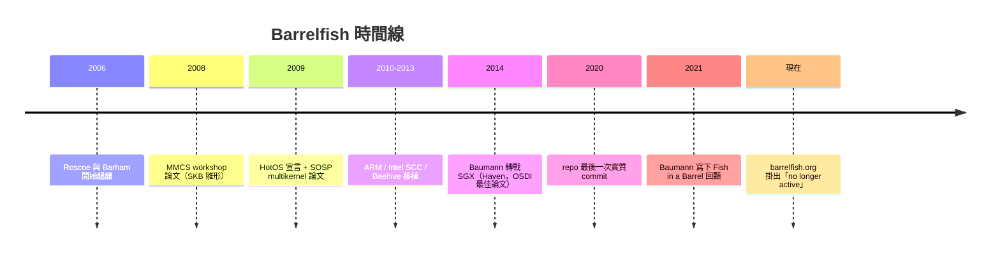

> 本文擴寫自 2025-02-15 的 HackMD 論文筆記，擴寫於 2026-11-04。

先問一個問題：你覺得現在跑在 128 核機器上的 Linux，跟 2009 年跑在 8 核機器上的 Linux，核心架構差了多少？

答案是：核心資料結構的基本假設幾乎沒變——還是共享記憶體加鎖。而 2009 年有一篇論文主張，這整條路是錯的，作業系統應該從第一天就寫成**分散式系統**。這篇就是 ETH Zurich 和 Microsoft Research 合作的 Barrelfish multikernel 論文。我先說證據等級：以下整理自我自己的二手閱讀筆記（原始碼我沒跑過、沒挖過），事實宣稱都附了原文連結，寫錯請留言糾正。

## 先把年份查清楚：是 SOSP 2009，不是 OSDI

查資料的時候我自己先踩了一個雷：我一直以為這篇是 OSDI 論文。翻了[原文頁](https://barrelfish.org/publications/barrelfish_sosp09.pdf)才確認——**The Multikernel: A new OS architecture for scalable multicore systems** 發表在 [SOSP 2009](https://www.sigops.org/s/conferences/sosp/2009/papers/baumann-sosp09.pdf)（ACM 的 Symposium on Operating Systems Principles，2009 年 10 月 11–14 日，Big Sky, Montana），不是 USENIX 的 OSDI。作者是 Andrew Baumann、Paul Barham、Tim Harris、Rebecca Isaacs、Simon Peter、Timothy Roscoe 等九人，橫跨 ETH Zurich Systems Group 和 Microsoft Research Cambridge。

這個合作本身就有故事：[Baumann 在 2021 年寫的回顧](https://www.sigops.org/2021/fish-in-a-barrel-an-insiders-retrospective-of-the-sosp09-multikernel-paper)（"Fish in a Barrel"）提到，點子是 Roscoe 和 Barham 在 2006 年左右聊出來的——兩人是當年劍橋 Nemesis OS 的老戰友，一個剛去 ETH 當教授、一個在管 MSR 的系統組。他也誠實得很：「專案第一年，我們在一個沒有明確研究議程的狀態下蓋系統。」

在 SOSP 之前還有兩篇鋪陳：2008 年 MMCS workshop 的[《Embracing diversity》](https://barrelfish.org/publications/barrelfish_mmcs08.pdf)先提出了 system knowledge base 的雛形；2009 年 5 月 HotOS 的[《Your computer is already a distributed system. Why isn't your OS?》](https://barrelfish.org/publications/barrelfish_hotos09.pdf)則把整個論證講得最白：一台現代多核電腦有節點異質性、有動態成員變化（熱插拔、省電狀態）、有巨大的延遲差異——**它已經具備分散式系統的所有特徵了，你憑什麼不這樣寫 OS？**

## 核心主張：OS as a distributed system

multikernel 模型的定義很乾脆：**把整台機器當成一個由獨立核心組成的網路**，每個核心跑自己的 kernel instance，最低層不假設任何跨核心共享，傳統的 OS 功能搬到一組用 message passing 溝通的行程上。三條設計原則：

1. **所有跨核心通訊都是明確的**——不靠共享記憶體的「隱式」訊息（cache coherence 協定本身就是一種訊息系統，只是你沒寫）。
2. **OS 結構與硬體無關**——只有訊息傳輸層和硬體介面需要針對機器調整。
3. **狀態視為複本而非共享**——一致性靠 agreement protocol 維護。

論文裡最有說服力的是一個小實驗（Figure 3）：16 個核心用共享記憶體直接更新同一組資料，每次更新要額外付出近 **12,000 個 cycle**，全卡在 cache miss 上；改成一個 server 行程用 RPC 收更新，單一 server 每秒能做的更新次數是 16 個共享記憶體執行緒加總的**兩倍**。這呼應了 Lauer 和 Needham 1978 年的老論點：message passing 和 shared memory 是對偶，選哪個該看機器長什麼樣——而 2009 年的機器，訊息成本正在反超。

論文還順手補刀：為了讓 Windows 7 拿掉 dispatcher lock，微軟動了 58 個檔案裡的 6,000 行程式碼，被形容為「heroic」。用鎖追硬體，是一場打不完的仗。

## 關鍵機制：小 CPU driver、capability、會講 Prolog 的 SKB

幾個我覺得值得單獨記下來的設計：

**CPU driver 極小且使用者態化（幾乎）。** 每核心一個 CPU driver 加一個 user-space 的 monitor 行程。因為跟其他核心零共享，CPU driver 可以是完全事件驅動、單執行緒、不可搶佔的——x86-64 版含除錯支援只有 **7,135 行 C 加 337 行組語**。真正傳統 kernel 的職責（排程、通訊、資源分配）被拆成一個分散在各核心 monitor 之間的分散式系統。

**Memory management 全在 user space。** 採用 seL4 式的 capability 系統：所有記憶體操作都是對 capability 的 retype/revoke，CPU driver 只負責檢查操作正確性，連動態記憶體配置都從核心裡消失了。跨核心的 capability 修改靠 monitor 之間的協定——頁表映射是一階段提交，retype（含 revoke）是兩階段提交。有趣的是論文自己認了錯（§4.7 原話）：

> In hindsight, this was a mistake: the capability code is unnecessarily complex, and no more efficient than scalable per-processor memory managers used in conventional OSes like Windows and Linux.

研究型論文肯寫這種句子，值得尊敬。

**SKB：把硬體知識變成一階邏輯。** [System Knowledge Base](https://barrelfish.org/publications/TN-000-Overview.pdf) 是一個用 ECLiPSe constraint solver（Prolog 系）實作的服務，吃 ACPI、PCI probe、CPUID，再加上開機時實測的所有核心對之間的 URPC 延遲，讓 OS 和應用程式直接對硬體拓撲下約束查詢。最有感的應用是 TLB shootdown：與其像傳統 OS 用序列的 inter-processor interrupt 一台一台敲，Barrelfish 讓 SKB 在執行期算出一棵**拓撲感知的 multicast tree**（每個 socket 一個 aggregation node），unmap 延遲在 32 核機器上明顯低於 Linux 和 Windows——這是「把網路知識搬進 OS」的直接兌現。核心間訊息本身走 URPC：cache-line 大小的訊息、單寫單讀輪詢，2×4-core Intel 上單向延遲 68ns。

## 然後呢：一個研究專案的消失史

Barrelfish 後來移植到 ARM、Intel 的 Single-Chip Cloud Computer、MSR Beehive 這些**沒有 cache coherence** 的實驗平台，一路做了十幾年。然後呢？

- [barrelfish.org](https://barrelfish.org/) 現在首頁就寫著：**"The Barrelfish project is no longer active."** 導向 [ETH Systems Group](https://systems.ethz.ch/)。
- GitHub 的 [BarrelfishOS/barrelfish](https://github.com/BarrelfishOS/barrelfish) 是官方 mirror，MIT 授權，240 顆星；最後一次實質 commit 停在 2020 年 3 月（「readme: add NXP iMX8X to supported platforms」），此後只有雜項 push。
- 主要作者各奔東西：**Andrew Baumann 因為 Barrelfish 的表現被直接挖進 Microsoft Research Redmond**（[MSR 官方部落格原話](https://www.microsoft.com/en-us/research/blog/barrelfish-exploring-multicore-os)），後來做出了 [Haven](https://www.usenix.org/conference/osdi14/technical-sessions/presentation/baumann)——OSDI 2014 最佳論文，第一個在 Intel SGX enclave 裡跑未修改 Windows 應用的 shielded execution 系統；2014 年還有把「incoherent world 裡共享資料」問題接續下去的 [Cosh](https://www.usenix.org/conference/trios14/technical-sessions/presentation/baumann)。Roscoe 則回 ETH 繼續做 Enzian 這種 FPGA 研究電腦。

論文自己給的理由也還成立：driver 生態、既有的共享記憶體應用程式假設、以及「在當代硬體上 Linux 就是比較快」。研究 OS 打不贏生態系，這不是 Barrelfish 的失敗，是所有研究 OS 的宿命。

## 為什麼我從 Rust 想到這篇論文

我的原始筆記旁邊就抄了《The Rust Programming Language》的一段：

> One increasingly popular approach to ensuring safe concurrency is message passing, where threads or actors communicate by sending each other messages containing data.

以及 Go 的格言："Do not communicate by sharing memory; instead, share memory by communicating."

但 2026 年重讀，我覺得這條連結比 2009 年看起來深刻得多。**multikernel 在 C 時代做不到的事，恰恰是 Rust 的所有權系統做到的事。** 2009 年用 C 寫 message-passing OS，編譯器無法告訴你一塊狀態是不是真的只有一個主人、一則訊息是不是真的被 move 而不是被兩邊同時摸——這些不變量全靠紀律。論文 §2.6 自己承認了這個軟體工程疑慮，當時的解法是寄望 Tame/Tamer 這類 C++ 函式庫或 X10 這種新語言；[MSR 部落格也提到](https://www.microsoft.com/en-us/research/blog/barrelfish-exploring-multicore-os) Tim Harris 特別在開發「幫助程式設計師處理 Barrelfish 到處都是的非同步通訊」的 C 語言擴充。

Rust 後來把這件事變成了型別系統本身：`channel` 的 `send` 是 move——訊息送出去，所有權就走了，編譯期就把 data race 擋掉；`Send`/`Sync` trait 把「這個型別能不能安全跨越邊界」寫進型別簽名。**「每核心一份狀態、明確傳訊」這種架構，在所有權可以被靜態驗證的語言裡，成本陡降。** multikernel 的論文賭的是「訊息會越來越好寫」——它賭對了方向，只是兌現它的語言晚了大約十年。

## 2026 年回看：NUMA、CXL、加速器時代

那這個模型死了嗎？我覺得反而越活越回去：

- **NUMA 早就是日常**，而且核心數繼續漲。2021 年 OSDI 的 [NrOS](https://www.usenix.org/system/files/osdi21-bhardwaj.pdf) 提出的 NRkernel 直接站在 Barrelfish 肩膀上：核心照樣複製（node replication），但在群組內允許受控共享，用編譯期自動化的 replica 維護把 shared-memory 的好效能和 multikernel 的擴展性折衷起來。Popcorn Linux 則是把 multikernel 概念搬進 Linux 的嘗試。
- **CXL 讓「一台機器=一個網路」重新變成字面意義**：記憶體變成可以跨 socket、跨設備存取的 fabric，異質加速器（GPU、DPU、NPU）每一顆都有自己的記憶體階層和不參與 cache coherence 的核心。論文 §2.2 當年寫「核心異質到無法共享同一份 kernel instance」，今天的主機板就是這個形狀——只是主流 OS 又把加速器退化成「裝置+狹窄驅動介面」，而 multikernel 當年想要的是把它們當成一級公民核心納管。
- 當然要誠實：**在 cache-coherent 硬體上，共享記憶體仍然是對的**，NrOS 的量測也這麼說。multikernel 的價值主張從來不是「永遠比較快」，而是「硬體異質時不會整個重寫」。

## 心得

回頭看我 2025 年那份筆記的優缺點表，結論沒變：scalability、異質適應性、fault isolation 是 multikernel 的強項；複雜度、driver 生態、訊息延遲是它輸的地方。但兩年後我多了一層感想——這篇論文最值錢的可能不是那台 OS，而是**論證的姿勢**：與其慢慢補丁，不如先站到極端（零共享、全複本、純訊息），再回頭把共享當成「複本維護的最佳化」加回來（論文原話：用鎖優化 replica maintenance，而不是反過來）。這個把光譜整個翻轉的思考方式，比任何單一設計都耐用。

順帶一提，那份筆記的結尾還留著一行 "Would you like me to add more details or refine any sections? 🚀"——是當年拿 AI 整理論文的痕跡，這篇就是把它認真展開之後的樣子。

## References

- [The Multikernel: A new OS architecture for scalable multicore systems（SOSP'09 PDF）](https://barrelfish.org/publications/barrelfish_sosp09.pdf)／[SIGOPS 版本](https://www.sigops.org/s/conferences/sosp/2009/papers/baumann-sosp09.pdf)
- [Your computer is already a distributed system. Why isn't your OS?（HotOS XIV '09）](https://barrelfish.org/publications/barrelfish_hotos09.pdf)
- [Embracing diversity in the Barrelfish manycore operating system（MMCS '08）](https://barrelfish.org/publications/barrelfish_mmcs08.pdf)
- [Fish in a Barrel: an insider's retrospective of the SOSP'09 multikernel paper（SIGOPS, 2021）](https://www.sigops.org/2021/fish-in-a-barrel-an-insiders-retrospective-of-the-sosp09-multikernel-paper)
- [Barrelfish: Exploring a Multicore OS（Microsoft Research blog）](https://www.microsoft.com/en-us/research/blog/barrelfish-exploring-multicore-os)
- [The Barrelfish Operating System（官方網站，已標記 no longer active）](https://barrelfish.org/)／[GitHub mirror](https://github.com/BarrelfishOS/barrelfish)
- [Shielding Applications from an Untrusted Cloud with Haven（OSDI'14 最佳論文）](https://www.usenix.org/conference/osdi14/technical-sessions/presentation/baumann)
- [Cosh: Clear OS Data Sharing In An Incoherent World（TRIOS'14）](https://www.usenix.org/conference/trios14/technical-sessions/presentation/baumann)
- [NrOS: Effective Replication and Sharing in an Operating System（OSDI'21）](https://www.usenix.org/system/files/osdi21-bhardwaj.pdf)
- [The Rust Programming Language — Ch.16 Message Passing](https://doc.rust-lang.org/book/ch16-02-message-passing.html)／[Share Memory By Communicating（Go blog）](https://go.dev/blog/share-memory-by-communicating)
- [Popcorn Linux](https://popcornlinux.org/)
