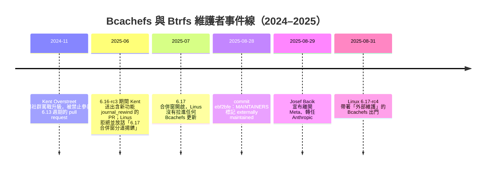

> 擴寫自 2025-08-31 的隨筆（原發於 Facebook）。擴寫時已補查兩案的事件時間線與原始出處，脈絡以 2025-08-31 當時為準。

## 事件背景：一週之內兩記重擊

寫原稿那天我的開頭是「Linux 檔案系統這週沒什麼好消息」，現在補完調查後，我覺得這句話還算是客氣的。

第一記：Linus Torvalds 在 [8 月 28 日直接改了 MAINTAINERS 檔](https://github.com/archlinux/linux/commit/ebf2bfec412ad293a0b118fb1a20a551088ebc9b)，把 Bcachefs 的維護狀態從「supported」改成「externally maintained」，commit message 只有淡淡一句「As per many long discussion threads, public and private」。[LWN 的解讀](https://lwn.net/Articles/1035736/)是：短期內不會有任何 Bcachefs 的變動進主線，但也不代表馬上會從 kernel 裡移除。程式碼還在樹裡，只是沒有人會再把你的 pull request 拉進去了。

第二記：Btrfs 共同維護者 [Josef Bacik 宣布離開 Meta](https://www.phoronix.com/news/Josef-Bacik-Leaves-Meta)，隔週起轉任 Anthropic 做基礎設施擴充，並說這是他職業生涯第一次「不再以 kernel 開發為主業」。他在 [Mastodon 上的原文](https://hachyderm.io/@josefbacik/115111769723183990)寫得很真誠：這是他待過最好的團隊，但人生該翻頁了。

跟我預期一樣，Linus 真的把 Bcachefs 標成外部維護了。這其實就是宣告：他不想再管一個不尊重合併週期的人，這個檔案系統未來能不能活下去，全看 Kent Overstreet 自己。

## 兩條時間線

先講 Bcachefs 這邊，衝突不是一天造成的：

爭議的核心是 2025 年 6 月那次 [6.16-rc3 的 pull request](https://lore.kernel.org/lkml/CAHk-=wi2ae794_MyuW1XJAR64RDkDLUsRHvSemuWAkO6T45=YA@mail.gmail.com/)：Kent 把新功能 `journal_rewind`（把整個檔案系統回捲到較早時間點的災難復原工具）混進了 rc 階段的修復 PR。Linus 的回覆很直白：「rc 的修復就該是純修復」，還補了一句後來被瘋狂引用的「我堅定地相信，任何用 bcachefs 的人都該預期它是實驗性的」。ext4 維護者 Ted Ts'o 也[下場提醒](https://lore.kernel.org/lkml/20250620124346.GB3571269@mit.edu/)：merge window 的規則是十幾年來社群的共識，而執行它正是 Linus 的職責。Kent 不服氣、搬出 XFS 和 Btrfs 在 rc 期也收過類似修補的先例重送，Linus 最後雖然合了那一批，但[丟下](https://theregister.com/2025/07/01/bcachefs_may_get_dropped/)「我想我們會在 6.17 合併窗分道揚鑣」和一句「we're done」。到了 7 月的 6.17 合併窗，他真的什麼都沒拉。

Btrfs 這邊的時間線短得多——8 月 29 日一天就結束了。Bacik 自 2017 年起與 David Sterba 共同維護 Btrfs，負責過空間管理、extent 配置這類最難啃的部分。Sterba 還在，所以 Btrfs 並不是無人領導；但原稿裡我寫「Btrfs 在 META 可是撐起整個基礎設施的東西」，這不是誇飾：Meta 把 Btrfs 大規模跑在生產環境上，Bacik 正是那個把企業需求帶進 kernel 的人。這條管道現在細了。

## 對 kernel 生態的影響

**「externally maintained」是個很冷靜、但很殘酷的狀態。** 它不同於把程式碼標成 BROKEN 或直接刪除——Linus 特意讓使用者不會立即受害——但 maintenance 狀態表裡的每個字都有法律效力般的意義：沒人再負責這段程式碼與主線的整合。LWN 討論串裡大家問的正是這個：沒有人送 PR、程式碼也不刪，那 `fs/bcachefs/` 裡的東西會不會就這樣慢慢爛掉？如果 Kent 從此只維護自己的樹，那 kernel 裡這份算是什麼——fork 嗎？

**單一維護者是結構性風險。** Bcachefs 從進主線以來，實質上就是 Kent 一個人扛九成的開發。這次事件暴露的不是技術問題，而是治理問題：一個技術上被不少人看好的 COW 檔案系統，可以在兩個星期內因為一個人的溝通方式被逐出主線流程。檔案系統是那種「寫進去就是十年」的東西，使用者在意的從來不是本月有沒有新功能，而是十年後還有沒有人替這段程式碼收信。

**AI 業界正在虹吸 kernel 人才。** Bacik 去 Anthropic 這件事，我認為影響比標題看起來大。Meta 僱他用戶級規模驗證 Btrfs，這種「企業長期僱用核心檔案系統開發者」的模式一旦鬆動，上游就少了一個穩定的資源錨點。當 AI 基礎設施的薪水遠超過維護 kernel 子系統的合理報酬，下一個 Bacik 只會更多。這對整個基礎軟體生態都是警訊，不只是 Btrfs。

**COW 檔案系統的版圖更尷尬了。** ZFS 因授權不相容永遠進不了 kernel、XFS 沒有快照、ext4 是安全牌、Btrfs 終於在生產環境站穩卻折損大將、Bcachefs 懸在半空。使用者真正想要的「有 checksum、有快照、有多裝置、在主線裡」的組合，選擇其實只有 Btrfs 一個。

## 我的看法

站在 FOSS 的立場，我兩邊都不想站得太平：merge window 的紀律是社群十幾年的社會契約，Kent 把新功能塞進 rc 期的 PR 確實是踩線；但反過來說，把一個有真實用戶、資料丟了會救不回來的檔案系統整個踢出流程，懲罰的也不只是 Kent——那些用 Bcachefs 救回過資料的人也一起被懲罰了。Linus 的治理風格一直是「用 process 代替人情」，這次他選擇了 process。我不覺得他錯，但這種處理方式的代價是由使用者分攤的。

我真正在意的反而是 Bacik 的離職聲明裡那句「第一次不以 kernel 開發為主業」。基礎軟體的永續從來不靠英雄，靠的是有人願意長期、體面地被僱用去做這些吃力不討好的事。當最體面的僱主都開始把預算轉向 AI 基礎設施，我們該擔心的不是哪一個檔案系統會消失，而是十年後還有沒有人守著 `fs/` 這個目錄。

至於 Bcachefs：我不悲觀它的技術，只悲觀它的流程。如果它真的要在外部活下來，得先長出一個不只靠 Kent 一個人的社群——這比修好任何一個 bug 都難。

延伸閱讀：我之前修過一門[檔案系統課程](/blog/2025-04-02_082028_hm_filesystem/)，裡面也從 ZFS 與 Btrfs 的設計差異談起。

**References**

- [Linus Torvalds Marks Bcachefs As Now "Externally Maintained" — Phoronix](https://www.phoronix.com/news/Bcachefs-Externally-Maintained)
- [Bcachefs goes to "externally maintained" — LWN](https://lwn.net/Articles/1035736/)
- [MAINTAINERS: mark bcachefs externally maintained — commit ebf2bfe](https://github.com/archlinux/linux/commit/ebf2bfec412ad293a0b118fb1a20a551088ebc9b)
- [Linux 6.17-rc4 Released With Bcachefs Now "Externally Maintained" — Phoronix](https://www.phoronix.com/news/LInux-6.17-rc4)
- [Re: [GIT PULL] bcachefs fixes for 6.16-rc3 — Linus Torvalds, LKML](https://lore.kernel.org/lkml/CAHk-=wi2ae794_MyuW1XJAR64RDkDLUsRHvSemuWAkO6T45=YA@mail.gmail.com/)
- [Re: [GIT PULL] bcachefs fixes for 6.16-rc3 — Theodore Ts'o, LKML](https://lore.kernel.org/lkml/20250620124346.GB3571269@mit.edu/)
- [Bcachefs may be dropped from the Linux kernel — The Register](https://theregister.com/2025/07/01/bcachefs_may_get_dropped/)
- [Btrfs Developer Josef Bacik Leaving Meta & Stepping Back From Kernel Development — Phoronix](https://www.phoronix.com/news/Josef-Bacik-Leaves-Meta)
- [Josef Bacik 離職聲明原文 — Mastodon](https://hachyderm.io/@josefbacik/115111769723183990)
