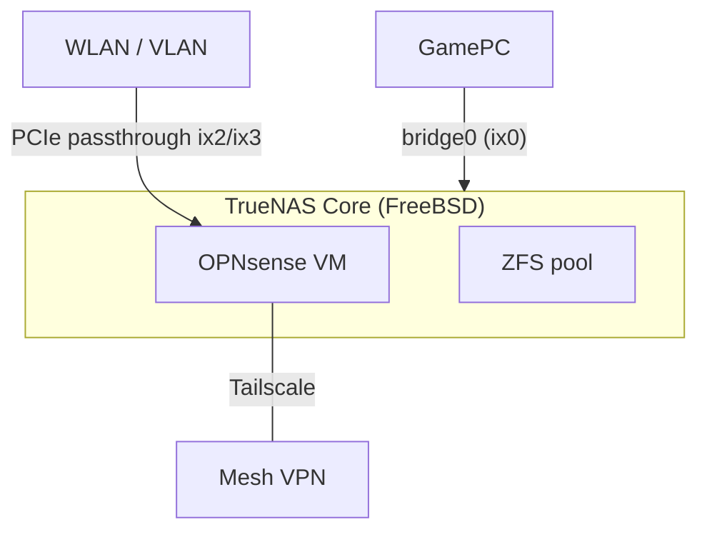

> 本文擴寫自 2024-08-30 的 HackMD 專案筆記（原稿為英文專案 log，記錄 2024 年 7–8 月的安裝過程與失敗清單；版本脈絡以 2024 年 8 月為準）。

家裡的 NAS 遲早要對外服務，但我一直不想讓它直接裸奔在區網邊界上——既然要玩 ZFS，就乾脆走整條 BSD 線：FreeBSD 基底的 TrueNAS Core 管儲存，再用虛擬化開一台 OPNsense 當防火牆，Tailscale 負責遠端接入。聽起來很美，最後也真的能跑，但踩的雷比預期多一個數量級，尤其是「巢狀虛擬化」這條路整段放棄重來。

## 架構總覽

硬體是 III 提供的 Intel Atom i3-N305 裸機，內建 igc0/igc1 兩張網卡與 iwlwifi0 無線網卡。最終架構：TrueNAS Core 當底層，ZFS pool 管儲存，OPNsense VM 透過 bridge 接實體網卡，兩張網卡以 PCIe passthrough 直通，Tailscale 在 VM 裡提供 mesh VPN 入口：



## 1. 先在 VirtualBox 學 FreeBSD

七月從 VirtualBox 開始，把 FreeBSD 和 TrueNAS Core 各裝一次、學基本指令。事後證明這步很值得——後面所有坑，都是靠「至少知道正常流程長什麼樣」才定位得出來。不過 2013 年的 MacBook（macOS 10.15）連某些 BSD VM 映像都打不開（checksum 錯誤），VMware 也因 macOS 太舊失敗，最後實驗全靠工作站和 homelab 機。

## 2. QEMU/KVM 的第一次嘗試

接著在 NTU CSIE 工作站用 QEMU/KVM 裝 TrueNAS Core（六顆 qcow2 當 ZFS 碟）：

```bash
qemu-img create -f qcow2 -o cluster_size=2M disk00.qcow2 256G

virt-install \
--name=TruenasCore \
--vcpus=8 \
--memory=16384 \
--disk path=raid/disk00.qcow2 \
--disk path=raid/disk01.qcow2 \
--disk path=raid/disk02.qcow2 \
--disk path=raid/disk03.qcow2 \
--disk path=raid/disk04.qcow2 \
--disk path=raid/disk05.qcow2 \
--disk path=raid/disk06.qcow2 \
--cdrom=Truenas.iso \
--network=default \
--os-variant=freebsd12.0 \
--console pty,target_type=serial \
--graphics vnc,listen=0.0.0.0,password=0910 \
--noautoconsole

virsh qemu-monitor-command --hmp TruenasCore 'hostfwd_add ::3636-:22'
```

安裝成功，但天花板立刻現形：TrueNAS Core 裡的 bhyve 後端對不上 QEMU/KVM 前端，VM 裡開 VM 直接失敗。這不是設定問題——[FreeBSD bug 246168](https://bugs.freebsd.org/bugzilla/show_bug.cgi?id=246168) 標題就叫「KVM / QEMU Failure with nested FreeBSD bhyve」。想在 QEMU 裡再跑 bhyve，當時就是不行。

## 3. 換裸機：i3-N305 的兩個麻煩

八月上裸機，FreeBSD 13.2 和 14.1 都成功安裝，但：

- **內顯**：i3-N305 的 Intel UHD 在 FreeBSD 13.2 到 14.x 只有 framebuffer 驅動、無加速；同一台機器在 Ubuntu 和 Arch 上圖形一切正常。官方文件的更新說明也含糊，升級路徑要自己拼。
- **Wi-Fi**：iwlwifi0 在 DHCP 階段丟出「no buffer space available」，形同殘廢。還好這台機器的定位是有線 NAS。

## 4. TrueNAS Core：單碟安裝也會失敗

裸機上裝 TrueNAS Core，單碟安裝直接失敗。錯誤訊息難排查，我的做法是在 VM 裡模擬同樣的單碟場景、反覆重試找出能過的組合——土，但比裸機每次重開機快得多。[TrueNAS 論壇的 pfSense VM 討論串](https://forums.truenas.com/t/how-to-install-pfsense-on-virtual-machine-on-truenas-core/3317)也顯示 Core 內建 bhyve 開防火牆 VM 是社群常見玩法。

## 5. OPNsense VM + Tailscale：終於跑起來

巢狀 bhyve 疊不到三層，架構只好改扁平：bhyve 直接跑在 TrueNAS Core 那層，防火牆 VM 與儲存服務平級共存。OPNsense 裝好後按 [Tailscale 官方文件](https://tailscale.com/docs/install/opnsense)把 Tailscale 掛起，防火牆、VLAN、2FA、mesh VPN 入口一次到位。遠端接進家裡網路的那一刻，前面所有的雷都「終於」值得了。

## 踩雷清單（按時間線）

原稿的 Issues and Failures 是整份筆記最值錢的部分，照時間線整理：

- **七月**：VirtualBox 成功裝好兩套系統；macOS 10.15 上部分 BSD VM 映像 checksum 錯誤打不開；QEMU/KVM 前端配不出巢狀 bhyve。
- **八月**：拿到 i3-N305 裸機；FreeBSD 13.2/14.1 安裝成功但內顯只剩 framebuffer；iwlwifi DHCP 報「no buffer space available」；TrueNAS Core 單碟安裝失敗，靠 VM 模擬重現問題才找出路；bhyve 疊不到三層，被迫改扁平架構；官方文件的升級說明含糊，路徑要自己拼。

## 用後感：誠實盤點

最後只有 TrueNAS Core 成功——FreeNAS、TrueNAS Scale 的 VM 都停在 pending，jails 也沒真部署起來（原稿裡 Jails、bhyve、Auto-install Script 三個空標題就是當時進度的誠實寫照）。優點：ZFS 的 pool/snapshot/RAID-Z 名不虛傳，扁平架構可行，OPNsense + Tailscale 遠端接入乾淨俐落。缺點：當時 Core 的 plugins 生態掛了一部分；Docker 與 VM 生態基本要看 Scale（Debian 基底），Core（FreeBSD 基底）只能靠 bhyve 硬撐；Sunshine + Moonlight 串流和 UPnP 只到開發中，log server 想都沒想。Core 對 Scale 的取捨當時吵得兇，[Lawrence Systems 論壇的 2024 對比串](https://forums.lawrencesystems.com/t/truenas-core-vs-truenas-scale-2024/20314/5)可參考。

重來一次，我會先確認巢狀虛擬化可不可行再定架構——整整一個月的時間線被「假設可以巢狀」拖著走。選 FreeBSD 是選一個原則，不是選一條省力的路。

## 延伸閱讀

- [FreeBSD bug 246168：KVM/QEMU Failure with nested FreeBSD bhyve](https://bugs.freebsd.org/bugzilla/show_bug.cgi?id=246168)
- [Tailscale：Using OPNsense with Tailscale](https://tailscale.com/docs/install/opnsense)（原 kb/1097 遷移）與 [OPNsense + unbound 整合](https://tailscale.com/docs/integrations/firewalls/opnsense-unbound)（原 kb/1299）
- [TrueNAS 論壇：pfSense VM on TrueNAS Core](https://forums.truenas.com/t/how-to-install-pfsense-on-virtual-machine-on-truenas-core/3317)、[系統架構建議](https://forums.truenas.com/t/advise-on-system-architecture/1311/12)、[pfSense vs OPNsense](https://forums.truenas.com/t/pfsense-vs-opnsense/1166)
- [Using bhyve on FreeBSD（jjasghar, 2019）](https://jjasghar.github.io/blog/2019/06/03/using-bhyve-on-freebsd/)
- [OPNsense 官方文件](https://docs.opnsense.org/)、[TrueNAS Core 官方文件](https://www.truenas.com/docs/core/)
- [FreeBSD Handbook：Jails](https://docs.freebsd.org/en/books/handbook/jails/)
