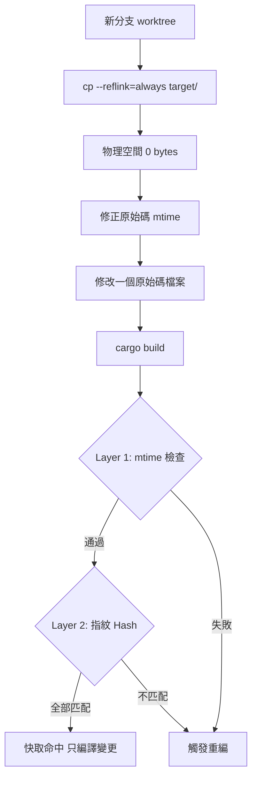

> 本文由 2025-12-22 的課程專題研究筆記於 2026-10-24 擴寫而成，實測數據均為該實驗環境（Arch Linux、Kernel 6.17、Btrfs `compress=zstd:3,noatime`、NVMe SSD PCIe 4.0）的單次實測值，不應視為通用結論。

每個寫 Rust 的人都遇過同一個噩夢：`cargo clean` 之後按下 Enter，然後眼睜睜看著 `target/` 目錄從零開始長回來。單態化讓 rustc 為每個泛型實例生成專屬程式碼，中型專案編譯十幾分鐘是家常便飯，而 `target/` 動輒吃掉數十 GB。

更麻煩的是多分支開發。兩種傳統策略都很痛：

- **單一工作目錄**：`git checkout` 會改寫檔案的 mtime，Cargo 的快取判定被弄髒，切一次分支就觸發大規模重編。
- **Git Worktree 多目錄**：每個分支一份原始碼、一份獨立的 `target/`，磁碟空間直接乘上分支數。

一開始的想法是仿效 Docker 的分層儲存：把 Btrfs subvolume 當 layer。但很快就發現顆粒度對不上——Docker layer 是不可變的檔案系統快照，Cargo 的 crate 卻是高度動態的編譯單元。要為每個 crate 開 subvolume，管理成本高到不切實際；只對整個 `target/` 做 snapshot，又無法精細重用中間產物。最後退回到最輕量的做法：`cp --reflink`。

## 原理總覽：Reflink、Hardlink、Tar 快取

在同一台機器上共享編譯產物，至少有三條路：

| 方法 | 原理 | 問題 |
| --- | --- | --- |
| **Hardlink** | 同一 inode 多個目錄項 | `cargo build` 會直接覆寫（truncate + write）既有檔案，hardlink 共享的資料被原地改掉，另一份 worktree 的快取立刻被污染 |
| **Tar 解開舊快取** | 打包 target/、在新分支解開 | 複製要讀寫全部資料，幾十 GB 的 target/ 要好幾分鐘，跟重編差不了多少 |
| **Btrfs Reflink (CoW)** | 只複製 extent 指標，寫入時才真正複製 | 需要同一個 Btrfs 檔案系統；且繞不過 Cargo 的指紋檢查（見後文） |

Reflink 的本質是 Linux 的 `FICLONE` ioctl（前身是 Btrfs 專屬的 `BTRFS_IOC_CLONE`，後被泛化成通用介面）：目的檔的 extent 直接指到來源檔的實體區塊，複製過程只改 metadata，時間複雜度 O(1)、初始額外空間趨近於零。寫入任一端時，檔案系統才把該區塊複製一份寫新位置——這就是 copy-on-write。另一個 `FIDEDUPERANGE` 則是「比對相同才共享」的去重語意，兩者常被一起討論但用途不同。

## 1. 實驗設計

實驗要回答兩個問題：**Reflink 到底能省多少空間？** 以及 **複製過去的快取，Cargo 認不認？**

架構很單純：

- **Seed（黃金映像）**：clone 一次專案，完整 `cargo build --release`，其 `target/` 作為快取源。
- **Control（對照組）**：另一份獨立 clone，代表傳統工作流。
- **Reflink 組**：`git worktree add` 開新分支目錄，`cp --reflink=always` 秒級複製 target/，再修 mtime、模擬修改、增量編譯。

測試對象選了兩個極端：`ripgrep`（純 Rust、約 13K 行，小專案）與 Zed Editor（Rust + C++ FFI、20 萬行以上、約 1620 個編譯單元，大專案）。

快取能否命中，關鍵在 Cargo 的雙層新鮮度檢查：



Layer 1 只看檔案時間戳，可以用 `touch` 或 `git-restore-mtime` 騙過；Layer 2 的指紋雜湊卻摻入了**工作目錄的絕對路徑**——這一層騙不了，也是整場實驗最大的變數。

## 2. 腳本

完整可重現的腳本如下（請在 Btrfs 檔案系統上執行）：

```bash
#!/usr/bin/env bash
set -euo pipefail

REPO="https://github.com/BurntSushi/ripgrep.git"
BASE="$HOME/cow-bench"
rm -rf "$BASE" && mkdir -p "$BASE/worktrees" "$BASE/control"

# 1) 黃金映像：完整建一次，作為 reflink 快取源
git clone --quiet "$REPO" "$BASE/seed"
cd "$BASE/seed" && cargo build --release

# 2) 對照組：傳統完整 clone + 獨立 target/
git clone --quiet "$REPO" "$BASE/control/ripgrep"

# 3) Reflink 組：新 worktree + 秒級複製 target/
#    --reflink=always 表示不支援時直接報錯，而非默默退化成完整複製
git -C "$BASE/seed" worktree add "$BASE/worktrees/bench" HEAD
cp -a --reflink=always "$BASE/seed/target" "$BASE/worktrees/bench/target"

# 4) Mtime 修正：讓原始碼比編譯產物「舊」，騙過 Cargo 的 Layer 1 檢查
find "$BASE/worktrees/bench" -name '*.rs' -exec touch -d '1 hour ago' {} +

# 5) 模擬一次真實修改後的增量編譯
touch "$BASE/worktrees/bench/src/main.rs"
cd "$BASE/worktrees/bench" && cargo build --release

# 6) 空間驗證：du 會把共享區塊重複計算，看物理佔用要用 compsize
compsize "$BASE/worktrees/bench/target"
du -sh --apparent-size "$BASE/seed/target"
du -sh "$BASE/seed/target"
```

兩個容易踩的細節：`cp --reflink=auto` 在不支援時會靜默退化成普通複製，實驗必須用 `=always` 讓它失敗得明明白白；另外驗證空間時不能只看 `du`——它會把 reflink 共享的區塊重複計入，Btrfs 上要看 `compsize` 的 Referenced 與 Disk Usage 差異。

## 3. 實測數據

以下皆為前述實驗環境的實測值。

**空間效率（ripgrep，模擬約 5 個並行分支）**：

| 測試組 | 邏輯大小 | 物理佔用 | 備註 |
| --- | --- | --- | --- |
| 單一 target/（基準） | 341 MB | 136 MB | zstd 壓縮後 |
| 多分支 Reflink | 1.6 GB | 372 MB | 約 4.3x 區塊級去重 |

5 份邏輯 1.6 GB 的 target/，物理只佔 372 MB，其中約 77% 區塊是 reflink 共享的；若用傳統方式複製 5 份要約 680 MB。更意外的是透明壓縮沒有被破壞——壓縮率維持在 45–46%，等於同時拿到 CoW 去重與 zstd 壓縮的雙重優惠。

**建置時間**：

| 情境 | 傳統 | Reflink | 結果 |
| --- | --- | --- | --- |
| ripgrep 冷啟動（完整重編） | 4.09 s | 2.80 s | 快 1.46x，成功跳過依賴編譯 |
| Zed 冷啟動 | 140.8 s | 146.1 s | 反而略慢，全量重編 |
| ripgrep 增量修改 | 0.67 s | 5.37 s | 慢 8 倍，固定開銷吃掉優勢 |

## 4. 結果分析：路徑污染之壁

小專案有效、大專案失效，原因是 Cargo 指紋機制裡的**絕對路徑**。Cargo 在新路徑下重建 unit graph 時，會把工作目錄（CWD）計入每個 unit 的指紋雜湊。Reflink 把 `target/` 從 `/src/main` 複製到 `/src/feature-x` 後，dep-info 記錄的路徑與實際路徑不符，底層依賴（`libc`、`syn` 這類基礎 crate）首先被標記為 `DirtyReason::FingerprintChanged`，接著上游所有 crate **連鎖失效**。

Zed 的數據把這件事曝露得一覽無遺：Reflink 後的「增量」編譯花了約 144 秒，與冷啟動的 146 秒幾乎相同——1620 個 unit 全部標記為 dirty，等於 100% 快取失效。Reflink 的複製本身只花 2.5 秒左右，但省下的依賴編譯時間完全被全量重編吞掉。相比之下，留在原路徑的原生增量編譯只要 4.85 秒（1620 個 unit 只有 1 個 dirty）。

所以結論是尖銳的：**reflink 解決的是空間問題，不是時間問題**。它省下 77% 的磁碟，卻換不回大型專案的編譯時間。

## 5. 局限與失敗情境

CoW reflink 不是無條件可用，實作時會撞上幾堵牆：

1. **跨檔案系統／跨裝置**：共享的是實體 extent，來源與目的必須在同一個 Btrfs 檔案系統上，否則 `cp --reflink=always` 直接回 `EXDEV` 錯誤。CI 上把快取丟到另一顆磁碟的玩法行不通。
2. **NOCOW**：掛了 `nodatacow`（或 `chattr +C`）的目錄與檔案無法參與 reflink——CoW 語意本身就是共享的前提。為了跑資料庫虛擬機映像關掉 CoW 的子目錄，快取複製會失效。
3. **壓縮**：來源與目的壓縮設定不一致時 clone 會失敗；而寫入共享的壓縮 extent 需要解壓縮、改寫、重新壓縮，寫入成本比未壓縮高。本實驗中壓縮與共享能並存（45–46% 壓縮率），但這是「同 mount option、同機」的前提下成立的實測結果。
4. **Mtime 黑魔法的極限**：`touch` 只能騙過 Layer 1 時間戳檢查；Layer 2 的絕對路徑雜湊無解。除非把每個 worktree 掛載到容器內相同的路徑（例如都叫 `/app`），否則跨目錄快取重用註定失敗。
5. **Swap 檔與特殊檔案**：swap file 無法共享儲存（`ETXTBSY`），少見但會讓批次腳本整批失敗。

## 6. 個人評價

回到一開始的痛點：清理後重建全重來、多分支空間爆炸。這場實驗給的答案一半是好消息——**在同一台機器上，Btrfs reflink 確實能把多分支的 target/ 成本壓到近於零**，這對筆電等磁碟吃緊的環境是真實的價值；另一半是壞消息——**編譯時間的加速只對小專案的冷啟動成立**，中型以上的專案會被路徑指紋整個打回原形。

與既有工具對照一下定位會更清楚：sccache 走「內容雜湊 → 快取命中」的路線，不依賴絕對路徑，但只支援整個 crate 級重用、不支援增量編譯，而且本地模式下 target/ 與快取雙份儲存反而更佔空間；cargo-chef 則是 Docker CI 世界裡的解法，靠拆分依賴層讓 layer cache 生效，與本機多分支是不同戰場。reflink 方案最終比較像是「空間維度的 sccache」——同機、同檔案系統、零傳輸，但被 Cargo 的指紋設計擋在時間維度之外。

真正治本的路，是把路徑從指紋與產物裡拿掉：短期可以在容器裡給每個 worktree 固定的 `/app` 路徑，徹底欺騙路徑檢查；中期配 mold 連結器壓低連結時間；長期則看 Rust 的 [RFC 3127 `--trim-paths`](https://rust-lang.github.io/rfcs/3127-trim-paths.html)——等編譯器層級移除絕對路徑後，reflink 方案才能擺脫容器化，真正變成「秒級準備環境 + 原生增量編譯」的組合。甚至可以想像一個 reflink-aware 的 sccache：本地後端直接用 `FICLONE` 存取共用產物，結合雜湊管理與區塊去重。這些都是後話，但至少這次實驗把可行與不可行的邊界量出來了。

順帶一提，這台實驗機後來也拿去跑本地大型語言模型推理——磁碟與記憶體吃緊的環境裡，檔案系統層級的去重與壓縮會越來越重要，這是另一個故事了，參見〈[在 Linux 上部署 EXL3 本地模型](/blog/exl3-glm-local-deploy/)〉。

## 參考資料

1. [`ioctl_ficlone(2)`](https://man7.org/linux/man-pages/man2/ioctl_ficlone.2.html) — Linux man-pages
2. [`ioctl_fideduperange(2)`](https://man7.org/linux/man-pages/man2/ioctl_fideduperange.2.html) — Linux man-pages
3. [Btrfs Documentation — Kernel.org](https://www.kernel.org/doc/html/latest/filesystems/btrfs.html)；[Btrfs Wiki](https://btrfs.wiki.kernel.org/index.php/Main_Page)
4. [GNU Coreutils: `cp` invocation](https://www.gnu.org/software/coreutils/manual/html_node/cp-invocation.html) — `--reflink` 語意
5. [Cargo Book: Build Cache](https://doc.rust-lang.org/cargo/reference/build-cache.html) — 指紋與重編判定
6. [sccache](https://github.com/mozilla/sccache)、[cargo-chef](https://github.com/LukeMathWalker/cargo-chef) — 既有建置快取工具
7. [mold: a modern linker](https://github.com/rui314/mold)
