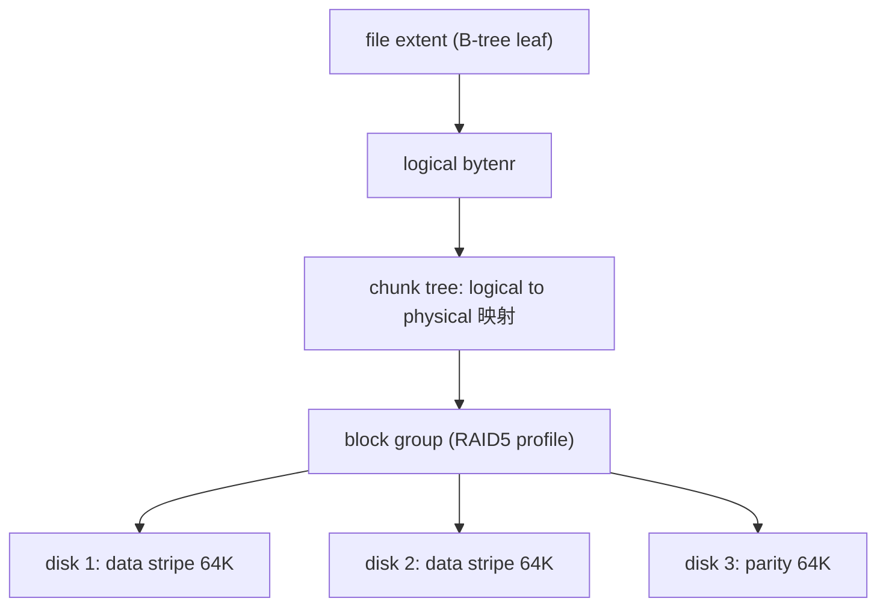
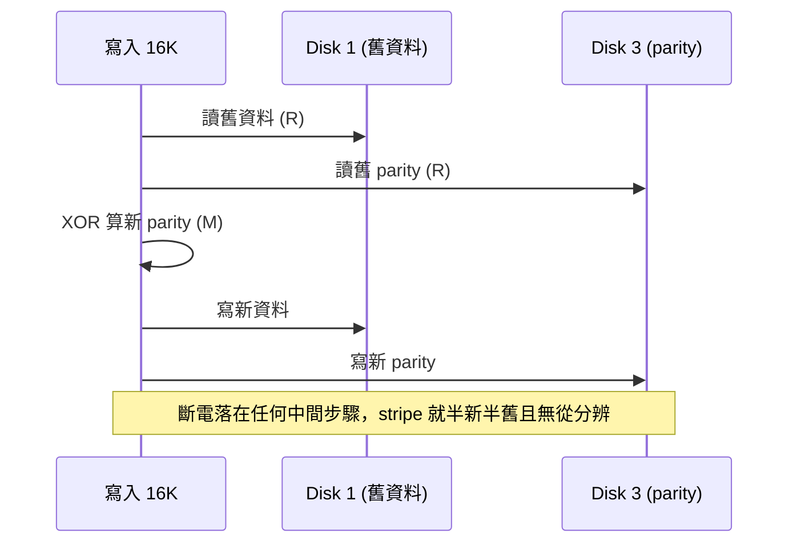

> 本文擴寫自 2025-04-02 的課程期末專題提案筆記（SSDI 期末專題「A Survey on Flaws of Btrfs with RAID 5/6」，去識別化後整理），擴寫於 2026-11-03，原稿為投影片式筆記。先老實聲明證據等級：原稿的計畫是「實際斷電重現 write hole」，但提案最後只走到文獻調查這一步，所以本文主要整理官方文件與郵件列表討論——每個失效場景都標得出處，卻沒有一個是我親手重現的。寫錯請留言糾正。

## Btrfs RAID5/6 的三個缺陷：write hole、metadata 與 replace 的坑

## 動機：大家都在用 btrfs，但沒人敢用它的 RAID5/6

Btrfs 已經是 openSUSE/SLE 和 Fedora 的預設根檔案系統，也進了 Synology 等 NAS 產品的檔案系統層。但它的 RAID5/6 模式長期掛著一個罕見的警告。Arch Wiki 的 [Btrfs 頁面](https://wiki.archlinux.org/title/Btrfs)直接寫道：

> The RAID5/6 write hole … Should not be used for anything but testing with throw-away data.

而上游官方文件 [btrfs(5) 的「RAID56 status and recommended practices」](https://btrfs.readthedocs.io/en/latest/btrfs-man5.html#man-btrfs5-raid56-status)說得更保守：

> There are some implementation and design deficiencies that make it unreliable for some corner cases and the feature **should not be used in production, only for evaluation or testing**. The power failure safety for metadata with RAID56 is not 100%.

有趣的反差是：btrfs 的維護主力（SUSE、Facebook/Meta）自己並不需要 parity RAID——[Qu Wenruo 的演講稿](https://github.com/adam900710/btrfs_talk/blob/master/raid56.md)提到 RAID56 是「a not-so-small chunk of feature completely truncated from SLE kernel」。所以這個缺陷一掛就是十五年。本文把三大缺陷逐一挖開：write hole、metadata 不該上 parity、以及 parity consistency／replace 的坑。

## 先立術語

談缺陷之前先把名詞釘死，避免後文概念漂移：

- **stripe**：parity RAID 中一次垂直切過所有裝置的資料單位。btrfs 的 `stripe_len` 固定 64K（md-raid5 預設則是 512K）。
- **RMW（read-modify-write）**：寫入不足一個完整 stripe 時，先讀出舊資料與舊 parity、算出新 parity、再寫回的循環。
- **write hole**：RMW 的多步寫入不是原子的，斷電會讓同一個 stripe 半新半舊，而且「哪半是新的」沒有任何記錄。這個詞是 ZFS 陣營（Jeff Bonwick）帶紅的，但問題本身屬於所有 parity RAID。
- **full-stripe write**：讓每次寫入永遠涵蓋整個 stripe，parity 直接由本次寫入的資料算出，不需要讀舊值——這是根治 RMW 的方向。

## Btrfs 怎麼找到資料：CoW B-tree 的三層定位

要理解缺陷出在哪一層，先快速過一次 btrfs 的位址轉譯。讀寫檔案時，路徑是這樣走的：

關鍵在於 btrfs 的 RAID 是**檔案系統自己做**的：以 block group 為單位選 profile（同一個檔案系統可以同時有 RAID1 的 metadata block group 和 RAID5 的 data block group），stripe 怎麼切、parity 放哪，都記在 chunk tree 的映射裡。這跟「md 鋪一層 RAID、上面蓋檔案系統」的架構完全不同。Qu Wenruo 在上述演講稿裡的描述是：

> Btrfs handles various RAID profiles in a block group by block group base. … by default btrfs go RAID1 for metadata and RAID0 for data for multi-device mkfs.

理論上這是優勢：btrfs 知道每個 extent 的 checksum、知道哪些資料還活著，本來最有機會做出比 md 更聰明的 parity RAID。但實際上三個缺陷都卡在這個架構裡。

## 缺陷一：write hole——從 day one 到今天

### 歷史脈絡

btrfs 的 RAID56 從提案那天起就揹著 write hole。2009 年 David Woodhouse 的第一版 patch 貼上郵件列表（[LWN 存檔](https://lwn.net/Articles/341026/)），Chris Mason 建議靠「永遠寫整個 stripe」避開 RMW：

> Chris suggests that we can avoid read/modify/write cycles for the parity blocks by ensuring that the file system always writes a full set of stripes.

但實作一直做不到「永遠 full-stripe」。2010 年 Woodhouse 更新 RAID56 支援時（[郵件列表](http://www.mail-archive.com/search?f=1&l=linux-btrfs%40vger.kernel.org&o=newest&q=subject%3A%22Updating%20RAID%5C%5B56%5C%5D%20support%22)）承認：

> At the moment, we limit writes to a single disk's worth at a time, which means we _always_ do the read-calculate-parity-write cycle and suffer the traditional RAID 'write hole' problem.

2013 年 RAID56 主線合併時，Chris Mason 在 [pull request 訊息](https://android.googlesource.com/kernel/common/+/b695188dd39162a1a6bff11fdbcc4c0b65b933ab)裡說「I'm still working on the parity logging setup that will avoid inconsistent parity after a crash」——parity logging 後來沒有下文。2017 年 Liu Bo 貼了 [「Btrfs: Add journal for raid5/6 writes」的 14 patch RFC](http://www.mail-archive.com/linux-btrfs@vger.kernel.org/msg76192.html)，Mason 回覆同意方向（「it's better to put the logging into a dedicated chunk type」），但該系列最終沒進主線。2024 年底郵件列表上還在討論同一個問題；2026 年 9 月 Qu Wenruo 的 [RAID56_VSL patchset](https://lwn.net/Articles/1092489/) 也仍是實驗性、藏在 `experimental` 後面。

### 現況原話

[官方文件](https://btrfs.readthedocs.io/en/latest/btrfs-man5.html#man-btrfs5-raid56-status)對 write hole 的描述非常直白：

> The _write hole_ problem. An unclean shutdown could leave a partially written stripe in a state where the some stripe ranges and the parity are from the old writes and some are new. The information which is which is not tracked. Write journal is not implemented. Alternatively a full read-modify-write would make sure that a full stripe is always written, avoiding the write hole completely, but performance in that case turned out to be too bad for use.

### 為什麼 CoW 檔案系統做 RMW 特別刺眼

Zygo Blaxell 在 2016 年的[討論](http://www.mail-archive.com/linux-btrfs@vger.kernel.org/msg58249.html)裡點出一個更根本的架構矛盾：

> btrfs doesn't avoid writing new data in the same RAID stripe as old data (it provides a rmw function for raid56, which is simply a bug in a CoW filesystem)

CoW 的本意是「新資料寫新地方、永不覆蓋舊資料」，而 RMW 恰恰是「在舊資料原地覆寫」——等於主動放棄了 CoW 的原子性保證。斷電時序用圖看最清楚：

### 實際傷害有多大？

write hole 需要「斷電」加「隨後一顆碟掛掉」兩個事件疊加、中間沒有 scrub，才會真的吃掉資料。[unixdigest.com 的實測文](https://unixdigest.com/articles/battle-testing-zfs-btrfs-and-mdadm-dm.html#btrfs-the-write-hole-issue)（2019，多次斷電測試）作者表示在他的測試裡重現不出來，但 2020 年的更新寫道：

> **Update 2020-01-23:** People have been emailing me with examples of the write hole problem persisting, where they have lost data, even in the Btrfs version of the 5.x kernel.

Zygo Blaxell 2020 年整理的[「Current bugs with operational impact on btrfs raid5」](https://lore.kernel.org/linux-btrfs/20200627030614.GW10769@hungrycats.org/t/)對 write hole 的評價更狠：

> Impact: negligible. It occurs orders of magnitude less often and destroys orders of magnitude less data each time it occurs compared to the above bugs. … **Don't worry about write hole yet. The other bugs will ruin your day first.**

## 缺陷二：metadata 為什麼也不該上 parity

官方文件的建議是[一句話](https://btrfs.readthedocs.io/en/latest/btrfs-man5.html#man-btrfs5-raid56-status)：

> Do not use _raid5_ nor _raid6_ for metadata. Use _raid1_ or _raid1c3_ respectively.

原因有三層。第一，文件明說「The power failure safety for metadata with RAID56 is not 100%」——write hole 同樣作用於 metadata stripe，而 metadata 損傷比 data 損傷嚴重得多：一個 B-tree 節點壞了，整棵樹下面的東西都摸不到。

第二，mirror 與 parity 的更新模型不同。mirror 的兩份副本可以分開更新，斷電後總有一份是完整的舊版本；parity stripe 的成員卻必須同步一致。2016 年的[郵件列表討論](http://www.mail-archive.com/linux-btrfs@vger.kernel.org/msg58249.html)裡就有人設想過「讓兩份 metadata 副本各自更新、至少一份躲過 write hole」的玩法，並強調這種設定未經測試——但這正說明了 mirror 的容錯模型與 parity 根本不同。

第三，空間與維運上 mirror 也不吃虧：文件算了筆帳，N 顆碟上 RAID5 metadata 每顆要保留 1GiB chunk，而 RAID1 只需兩顆碟各 1GiB；且 balance/轉換 profile 時 RAID1 的 chunk 空間要求更寬鬆。`raid1c3`／`raid1c4` 提供與 RAID5/6 相同的「壞一顆／兩顆」容忍度。

## 缺陷三：parity consistency 缺乏與 btrfs replace 的坑

parity 本身沒有 checksum（btrfs 只對 data 和 metadata 算 checksum），所以「parity 對不對」只能靠 scrub 重算比對——[討論](https://www.spinics.net/lists/linux-btrfs/msg81026.html)裡的描述是「Scrub can repair parity damage on normal data and metadata—it recomputes parity from data if the data passes a CRC check」。換句話說，parity 的一致性是事後補救出來的，不是寫入時保證的。

更疼的是 `btrfs replace` 的實際表現。Zygo 2020 年那份 bug 清單裡有兩條直接命中：

> Name: btrfs-replace-lockup … Summary: 'btrfs replace' sometimes hangs just before it is finished. Impact: reboot required to complete device replace.
>
> Name: btrfs-replace-wrong-state-after-exit … 'btrfs replace' replace state is not fully cleared. … later resize and balance operations fail with "resize/replace/balance in progress" until the kernel is rebooted.

他在[另一篇](https://www.spinics.net/lists/linux-btrfs/msg102645.html)「How to use btrfs raid5 successfully(ish)」裡給的使用守則更直白：換碟過程要「be prepared to reboot multiple times during disk replacement」，而且：

> Any read errors after btrfs replace is done (and maybe after an extra reboot to be sure replace is really done) are real data loss. Sorry.

原稿裡那句「After an extra reboot may cause real loss」正是出自這裡。也就是說：raid5 的日常維運不是「壞了就換」，而是「壞了、replace、卡住、重開機、再 replace、再重開機、scrub、然後祈禱多出來的 read error 不是真資料損失」。

## ZFS 怎麼解：換掉問題本身

ZFS 對這套問題的解法不是「修好 RMW」，而是從 on-disk format 上讓 RMW 不存在。

**動態 stripe width。**傳統 RAID 的 stripe 寬度固定，寫入不足就得 RMW。[OpenZFS 文件](https://openzfs.github.io/openzfs-docs/Basic%20Concepts/Pool%20Structure/RAIDZ.html)寫明：

> RAIDZ is a variation on RAID-5 that allows for better distribution of parity and eliminates the RAID-5 "write hole" (in which data and parity become inconsistent after a power loss).

[raidz 的 stripe 寬度是動態的](https://openzfs.github.io/openzfs-docs/man/master/7/zpoolconcepts.7.html)——每個 block 按實際大小決定由幾個 data sector 加幾個 parity sector 組成，資料與 parity 在同一個 transaction 內一起刷下去。寫入永遠是 full-stripe write，沒有「讀舊值」這一步，write hole 自然消失。代價是讀取時要靠 block pointer 裡的幾何資訊還原 stripe 佈局——這正是「檔案系統與 RAID 必須一體」的論證：btrfs 也一體，只是沒走到這一步。

**ZIL（intent log）。**同步寫入先進 [ZFS Intent Log](https://openzfs.github.io/openzfs-docs/man/master/7/zpoolconcepts.7.html)再落地，滿足 `fsync` 語意的同時，也把「交易進行中」的狀態記錄下來，重開機後可重播。btrfs 的 write journal RFC 想補的正是這塊。

**冗餘的補強。**ZFS 還會在 stripe 過長時把部分資料鏡像（gang block），避免「壞碟數超出 parity 能重建範圍」的角落情況。

## 2024–2026 現況：官方文件沒有鬆口

回到 2024 年 12 月的[郵件列表討論](https://lore.kernel.org/all/8d4d83e.80527959.193ea7e5d3e@tnonline.net/T/)「Using btrfs raid5/6」：有人問正確用法，Qu Wenruo 回覆的清單第一條是「0) Use kernel newer than 6.5 at least.」（scrub 與 raid56 修復有明顯改進），後面接著社群流傳多年的守則：不要用 raid5/6 放 metadata、一顆一顆跑 scrub、別期待 degraded 模式堪用。

同一條 thread 裡，Forza 提出了 [RAID-PN 提案](https://lore.kernel.org/linux-btrfs/e2ca9ceb-4ead-4739-af8b-f37b1a902170@libero.it/)——extent-based parity、拋棄固定 stripe、parity 有 checksum、資料與 parity 同 transaction 寫入，等於在 btrfs 架構裡重做一次 raidz 的思路。討論熱烈，但截至本文撰寫（2026-11）仍只是提案。Qu 的 [RAID56_VSL patchset](https://lwn.net/Articles/1092489/)（2026-09）則走了另一條路：用固定 datasize 保證寫入對齊 full stripe，同樣標著 experimental。而 [btrfs(5) 文件](https://btrfs.readthedocs.io/en/latest/btrfs-man5.html#man-btrfs5-raid56-status)「should not be used in production」那句話至今沒改。

## Workaround 與結語

如果非要在 btrfs 上開 RAID5/6，把各方守則彙整成一份清單（全部有出處，見上文）：

- metadata 一律用 `raid1`（兩碟容錯用 `raid1c3`/`raid1c4`），不要 parity metadata；
- kernel 越新越好（至少 6.5+）；
- 壞碟用 `btrfs replace` 而不是 `device remove`，replace 完接一次 scrub；replace 卡住要重開機是已知行為；
- scrub 一次只跑一顆碟；
- degraded 模式下有 spurious read error 的已知 bug，別把應用掛在上面；
- 最重要：先做好備份——這些守則只能降低風險，不能提供保證。

而這份提案當時的研究結論，其實可以濃縮成一句話：**要 parity，就選 ZFS raidz；要 btrfs 的功能（快照、send/receive、壓縮），就用 mirror。兩者都要，目前沒有免費的午餐。**原稿提議的後續工作——實際斷電重現 write hole、對比 ZFS/btrfs/mdadm 的容錯測試——[unixdigest.com 那篇 battle testing](https://unixdigest.com/articles/battle-testing-zfs-btrfs-and-mdadm-dm.html)已經做了非常紮實的一輪；至於 btrfs 這邊的根治，就等 RAID-PN 或 RAID56_VSL 哪個先落地了。

## References

- [btrfs(5) — RAID56 status and recommended practices](https://btrfs.readthedocs.io/en/latest/btrfs-man5.html#man-btrfs-raid56-status)（官方現況與 metadata 建議）
- [Woodhouse, "A start at RAID[56] support", 2009](https://lwn.net/Articles/341026/)（首次提案與 full-stripe write 想法）
- [Woodhouse, "Updating RAID[56] support", 2010](http://www.mail-archive.com/search?f=1&l=linux-btrfs%40vger.kernel.org&o=newest&q=subject%3A%22Updating%20RAID%5C%5B56%5C%5D%20support%22)
- [Chris Mason pull request 訊息中的 parity logging 說明, 2013](https://android.googlesource.com/kernel/common/+/b695188dd39162a1a6bff11fdbcc4c0b65b933ab)
- [Liu Bo, "[PATCH 00/14 RFC] Btrfs: Add journal for raid5/6 writes", 2017](http://www.mail-archive.com/linux-btrfs@vger.kernel.org/msg76192.html)（含 Mason 回覆）
- [Zygo Blaxell 於 linux-btrfs 的 write hole 分析, 2016](http://www.mail-archive.com/linux-btrfs@vger.kernel.org/msg58249.html)
- [Zygo Blaxell, "Current bugs with operational impact on btrfs raid5", 2020](https://lore.kernel.org/linux-btrfs/20200627030614.GW10769@hungrycats.org/t/)
- [Zygo Blaxell, "How to use btrfs raid5 successfully(ish)", 2020](https://www.spinics.net/lists/linux-btrfs/msg102645.html)
- [unixdigest.com, "Battle testing ZFS, Btrfs and mdadm+dm-integrity", 2019](https://unixdigest.com/articles/battle-testing-zfs-btrfs-and-mdadm-dm.html)
- ["Using btrfs raid5/6" 討論串, 2024-12](https://lore.kernel.org/all/8d4d83e.80527959.193ea7e5d3e@tnonline.net/T/)（含 RAID-PN 提案）
- [Qu Wenruo, "New challenges for old tricks - RAID56 in BTRFS" 演講稿](https://github.com/adam900710/btrfs_talk/blob/master/raid56.md)
- [LWN, "btrfs: introduce a new experimental feature, RAID56_VSL", 2026-09](https://lwn.net/Articles/1092489/)
- [OpenZFS docs — RAIDZ](https://openzfs.github.io/openzfs-docs/Basic%20Concepts/Pool%20Structure/RAIDZ.html)、[zpoolconcepts(7)](https://openzfs.github.io/openzfs-docs/man/master/7/zpoolconcepts.7.html)（write hole 消除與 ZIL）
- [pthree.org, "ZFS Administration, Part II- RAIDZ", 2012](https://web.archive.org/web/20181220230710/https:/pthree.org/2012/12/05/zfs-administration-part-ii-raidz)（「RAID-5 write hole」一詞與 raidz 幾何細節）
- [farseerfc.me — Btrfs vs ZFS: difference in implementing snapshots](https://farseerfc.me/btrfs-vs-zfs-difference-in-implementing-snapshots.html)（CoW 實現差異的深度對照）
- [Arch Wiki — Btrfs](https://wiki.archlinux.org/title/Btrfs)
