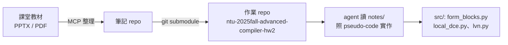

> 擴寫自 2025-09-20 的 Facebook 貼文（原稿只有兩行字加一張截圖），擴寫於 2026-11-11。

高等編譯器的作業是讀論文、讀講義，然後把 pseudo-code 變成真的程式。第一週的 HW2 要做 Bril 的 local optimization：切 basic block、dead code elimination、local value numbering。教材是 Cornell CS6120 的 lesson 頁和一份幾十頁的 LVN 講義。我以前直接把作業丟給 coding agent，它寫出來的東西能動，但細節全是它自己編的——DCE 的 killed condition 跟講義寫的不一樣，LVN 對 copy instruction 的處理也自成一格。錯不會錯得很明顯，就是跟標準答案的行為對不起來，查起來很花時間。

問題很單純：agent 沒有讀到那份教材。它有 web search，但課堂投影片是 PDF，不一定抓得到內容，而且每次作業都重新爬一次太浪費。我後來想到，我已經有一套用 MCP 從課堂資料整理出來的筆記 repo，不如直接把它掛進作業 repo，讓 agent 開工前先讀。

## 兩個 repo 的架構

我先有一個筆記 repo，內容是把上課的投影片和 PDF 交給 MCP 工具抽出來、逐堂整理成的 markdown。然後是作業 repo，裡面是 Bril 的實作程式碼。做法是把筆記 repo 以 git submodule 的方式掛在作業 repo 的 `notes/` 底下：



掛進去之後的作業 repo 長這樣（這是當時截圖的檔案樹）：


`docs/course-materials/` 放原始的講義檔（`Local optimizations, DCE, and LVN framework.pptx`、`Local Value Numbering & SSA.pptx`、`WhyCompiler.pdf`），`notes/` 是 submodule，裡面是逐堂整理過的 markdown：從 `00-why-study-compiler.md` 到 `04-data-flow-analysis-and-global-optimization.md`，一堂一個檔案。`AGENTS.md` 在 repo 根目錄，`src/` 是 `form_blocks.py`、`local_dce.py`、`lvn.py`、`util.py`，`tests/` 有 `testcase_*.bril` 和 `threshold_*.txt`。

## 把筆記掛成 submodule

在作業 repo 的根目錄跑：

```sh
git submodule add <筆記 repo 的 URL> notes
git commit -m "Add course notes as submodule"
```

這會留下兩個東西：一個 `notes/` 目錄（裡面是另一個 git repo）和一根 `.gitmodules`：

```ini
[submodule "notes"]
	path = notes
	url = git@github.com:G36maid/advanced-compiler-notes.git
```

重點是 submodule 的狀態存在兩個地方：`.gitmodules` 記 URL，主 repo 會把「筆記 repo 目前鎖在哪個 commit」記成一筆 gitlink entry，`git status` 裡就是那行 `new commits`。所以更新筆記的流程是兩段式：先在筆記 repo 裡 commit 新筆記、push 上去，回到作業 repo 做 `git submodule update --remote notes` 把指標拉到最新，再 commit 一次指標的位移。忘記第二段的話，隊友 clone 到的永遠是舊版。

clone 的時候要加 `--recurse-submodules`，不然 `notes/` 只是一個空目錄：

```sh
git clone --recurse-submodules <作業 repo 的 URL>
```

忘記加也還有救：clone 進去補 `git submodule update --init` 就好。上面這些操作的細節都在 [git submodule 官方文件](https://git-scm.com/book/en/v2/Git-Tools-Submodules)。

為什麼用 submodule 而不是把筆記檔複製進來？我的筆記 repo 是跨課程共用的，同一份編譯器筆記別的作業、甚至別門課都要讀；複製一份進作業 repo 之後兩邊就分家了，筆記改了作業那份不會跟著動。submodule 讓筆記保持單一來源，作業 repo 只記「我引用了哪一版」，也順便讓作業 repo 的 diff 保持乾淨——不會一堆課堂筆記混在程式碼的 commit 裡。

## 在 AGENTS.md 裡指路

repo 有了筆記，還要讓 agent 知道要先讀。我的 `AGENTS.md` 開頭就寫清楚閱讀順序：

```markdown
# Agent Guide

Before writing any code:

1. Read `notes/01-local-optimizations-dce-lvn-framework.md` for the DCE
   algorithm (globally unused + locally killed, iterate to convergence).
2. Read `notes/02-local-value-numbering-ssa.md` for the LVN pseudo-code.
   Implement LVN following that pseudo-code, including the copy
   instruction handling.
3. Do not invent algorithms. If the notes do not cover a case, say so
   instead of guessing.
```

第三點是我踩過雷之後加的。agent 很會「補完」它沒讀到的部分，寫得煞有介事，實際上是幻覺；明講「筆記沒有就說沒有」能壓住大部分的瞎編。

實際效果看 HW2 最有感的部分：`drop_killed_local`（DCE 處理 locally killed instructions 的那半）的截圖裡，agent 的解釋直接引用筆記裡的 pseudo-code，原文是 "This logic comes directly from this pseudo-code in your notes"。它的三步驟——掃 block 內每個 instruction 的 dest、往後看這個變數會不會在被讀走之前就被覆寫、是就把前一個 instruction 標記刪除——跟講義的演算法是同一套，不是我事後逐行核對發現的，是它自己引用來的。這跟以前它自己編一套 killed condition 差很多。模型是 Claude Sonnet 4，context 只吃掉 26k/128k，整個筆記 repo 掛進來也不會把 context 撐爆。

```python
# src/form_blocks.py 的開頭，TERMINATORS 決定 basic block 在哪裡切斷
TERMINATORS = {'br', 'jmp', 'ret'}

def form_blocks(instrs):
    cur = []
    for instr in instrs:
        cur.append(instr)
        if 'op' in instr and instr['op'] in TERMINATORS:
            yield cur
            cur = []
    if cur:
        yield cur
```

basic block 的切法本身很機械：遇到 `br`、`jmp`、`ret` 這些 terminator 就收尾開新 block。真正需要教材的是 LVN——canonicalization 的順序、copy propagation 要不要做、怎麼跟 DCE 接——這些講義裡的取捨，agent 沒讀就是憑感覺選。

## submodule 的麻煩

- **clone 忘了 `--recurse-submodules`**：我自己就忘了兩三次，`notes/` 空目錄在 Zed 裡點開什麼都沒有，agent 也讀不到。後來把 `git config submodule.recurse true` 設進 repo 的設定，pull 的時候會自動帶 submodule，只有 clone 這一步救不了。
- **agent 沒權限動 submodule 指標**：筆記 repo 和作業 repo 是分開的 remote，agent 改筆記之後要回主 repo commit 指標，它有時候只做完一半就停了，留下 `new commits` 沒收尾。這一步我到現在還是習慣自己確認。
- **指標鎖死是特性也是坑**：submodule 鎖在某個 commit，好處是作業交出去的版本可重現；壞處是筆記修了 typo，所有掛它的 repo 都不會自動跟上，要一個一個去 update。只有一兩個 repo 時沒感覺，掛多了就是負擔。

## 評價

把教材變成 agent 看得懂的格式（markdown）、放在 agent 一定會經過的路徑上（submodule 進作業 repo），再用 `AGENTS.md` 指名要先讀——這三件事做完，agent 從「憑印象寫編譯器」變成「照 pseudo-code 寫編譯器」，HW2 的實作品質差別很實在。成本是 git submodule 的操作摩擦：多一個 repo 要管理、clone 多一個 flag、指標要兩段式更新。

如果只是單一課程、筆記也不會再被別的 repo 引用，直接把 markdown 複製進作業 repo 會更省事，submodule 的版本鎖定在那個場景裡沒有太多附加價值。我會繼續用 submodule，是因為筆記 repo 的服務對象不止這個作業。另外，如果偏好 repo 裡完全不放教材，把筆記轉成 skill 或 MCP tool 讓 agent 依需查詢也是一條路，代價是要多維護一層工具。

後來把這套閱讀教材再寫實作的做法繼續用在 data-flow analysis 和 global optimization 的作業上，筆記也一路累到 `04-data-flow-analysis-and-global-optimization.md`。期中考的 SSA 部分也是靠同一批筆記複習的。

延伸閱讀：

- [CS 6120 Lesson 3: Local Analysis & Optimization](https://www.cs.cornell.edu/courses/cs6120/2022sp/lesson/3) — DCE 和 LVN 作業的原始出處，任務描述就在這頁。
- [Bril](https://github.com/sampsyo/bril) — CS6120 的教學 IR（[作者介紹文章](https://www.cs.cornell.edu/~asampson/blog/bril.html)），台灣的高等編譯器課程常拿它的作業形式來用。
- [sampsyo/cs6120](https://github.com/sampsyo/cs6120) — 課程 repo，Bril 工具鏈和基準測試都在裡面。
- [Git 官方文件的 Submodules 章](https://git-scm.com/book/en/v2/Git-Tools-Submodules) — `git submodule add`、`.gitmodules`、`--recurse-submodules` 的完整說明。
