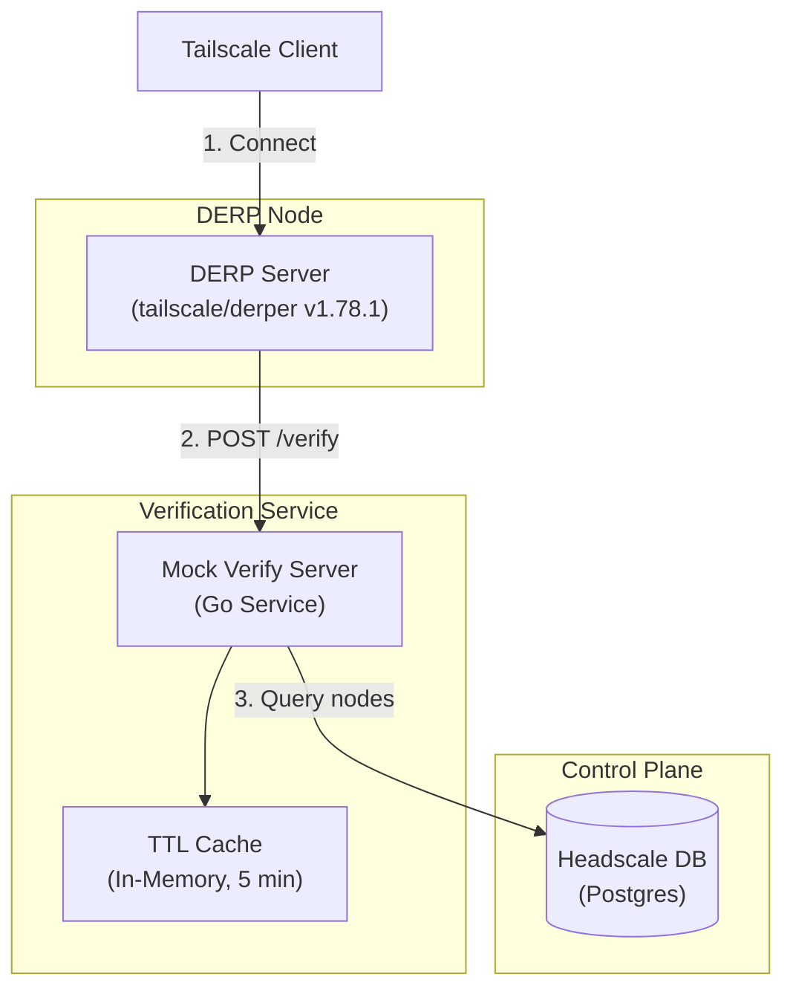
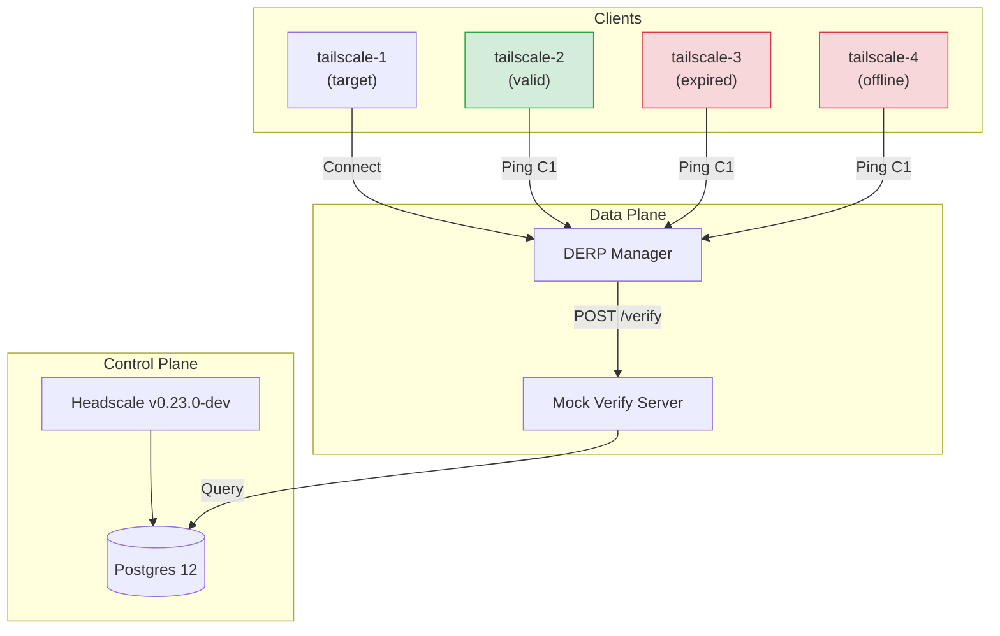

> 本文由 2026-11-02 擴寫，合併自 Moxa 實習期間（2025-12-04）的兩篇草稿——DERP 驗證系統實作筆記與整合測試報告，已去識別化內部細節。derper 行為以 v1.78.1 原始碼逐項查證，原稿與源碼不符處已如實修正。

自架 DERP relay 最尷尬的一件事：`derper` 預設是個公共中繼站。你架它是為了讓自家 tailnet 在直連失敗時有路可走，但只要網址被摸到，任何 Tailscale client 都能把它當免費跳板——relay 流量全算你的帳。Tailscale 自己的 DERP 靠 tailscaled 驗身，自架的獨立節點要擋人，得靠 `--verify-client-url` 這個 admission controller 掛勾自己接。這篇記錄我們怎麼把它接到 Headscale 的資料庫上，外加一輪 Docker Compose 整合測試。

## 架構總覽

整條驗證路徑三段：derper 收到連線 → POST 給 verify server → verify server 查 Headscale 資料庫。



## 一、derper 的驗證掛勾

我們用的 `tailscale.com/cmd/derper` 是 v1.78.1。相關旗標有兩個：`--verify-client-url` 指向驗證服務（`http://mock-verify-server:8080/verify`），`--verify-client-url-fail-open` 決定驗證服務掛掉時要不要放行。

**原稿修正**：兩份原稿都寫 fail-open「預設 false（fail closed）」，錯了。上游原始碼的預設是 `true`（fail open）——驗證服務連不上時**放行**。這對安全導向的部署是反的，所以我們在啟動腳本明確傳 `false`。

每次 client 連線，derper 會 POST 一個 JSON 過來，五秒內要回應：

```json
{
  "NodePublic": "nodekey:0123...ab",
  "Source": "203.0.113.7"
}
```

`NodePublic` 是 client 的 node key（`key.NodePublic` 的文字形式 `nodekey:<hex>`），`Source` 是來源 IP，兩個欄位都定義在 `tailcfg.DERPAdmitClientRequest`。回應只要一個欄位：`{"Allow": true}`——回非 200 或 `Allow: false`，連線就擋下。

## 二、Mock Verify Server 的驗證邏輯

verify server 是一顆自製 Go 服務，跳過 Headscale API 直接讀它的 Postgres。一個 node 放行的條件是全部成立：node key 存在於 `nodes` 表、`deleted_at` 是 `NULL`（沒被軟刪除）、`expiry` 是 `NULL` 或零值 `0001-01-01`（永久 key）或在未來。核心判斷就一段：

```go
// 零時間視為永久有效
if expiry.Valid && !expiry.Time.IsZero() && expiry.Time.Before(time.Now()) {
    return VerifyResponse{Allow: false} // 已過期
}
```

`is_online` 的檢查是後來才補的：第一版實作時這段還被註解掉（只查存在性＋刪除＋過期），整合測試輪把它打開——`is_online` 為 `false` 直接拒絕。這欄位反映的是節點與 control plane 的連線狀態，拿來擋 relay 存取是比 `expiry` 更強的政策，代價是後述的時效問題。

## 三、Headscale 資料庫對接

查的是 `nodes` 表，關鍵欄位：`node_key`（查找用）、`machine_key`、`expiry`、`deleted_at`、`last_seen`。

**原稿修正**：原稿把 `is_online` 列成 Headscale `nodes` 表的既有欄位——上游沒有這欄。翻過 `hscontrol/db/schema.sql` 全文，上游的線上狀態是從 `last_seen` 推算、存在記憶體裡的（連 `last_seen` 都只在斷線時才寫回 DB）。`is_online` 是我們內部修改版加上去的欄位，測試時才能直接 `UPDATE nodes SET is_online = false`。這點在對接官方版 Headscale 時要注意，官方對應機制是 derper 直連本機 tailscaled 的 `--verify-clients`，或新版 Headscale 內建自己的 `/verify` handler。

## 四、TTL cache

驗證是每條連線都查一次 DB，client 斷線重連又很頻繁，於是加了記憶體內 TTL cache：map＋mutex 鎖，key 是 node key，value 是驗證結果（Allow/Deny）加時間戳，TTL 預設五分鐘。命中就秒回，過期才回源查 DB，查完回填。理由有三：重複連線的驗證延遲歸零；防止大量 client 同時重連的 thundering herd 打爆資料庫；node key 這類靜態屬性本來就適合快取。

代價也要講白：**deny 結果一樣被快取五分鐘**。剛被 key expiry 撤銷的節點，在快取過期前還能繼續用 relay；`is_online` 變化同理。對內部 VPN 這是可以接受的收斂時間，但別指望它即時。

## 五、部署接線

兩個容器各吃一組環境變數：

| 變數 | 用途 |
| :--- | :--- |
| `DERP_VERIFY_CLIENT_URL` | 驗證端點 URL（derp-manager 傳給 derper） |
| `DERP_VERIFY_CLIENT_URL_FAIL_OPEN` | 驗證失敗時是否放行，設 `false` |
| `POSTGRES_HOST` / `POSTGRES_PORT` / `POSTGRES_USER` / `POSTGRES_PASSWORD` / `POSTGRES_DB` | verify server 連 DB 用 |

啟動流程：derp-manager 容器跑 `startup.sh`，偵測到 `DERP_VERIFY_CLIENT_URL` 就把它組進 derper 的命令列參數，derper 起來後每條連線都過 verify server。

## 六、整合測試

Docker Compose 起一套完整拓撲：Headscale（v0.23.0-dev）＋Postgres 12＋DERP Manager＋Mock Verify Server，外加四台 `tailscale/tailscale` 當節點。



測法是直接改資料庫製造非法狀態，再從各台對 `tailscale-1` 跑 `tailscale ping`（走 DERP relay）：

```sql
-- 讓 tailscale-3 的 key 過期
UPDATE nodes SET expiry = NOW() - INTERVAL '1 hour' WHERE given_name = 'tailscale-3';

-- 把 tailscale-4 標成離線
UPDATE nodes SET is_online = false WHERE given_name = 'tailscale-4';
```

結果三個案例全數符合預期：

| Client | 狀態 | 預期 | Ping 結果 | Verify log | 判定 |
| :--- | :--- | :--- | :--- | :--- | :--- |
| tailscale-2 | valid | Allow | `pong from tailscale-1 ... via DERP in 1ms` | `Verified node ...: Allowed` | PASS |
| tailscale-3 | expired | Deny | `ping "100.64.0.2" timed out` | `Node ... is expired` | PASS |
| tailscale-4 | offline | Deny | `ping "100.64.0.2" timed out` | `Node ... is offline` | PASS |

## 踩雷與限制

- **fail-open 預設值**：如前述，上游預設 fail open，忘記顯式設 `false` 等於驗證服務掛掉時大門全開。
- **快取時效**：五分鐘 TTL 意味著撤銷與離線狀態最多延遲五分鐘才生效；要更即時得縮 TTL 或加失效通知。
- **`is_online` 是自製欄位**：對接官方 Headscale 要改走 `last_seen` 推算或 derper 的 `--verify-clients`（tailscaled 本機驗身），不能照抄這套 SQL。
- **驗證只擋新連線**：已建立的 relay 連線不會被回頭驗證，撤銷後既有 session 得靠 TTL 到期自然斷。

## 個人評價

整套東西最划算的部分是 derper 把驗證設計成 HTTP admission controller——不用 fork derper、不用懂 relay 協議，一顆幾百行的 Go 服務加 SQL 就能掛上自己的授權邏輯。缺點是這條路徑上什麼都要自己顧：fail-open 預設要自己關、快取一致性要自己權衡、DB 直接耦合讓 verify server 綁死在內部版 Headscale 上。如果重來一次，可能會考慮 verify server 走 Headscale API 而非直連 DB，多一層 API 延遲，換掉 schema 耦合。本站 mermaid 圖是用 mmdr（無 Chromium 的 mermaid renderer）渲染的，見[〈mmdr：不用 Chromium 渲染 mermaid〉](/blog/mmdr-mermaid-without-chromium/)。
