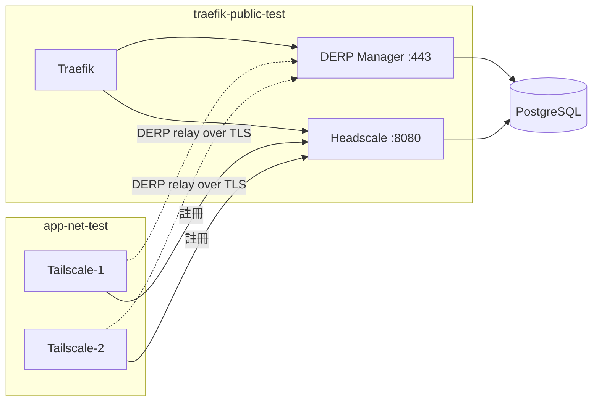

> 本文擴寫於 2026-11-02，原稿為 Moxa 實習期間（2025-11-20）的 DERP Manager 整合測試週報，已去識別化內部細節、改寫為第一人稱踩雷實錄。

自架 Tailscale DERP 中繼，最麻煩的從來不是把 server 架起來，而是「測試它」。DERP 協議有個很硬的規矩：只要綁在 443 port 上，就一定要講 TLS。而整合測試環境偏偏最缺的就是憑證——沒有公開網域、沒有 Let's Encrypt 能打到的 80 port，autocert 直接躺平。這篇記錄我怎麼用 Docker Compose 拼出一套能跑的 DERP 整合測試環境，以及繞不開的那道 443 TLS 牆。

## 測試拓撲總覽

最後成型的環境是六個容器、兩條 Docker network：



DERP Manager 同時開兩個 port：443 跑 DERP relay（HTTPS）、8080 跑管理 API（HTTP，含 `/derpmap`）。Headscale 會來抓 DERP map 發給 client；兩台 Tailscale client 用 preauth key 註冊後，靠 `TS_DEBUG_ALWAYS_USE_DERP=true` 強制所有流量走 relay，這樣才能確定測到的是 DERP 而不是碰巧打洞成功的直連。

## 1. Compose 環境：啟動順序就是依賴順序

`docker-compose.integration-test.yml` 的重點不是服務本身，而是 `depends_on` 加 healthcheck 串出來的啟動鏈：postgres `pg_isready` 健康 → DERP Manager 起來並通過 `curl /derpmap` 健康檢查 → Headscale 起來並向 DERP Manager 抓 map → 兩台 client 才起來註冊。順序錯了，client 會拿到空的 DERP map，之後怎麼 ping 都不通，而且錯誤完全不會指向真正的原因。

## 2. 產生憑證並發布 CA

我用 mkcert 生本地 CA，再簽一張涵蓋測試 hostname 的伺服器憑證：

```bash
cd integration-tests/certs/
mkcert -install  # 產生本地 root CA
mkcert \
  -cert-file derp-manager.pem \
  -key-file derp-manager-key.pem \
  "derp-manager.10.123.34.117.traefik.me" \
  "*.10.123.34.117.traefik.me" \
  "localhost" "127.0.0.1"
cp "$(mkcert -CAROOT)/rootCA.pem" ./rootCA.pem
```

關鍵在「發布」：DERP Manager 掛載整個 certs 目錄，兩台 client 各掛一份 `rootCA.pem` 進 `/usr/local/share/ca-certificates/`，啟動時先跑 `update-ca-certificates`。憑證簽得再漂亮，client 不信任 CA 一樣是白工——這是我第一次測試失敗的原因。

## 3. Client 加入

```yaml
tailscale-1:
  volumes:
    - ./integration-tests/certs/rootCA.pem:/usr/local/share/ca-certificates/mkcert-rootCA.crt:ro
  command: >
    sh -c "
      update-ca-certificates;
      tailscaled &
      tailscale up --login-server=http://headscale:8080;
      tail -f /dev/null
    "
```

## 4. 驗證 relay 互通

```bash
$ docker exec tailscale-1-test tailscale status
100.64.0.1   tailscale-1   tagged-devices   linux
100.64.0.2   tailscale-2   tagged-devices   linux

$ docker exec tailscale-1-test tailscale netcheck
  * DERP latency:
    - moxa: 2.1ms  (derp-manager.10.123.34.117.traefik.me)

$ docker exec tailscale-1-test ping -c 4 100.64.0.2
64 bytes from 100.64.0.2: icmp_seq=1 ttl=64 time=4.2 ms
--- rtt min/avg/max/mdev = 3.8/4.0/4.2/0.15 ms ---
```

`netcheck` 看到自家 DERP region 的延遲、ping 通 100.64.0.2，兩個 client 中間隔著 DERP relay 收發封包，這一刻整條鏈才算通了。看到 0% packet loss、RTT 4ms 左右，我在螢幕前真的鬆了一口氣。

## 踩雷一：443 上的 TLS 是寫死的

一開始我天真地想：測試環境嘛，DERP map 裡不是有 `InsecureForTests` 嗎？設下去不就跳過憑證了？結果 server 照樣吐這個：

```
2025/11/20 05:38:37 http: TLS handshake error from 172.21.0.3:43674: acme/autocert: missing certificate
```

翻原始碼才看懂，這是兩件完全不同的事。`InsecureForTests` 是 DERP map 裡 node 層級的欄位，tailscale 的 [derpmap.go](https://raw.githubusercontent.com/tailscale/tailscale/v1.80.3/tailcfg/derpmap.go) 註解寫得明白："used by unit tests to disable TLS verification"——它只影響**client 端**要不要驗憑證，server 綁 443 照樣要拿得出憑證。而 server 端的邏輯在 [derper.go](https://github.com/tailscale/tailscale/blob/main/cmd/derper/derper.go)：

```go
serveTLS := tsweb.IsProd443(*addr) || *certMode == "manual"
```

443 就是 production HTTPS，沒得商量。沒憑證時它退回去向 Let's Encrypt 做 autocert，本地環境 ACME challenge 必然失敗，就掉進 `acme/autocert: missing certificate` 迴圈——tailscale 的 [issue #3161](https://github.com/tailscale/tailscale/issues/3161) 有一模一樣的錯誤刷屏。順帶一提，`-c` flag 是 derper 自己的 key 設定檔路徑，不是憑證，別搞混。

## 踩雷二：HTTP workaround 的限制

`derp --help` 的 `-a` 說明其實把規則講完了：*Serves HTTPS if the port is 443 and/or -certmode is manual, otherwise HTTP*。所以換個 port 就能跑純 HTTP、完全免憑證（`-dev` 模式本質上也是這招，它把 listen address 覆寫成 `:3340`）：

```yaml
derp-manager:
  environment:
    - DERP_PORT=8443  # 非 443 → HTTP mode，免憑證
  expose:
    - "8443"
```

能跑，但我後來沒把它當正式做法，原因很實際：

- client 的 DERP map 預期 443，port 對不上要自己改 map，測的已經不是 production 行為
- 沒有 TLS，等於整條 relay 鏈最關鍵的路徑（握手、憑證載入）完全沒測到
- 只適合快速 debug，不適合放進 CI 當自動化測試

最終我選了憑證路線：mkcert 簽一張、rootCA 發給所有會連 DERP 的容器。代價是 CI pipeline 多一步產憑證、private key 絕不進 git（`.gitignore` 擋好）、憑證用短效期並定期輪換。

## 個人評價

這輪測試最值的收穫，是搞清楚 `InsecureForTests` 和「server 要不要憑證」是兩回事——一個在 map 裡管 client 驗證，一個在 server 端寫死在 port 上。文件不講，只有翻原始碼才會懂。

mkcert 的開發體驗我給好評：一行簽憑證、CA 複製進容器就能信任，比自簽 openssl 再手動導出省事太多。缺點也誠實列：每台機器、每個 CI runner 都要重複「產生 + 發布」的儀式；多一個會連 DERP 的服務（例如 Traefik 做 backend TLS）就要多發一份 CA；憑證管理從「不用管」變成測試基礎設施的一部分。

如果你也要測自架 DERP，我的建議是：別繞 443，直接把憑證流程做進測試環境裡，那才是 production 會走的那條路。
