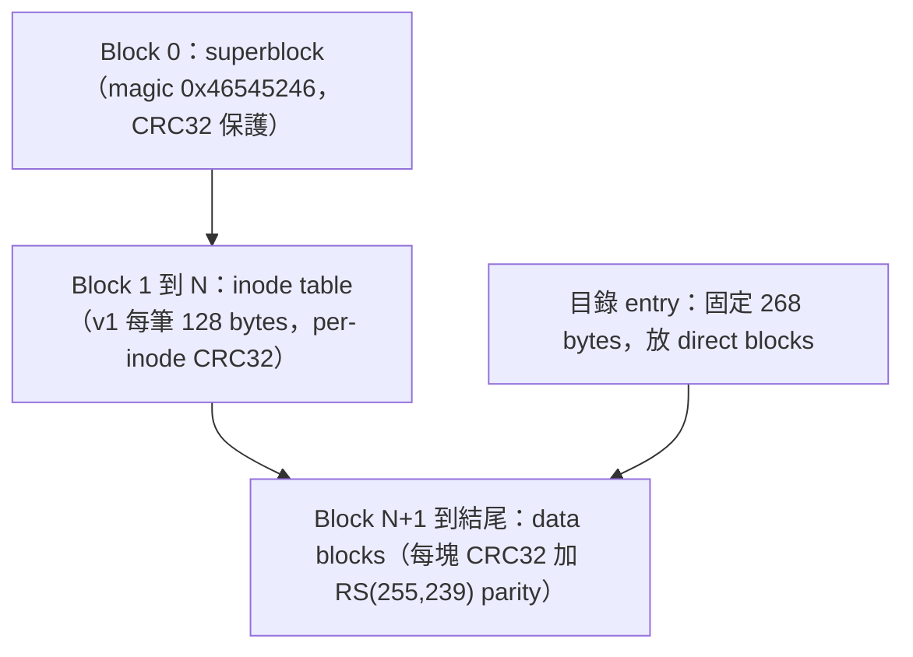
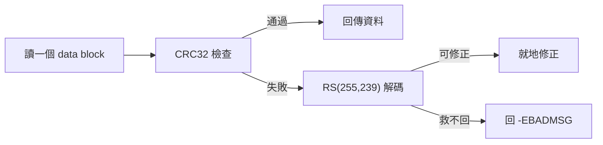

一顆低軌道衛星每次穿越南大西洋異常帶，高能粒子就有機會打進它的 flash 顆粒，把某個 0 翻成 1。翻到照片資料，頂多壞一張圖；翻到 superblock 或 kernel image，下次開機這顆衛星就再也不會回應——而你沒辦法上去修。ECC 記憶體偶爾抓到的 soft error，在太空對上消費級儲存媒體，代價是整顆衛星。

FTRFS（Fault-Tolerant Radiation-Robust Filesystem）就是為這個場景設計的。2026 年 4 月 13 日，Aurélien DESBRIERES 在 LKML 貼出 [RFC PATCH 00/10]，10 個 patch、1538 行。名字很像 Btrfs 但兩者毫無關係：Btrfs 是通用檔案系統，FTRFS 把所有雞蛋押在抗損壞上。看到這條 RFC 的當下我把它存進了待讀清單——一個 2015 年的檔案系統論文在 2026 年被陌生人撿起來實作送進 LKML，這種故事值得蹲後續。

照例聲明證據等級：本文全是二手資料（patch 信、2015 年 ARCS 論文、媒體報導），我沒跑過也沒逐行讀過程式碼，行為以 patch 信的自我描述為準，寫錯請留言糾正。

## 偵測與修正是兩件事

SEU（single event upset）是高能粒子造成的暫時性位元翻轉，在軌道上發生率比地面高出幾個數量級。檔案系統的對策分兩級：CRC/checksum 只能「偵測」損壞；Reed-Solomon 這類 FEC 才能不靠副本直接「修正」。這正是 FTRFS 與主流 FS 的分野：ext4、Btrfs、ZFS 的 checksum（Btrfs 那套的設計哲學站內在 /blog/apfs-design-vs-btrfs/ 談過）只告訴你資料壞了，救回來得靠第二份副本——ZFS 的 mirror、Btrfs 的 RAID1。而衛星上往往只有一顆儲存媒體。FTRFS 的賭注，是把修正能力放進每個 block 的尾端。

## 2015：論文

這名字不是 2026 年發明的。2015 年 ARCS 論文（Porto）裡，慕尼黑工大的 Fuchs、Langer、Trinitis 為衛星載台電腦（MOVE-II CubeSat 脈絡）設計了它：不用昂貴的抗輻射晶片，讓衛星直接用消費級 flash/NVM，把完整性保護做在檔案系統層。論文沉寂十一年後，被論文作者不認識的人撿起來實作，cover letter 原話：「This implementation is an independent open-source realization of the concepts described in that paper.」Wilcox 追問：原論文的程式碼在哪？沒有留下。

## 2026-04：RFC 與 on-disk format

RFC 版磁碟配置是教科書級的 ext2 風格：

magic 的 ASCII 就是 "FTRF"。三層防護：per-block、per-inode 的 CRC32（x86 `crc32_le` 硬體加速）；RS FEC，每 239-byte subblock 附 16 bytes parity；EDAC 相容錯誤追蹤。讀取路徑：

為什麼目錄 entry 固定 268 bytes、inode 固定大小、配置比照 ext2？在損壞復原語境下，固定長度結構的行為可預測：變長目錄 entry 斷在半路，掃描得猜邊界，可能整個目錄解不開；固定 entry 壞一個跳過一個，其餘照讀。v2 修訂信補上另一個理由：「The target is embedded critical systems where DO-178C (avionics), ECSS-E-ST-40C (space), or IEC 61508 (nuclear) certification is a hard requirement… FTRFS is designed to stay under 5000 lines of auditable code.」整個設計都在為「有人願意逐行簽名保證它正確」服務。

## Review：四月那個禮拜

第一個回應來自 Pedro Falcato：「Well, here's the obvious question: do you have a usecase for this?」ext4 開發者 Andreas Dilger 指出 ext4 早有 metadata checksums、fsverity 可驗檔案資料，然後補了最根本的一句：「having bugs in newly-developed filesystem code could be as fatal to the satellite as the radiation」——這直指核心矛盾：為了躲輻射寫新 FS，但全新 FS 的 bug 是另一種輻射。Darrick J. Wong 建議別重造輪子：「Why not add FEC to btrfs instead? Then you can concentrate on getting the IO paths correct.」Gao Xiang 看到連 mmap 的 page cache 都沒有，直接猜是 AI 寫的。

作者回應極快：v2 當天補上 address_space_operations、inode 改 256 bytes、`BUILD_BUG_ON` 把結構大小寫進編譯期保證；v3 換成 iomap IO path、補上完整 RS(255,239) decoder（Berlekamp-Massey、Chien search、Forney，每 255-byte subblock 修 8 個 symbol，救不回回 -EBADMSG），再加 Radiation Event Journal 記錄每次修正事件，也揭露 AI tooling（Assisted-by: Claude）。驗證環境本身是個故事：arm64 Cortex-A57、Linux 7.0-rc7、Yocto，部署在三節點 Slurm HPC cluster——為衛星設計的 FS 在地表 HPC cluster 驗證，不是輻射環境，只是手邊有什麼用什麼。

## 2026-10 update：分岔出 BeamFS

RFC 之後沒有下文。作者十月在新提案信自己總結死因：「The limits of FTRFS were in its design (threat model, where correction sits, scale, kernel integration).」10 月 19 日 BeamFS 以 18 個 patch 出現：資料 block 改用 kernel 既有的 lib/reed_solomon（Eric Biggers 建議），每個 4096-byte block 是 16 條交錯 RS(255,239) codeword，288 bytes parity（7% 開銷），解碼器無法擔保的讀取一律回 -EIO。驗證也升級：xfstests 兩個架構全跑，再注入單 bit 翻轉——BeamFS 沒有一次回傳錯的資料，要嘛救回、要嘛拒讀；同場 ext4/ext3 靜默回傳壞資料，單副本的 btrfs 偵測到但救不了。作者照實列出限制：翻轉是模擬的、沒測效能。也還沒有 journal 與 CoW——Darrick 四月提的點，十月還躺在 Questions 清單裡。

## 為什麼值得看

這系列最有價值的不是程式碼，而是它逼你面對 checksum 時代的假設：偵測到損壞之後，拿什麼救？Btrfs/ZFS 的答案是第二份副本（Btrfs RAID5/6 的狀況站內 /blog/btrfs-raid56-flaws/ 盤點過）；FTRFS/BeamFS 的答案是塊內 parity。衛星、放療室裡的設備（BeamFS cover letter 引了醫學文獻：質子治療室的中子場會讓心律調節器出 SEU）、任何單媒體系統，兩個答案只有一個可用。至於 LKML 收不收，沒人有答案——單用途 FS 進主線多難，/blog/bcachefs-btrfs-maintainers/ 示範過一輪；Phoronix 提了個轉折：低軌道太空資料中心正在變成市場，當利基不再是利基，review 天平也會移動。
