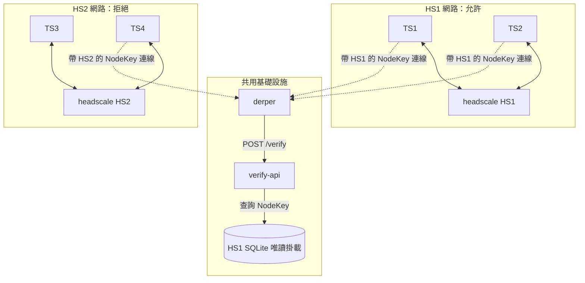
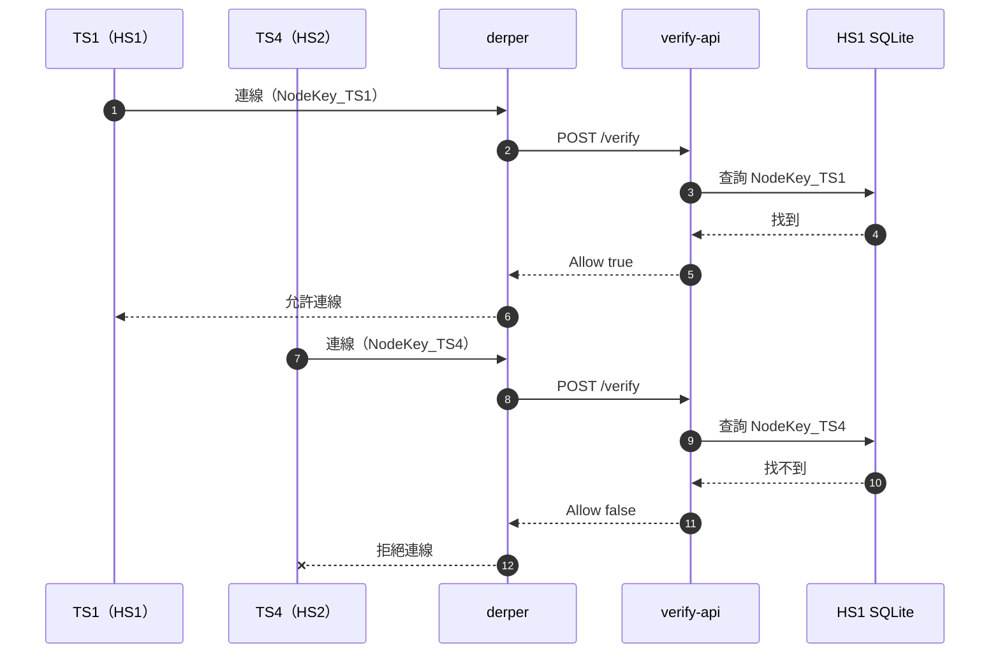

> 本文擴寫自 2025-11-27 的 HackMD 設計規格書，擴寫於 2026-11-03。

自架 [headscale](https://headscale.net/stable/) 之後，第一個撞到的問題不是控制平面，而是資料平面：兩台設備 NAT 打洞失敗時，流量得走 [DERP relay](https://tailscale.com/kb/1232/derp-servers)，而官方的 DERP servers 對我的網路環境來說延遲不理想，自然想自架 [derper](https://github.com/tailscale/tailscale/tree/main/cmd/derper)。但一查才發現 derper 預設**完全不驗證連線者**——任何知道你 DERP 位址的人都可以把你的 relay 當跳板。內建的 `--verify-clients` 可以驗，代價是 derper 主機上必須再跑一個 tailscaled，而且[官方 README](https://github.com/tailscale/tailscale/blob/main/cmd/derper/README.md) 明說「all clients must be visible to the derper tailscaled in the ACL」——這對我想把 DERP 和 control plane 拆開部署的架構來說很彆扭。

這份規格書是 derp/headscale 系列裡最早的一份設計文件，先立架構、之後才動手實作。目標：設計一個高可用（HA）headscale 架構，其中 derper 把 client 驗證「委外」給自建的 verify-api；PoC 階段只驗 HS1 的節點。

## 架構總覽

整個 PoC 用 Docker Compose 起：兩台各自獨立的 headscale（HS1、HS2，各管一個互不相通的 tailnet）、四個 client（TS1/TS2 註冊到 HS1、TS3/TS4 註冊到 HS2）、一台 derper，以及一個輕量 HTTP 服務 verify-api。verify-api 的設計完全以開源元件為基準——它只依賴 derper 的 `--verify-client-url` 契約（上游 `tailcfg` 定義）與 headscale 的公開 API/schema，任何依賴內部或未公開細節的部分都標出來。PoC 階段的實作是唯讀掛載 HS1 的 SQLite 檔、查連線者的 node key 是否存在，所以 HS2 的 client 註定被拒。



## 1. 先搞清楚 derper 的驗證選項

derper 的驗證相關 flag 有三個（定義在 [cmd/derper/derper.go](https://github.com/tailscale/tailscale/blob/main/cmd/derper/derper.go)）：

- `--verify-clients`：透過**本機 tailscaled** 驗證，如上所述部署綁得很死。
- `--verify-client-url`：把驗證委外給一個外部 HTTP admission controller。這個 flag 是 [v1.62.0](https://pkg.go.dev/tailscale.com/tailcfg#DERPAdmitClientRequest) 才加進來的（[PR #11193](https://github.com/tailscale/tailscale/pull/11193)），也就是本 PoC 的核心。原稿憑印象寫成「例如 `--verify-url`」，實際查證後確認真名是 `--verify-client-url`。
- `--verify-client-url-fail-open`：**預設是 `true`**——verify-api 掛掉時 derper 會 fail open 全部放行。拿它當存取控制用的話，這個預設值是安全陷阱，務必設成 `false`。

## 2. verify-api 的契約

原稿把契約設計成 `POST /verify` 收 `{"NodeKey": ...}`、用 HTTP 200/403 表達准否。後來查 [tailcfg 源碼](https://github.com/tailscale/tailscale/blob/main/tailcfg/derpmap.go)才發現不對：derper 送出的是 [`DERPAdmitClientRequest`](https://pkg.go.dev/tailscale.com/tailcfg#DERPAdmitClientRequest)：

```json
{
  "NodePublic": "nodekey:0123456789abcdef0123456789abcdef0123456789abcdef0123456789abcdef",
  "Source": "203.0.113.7"
}
```

回應則是 HTTP 200 帶一個 `DERPAdmitClientResponse`：

```json
{ "Allow": true }
```

準不准**不看 HTTP status code，看 body 裡的 `Allow` 布林**。原稿的 403 設計是錯的，這裡照實修正——這也是為什麼驗證契約要對照源碼寫，不能憑感覺。

verify-api 的邏輯因此極簡：解析請求、拿 `NodePublic` 去查唯讀掛載的 HS1 SQLite、回 `{"Allow": ...}`。第三方也有人做過同樣的事（例如 [tailscale-derp-client-verifier](https://github.com/hellodword/tailscale-derp-client-verifier)），可見這個契約確實可用。

## 3. Docker Compose 的接線

`docker-compose.yml` 要點（示意片段，不是能直接跑的完整檔）：

```yaml
services:
  derper:
    command:
      - derper
      - --hostname=derp.example.com
      - --verify-clients=false
      - --verify-client-url=http://verify-api:8080/verify
      - --verify-client-url-fail-open=false
  hs1:
    image: headscale/headscale:0.24
    volumes:
      - ./hs1:/var/lib/headscale
  hs2:
    image: headscale/headscale:0.24
    volumes:
      - ./hs2:/var/lib/headscale
  verify-api:
    volumes:
      - ./hs1:/var/lib/headscale:ro   # 唯讀掛載，只看 HS1
```

關鍵就是那個 `:ro`：HS1 的資料庫檔以唯讀方式進 verify-api，HS2 的不掛。HS2 的 node key 查不到，自然被拒。

## 4. 預期行為

兩條路徑：TS1（HS1）連線 → derper 轉發 `/verify` → verify-api 查到 key → `Allow: true`，DERP 通道建立，TS1/TS2 可經此 relay 通訊；TS4（HS2）連線 → 查不到 → `Allow: false` → 連線被拒。



## 5. 為什麼 PoC 先直接查 SQLite

正式的 HA 實作裡，verify-api 應該走 headscale 官方公開的介面（[REST API](https://headscale.net/stable/ref/api/) 的 `/api/v1/node` 列出 `nodeKey` 與 `expiry`，或 headscale 0.24 起內建的 [`/verify` endpoint](https://github.com/juanfont/headscale/pull/2046)），而不是綁內部 schema。PoC 的目的是驗證「derper 委外驗證」這個概念通不通，所以先用最直接的作法：直接讀 HS1 的 SQLite 檔。零額外依賴、最快能跑起來；代價是跟 headscale 的內部 schema 綁死，正式版應改走上述公開介面，這個債之後的 HA 版本再還。

## 限制（誠實列）

- **schema 綁定**：直接讀 headscale 的 SQLite 是偷吃步，headscale 升級改 schema 就會壞；SQLite 檔案被另一個容器唯讀掛載的讀取一致性也只是「堪用」等級，不是設計給跨行程共用的正規作法。
- **還是不 HA**：單台 derper 仍是單點。HA 的重點在 verify-api 背後的共享資料庫，derper 本身要多台、還要考慮 mesh 與 [derpmap 設定](https://headscale.net/stable/ref/derp/)。
- **fail-open 預設值**：再強調一次，`--verify-client-url-fail-open` 不關等于沒驗。
- **這是設計書，不是實測報告**：本篇停在規格階段，實際實作與踩雷記錄在系列後續文章。

## 後記（2026-11 補）

其實 headscale 在 [0.24.0（2025-01-17）](https://github.com/juanfont/headscale/pull/2046)就內建了與 derper 契約相容的 `/verify` endpoint（就是當初 [issue #1953](https://github.com/juanfont/headscale/issues/1953) 要的東西），內建 DERP 也有 `verify_clients` 設定。寫這份規格書時我仍選擇自建 verify-api，動機是 headscale 內建的 verify 只查「自己這一台」的節點表，做不到跨多個 headscale instance 的判斷——而 HA 架構需要的正是後者。如果你的需求只是單台 headscale 配單台 derper，直接用內建的就好，不必自己刻。

## References

- [Custom DERP servers — Tailscale KB](https://tailscale.com/kb/1118/custom-derp)
- [cmd/derper/derper.go — flags 定義](https://github.com/tailscale/tailscale/blob/main/cmd/derper/derper.go)
- [cmd/derper README — --verify-clients 的 ACL 要求](https://github.com/tailscale/tailscale/blob/main/cmd/derper/README.md)
- [PR #11193 — admission controller URL option](https://github.com/tailscale/tailscale/pull/11193)
- [tailcfg.DERPAdmitClientRequest — pkg.go.dev](https://pkg.go.dev/tailscale.com/tailcfg#DERPAdmitClientRequest)
- [tailcfg/derpmap.go — 契約源碼](https://github.com/tailscale/tailscale/blob/main/tailcfg/derpmap.go)
- [Headscale 官方文件](https://headscale.net/stable/)／[DERP 設定參考](https://headscale.net/stable/ref/derp/)
- [headscale PR #2046 — Support client verify for DERP（0.24.0）](https://github.com/juanfont/headscale/pull/2046)
- [headscale issue #1953 — 對 verify-client-url 的需求](https://github.com/juanfont/headscale/issues/1953)
- [hellodword/tailscale-derp-client-verifier — 第三方實作範例](https://github.com/hellodword/tailscale-derp-client-verifier)
