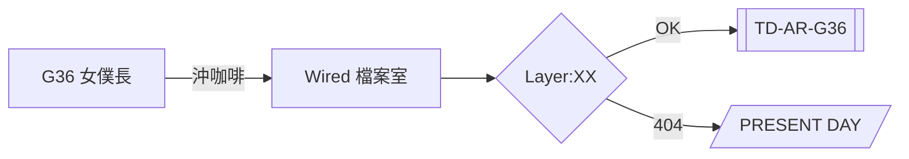

本篇紀錄這個部落格的誕生:設計語言、技術棧,以及一篇「規格測試文」——你現在看到的每一種 markdown 功能,都以後會是你文章裡的日常工具 :tada:

> [!NOTE]
> 這是一個 GitHub Alerts 測試。`> [!NOTE]`、`[!TIP]`、`[!IMPORTANT]`、`[!WARNING]`、`[!CAUTION]` 五種都會被渲染成戰術風格的提示框。

## 1. 設計語言

這個站的美學是三層融合:

| 層 | 來源 | 元素 |
|---|---|---|
| 基底 | serial experiments lain | CRT 掃描線、雜訊、藍灰深淵、`Layer:XX` 編號、**LoveLetter** 原汁字體 |
| 版面 | 虹彩六號 Siege | 45° 斜切角、corner brackets、警戒黃 `[SYS.OP]` 式標籤、stencil 標題 |
| 溫度 | 少女前線 G36 | 金髮 `#d4af37` 主 accent、藍瞳連結色、TD 代碼風 metadata |

克制的原則:掃描線與雜訊是「氛圍」而不是「裝飾」——它們應該在被意識到之前被感知[^restraint]。

[^restraint]: 出自 Curio 對 lain 1998 設計系統的分析:「效果應在被意識到之前被感知」。

## 2. 技術規格

- **框架**:Astro 7.3.5,官方 blog template 起步後 UI 全重寫
- **內容**:Content Collections(post / note 雙集合)
- **程式碼高亮**:Expressive Code(tokyo-night 主題)
- **數學**:KaTeX,行內公式使用 `$$…$$` 語法(雙錢號,CJK 安全)
- **圖表**:mermaid 由純 Rust 的 `mmdr` 在 build 時渲染成靜態 SVG — **零瀏覽器、零 client JS**
- **搜尋**:Pagefind(按 <kbd>Ctrl</kbd>+<kbd>K</kbd> 試試)
- **部署**:Cloudflare Pages

## 3. 功能展示

### 3.1 程式碼

```bash
# 部署到 Cloudflare Pages(用官方 cf CLI)
$ pnpm build
$ cf pages deploy ./dist --project-name=blog
```

```ts ins={2} del={5}
// Expressive Code 支援行標記
const layer = 7; // ins = 新增
function connect() {
  return "the wired";
}
const legacy = "dial-up"; // del = 刪除
```

### 3.2 數學

交換空間的計算——行內公式像這樣:$$\frac{16 \times 10 \times 1024}{16+16} = 5120 \text{ MiB}$$

展示型公式:

$$
\sigma = \sqrt{\frac{1}{N}\sum_{i=1}^{N}(x_i - \mu)^2}
$$

### 3.3 Mermaid(由 mmdr 預渲染)



### 3.4 表格與任務清單

- [x] 建立站點骨架
- [x] Lain/R6/G36 設計系統
- [x] GitHub markdown 全對齊
- [ ] ~~使用 Chromium 渲染 mermaid~~ → 改用 mmdr
- [ ] 綁定 `blog.g36maid.dev` 自訂網域

| 表情 | 語法 | 支援 |
|---|---|---|
| 表格 | `\|...\|` | remark-gfm |
| 刪除線 | `~~文字~~` | remark-gfm |
| 表情 | `:eyes:` | :eyes: remark-emoji |

## 結語

Present day, present site. 下一層見。

## 參考資料

- [serial experiments lain — konaka.com 官方頁](http://www.konaka.com/alice6/lain/index.shtml)
- [Astro Content Collections](https://docs.astro.build/en/guides/content-collections/)
- [mmdr — pure Rust mermaid renderer](https://crates.io/crates/mermaid-rs-renderer)
