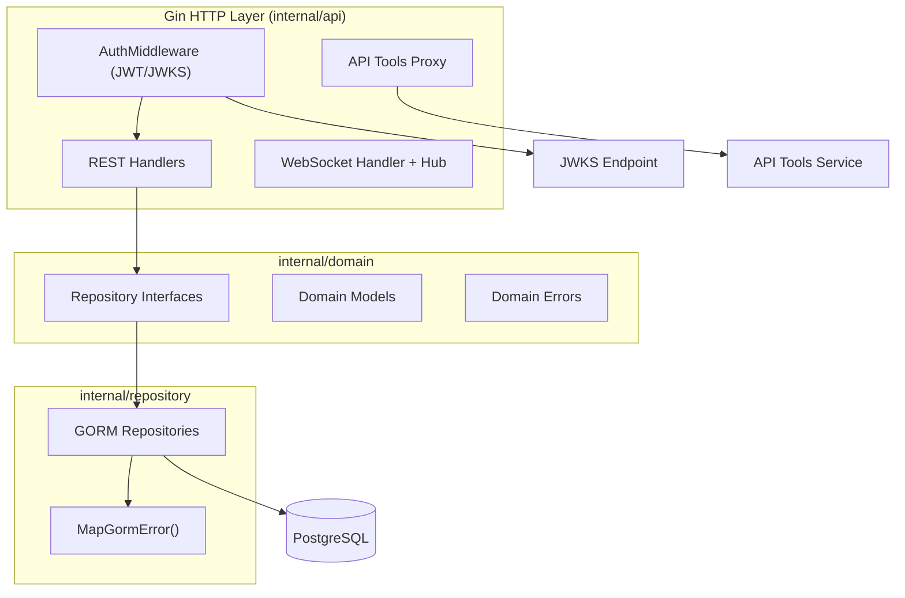

> 本文擴寫自 2026-03-11 的 HackMD 架構筆記(擴寫日期:2026-11-02)。原稿是當時整理 jpcorrect-backend 的技術文件,擴寫時保留原有架構脈絡,補上事後的檢驗與評價。

jpcorrect-backend 是一個日語矯正平台的 Go REST API。專案初期採用 pgx + sqlc 的組合:手寫 SQL、由 sqlc 產生型別安全的查詢程式碼。聽起來很理想——直到 schema 開始頻繁變動。

痛點很實際:每改一次欄位就要重寫 SQL、重跑 sqlc codegen、改 domain model、再手動補軟刪除與時間戳欄位。對一個單人開發、schema 還在劇烈演進的專案來說,sqlc 的型別安全優勢被迭代成本吃掉了。一月底的 refactor commit(`ce929a6`)把整個資料層換成 GORM,二月底(`41f63b5`)再補上 WebRTC 即時通訊。這篇記錄遷移後的架構、 trade-off 與踩過的雷。

## 架構總覽

整體是分層架構:entry point 在 `cmd/jpcorrect`,伺服器組態在 `internal/cmd`,以下依賴方向單向——API 層依賴 domain 層的介面,repository 層實作該介面。

資料表有 `user`(UUID 主鍵、軟刪除)、`event`、`event_attendee`、`mistake`、`transcript` 五張,以 `event_attendee` 作為使用者與活動的多對多關聯表。schema 由 GORM 的 `AutoMigrate` 在啟動時同步。API 層還掛了一個反向代理,把字典、聲調、振假名等請求轉發到外部的 API Tools 服務。

## 1. 資料層:pgx/sqlc 到 GORM

遷移實質上是三件事的替換:

- **連線**:從 `pgxpool.Pool` 換成 `gorm.io/driver/postgres` 的 `*gorm.DB`,連線池設 MaxOpen 50 / MaxIdle 10 / Lifetime 1h。
- **查詢**:從手寫 SQL + sqlc 生成,換成 GORM 的鏈式 API。
- **schema 管理**:從 SQL migration 換成 `AutoMigrate`。

Repository pattern 保留了下來:domain 層定義 `UserRepository` 等介面,repository 層用 GORM 實作,handler 只依賴介面。這樣的接縫讓測試可以塞 go-sqlmock,也讓「哪一天想換掉 GORM」不必動到 API 層。

GORM 免費送了幾樣原本要手寫的東西:軟刪除(`gorm.DeletedAt` 欄位即自動生效,查詢自動排除已刪除資料)、`CreatedAt`/`UpdatedAt` 時間戳、以及 UUID 主鍵的生成。

## 2. API 層:錯誤映射是關鍵接縫

驗證採 JWT + JWKS:中介層在啟動時抓 JWKS endpoint 的公鑰,驗證後把 userID 塞進 context。錯誤處理的核心是 `MapGormError()`——repository 層把 GORM 的錯誤翻譯成 domain 錯誤(`ErrNotFound`、`ErrDuplicateEntry`),handler 再映射到 404/409。

原稿的作法是 `errors.Is(err, gorm.ErrRecordNotFound)` 加上字串比對 `strings.Contains(err.Error(), "duplicate key")`。後者其實有更好的寫法:GORM 開啟 `TranslateError: true` 後會把資料庫方言錯誤轉成 `gorm.ErrDuplicatedKey`、`gorm.ErrForeignKeyViolated`,可以直接 `errors.Is` 判斷,不必依賴錯誤訊息文字。這是擴寫時回頭檢驗才發現的——原稿寫作當下並沒意識到這個選項。

## 3. WebRTC 整合:後端只做 signaling

這是最容易被誤解的部分:後端**不需要** pion/webrtc。WebRTC 的媒體路徑是瀏覽器之間的 P2P(經 STUN/TURN),Go 後端的角色只是 signaling server——透過 WebSocket 中繼 SDP offer/answer 與 ICE candidate,訊息內容對伺服器而言是不透明的。這正是 WebRTC 規範的設計:signaling 沒有標準協議,WebSocket 是最常見的選擇。

實作是典型的 hub pattern:`sync.RWMutex` 保護的 client map,訊息類型包含 `join-room`、`offer`、`answer`、`ice-candidate`、`get-online-users` 等,`BroadcastExcept` 負責廣播時排除發送者。保護措施有兩層:滑動視窗 rate limiter(每 IP 10 秒 15 條連線,超過回 429)與 WebSocket upgrader 的 Origin 檢查(由 `ALLOWED_ORIGINS` 環境變數設定)。另外也放了 `cmd/webrtc-demo`,用純 HTML/JS 驗證 handshake。

## 4. 部署與組態

Docker 多階段建置 + docker-compose 開發環境,hot reload 用 Air。HTTPS 自動偵測:有 `API_CERT_PATH`/`API_KEY_PATH` 憑證就走 TLS,沒有就 fallback HTTP(僅限開發)。必填環境變數是 `DATABASE_URL`、`API_TOOLS_URL`、`JWKS_URL` 三個,相當精簡。

## Trade-off 與踩雷

**AutoMigrate 只會加欄位與索引,不會刪欄位也不改型別。** 這是保護資料的設計,但代表重新命名欄位、改欄位型別仍要手動處理——從 int 主鍵換成 UUID 這種事 AutoMigrate 幫不了你,是靠重新建表完成的。

**複雜查詢最終還是會掉回 raw SQL。** GORM 的鏈式 API 應付 CRUD 很順,但牽涉多表聚合時,生成的 SQL 可讀性存疑;好在 GORM 允許直接寫 `Raw()`,不用硬撐。

**gorilla/websocket 的維護風險。** 它在 2022 年底曾被歸檔,後來有新維護者接手才恢復活躍,但中間那幾個月確實讓人考慮過換到 nhooyr 的 `x/net` 替代品。選庫時社群活性是實打實的風險因子。

**測試是遷移的附贈品,不是目標。** 原專案根本沒有測試;go-sqlmock 搭配 repository 介面才變得可行。這點 GORM 沒有功勞,是 architecture 的功勞。

## 個人評價

誠實說,GORM 的缺點一樣清楚:反射帶來的開銷、欄位名稱拼錯要等到執行期才爆、debug 時要看開啟 `Debug()` 才能看見實際 SQL、N+1 查詢的陷阱要自己小心 `Preload`。型別安全上它比 sqlc 退步了一大截——sqlc 在編譯期就擋掉的錯誤,GORM 要到跑起來才知道。

但我還是會再做一次同樣的選擇。理由是迭代速度:單人專案、schema 未定型的階段,「改 struct 就完成遷移」的價值遠大於編譯期安全。等 domain model 穩定、複雜查詢變多,sqlc 才是更好的落點。或許這條路的終點是:用 GORM 快速長出 schema,穩定後再遷回 sqlc。架構分層接縫(repository 介面)兩度被證明是值得投資的——它讓這種來回遷移的成本可控。

## 參考資料

- [GORM 官方文件](https://gorm.io/)
- [GORM Error Handling(TranslateError 與 ErrDuplicatedKey)](https://gorm.io/docs/error_handling.html)
- [GORM Delete(軟刪除)](https://gorm.io/docs/delete.html)
- [pgx — PostgreSQL driver for Go](https://github.com/jackc/pgx)
- [sqlc — Compile SQL to type-safe Go](https://sqlc.dev/)
- [pion/webrtc — Go WebRTC 實作(本專案未使用,作為對照)](https://github.com/pion/webrtc)
- [web.dev:WebRTC 基礎設施與 signaling](https://web.dev/articles/webrtc-infrastructure)
- [JetBrains Blog:Comparing database/sql, GORM, sqlx, and sqlc](https://blog.jetbrains.com/go/2023/04/27/comparing-db-packages/)
- 站內延伸:本篇的 mermaid 圖經由[用 mmdr 取代 Chromium 的 Mermaid 管線](/blog/mmdr-mermaid-without-chromium/)在 build 時渲染成 SVG。
