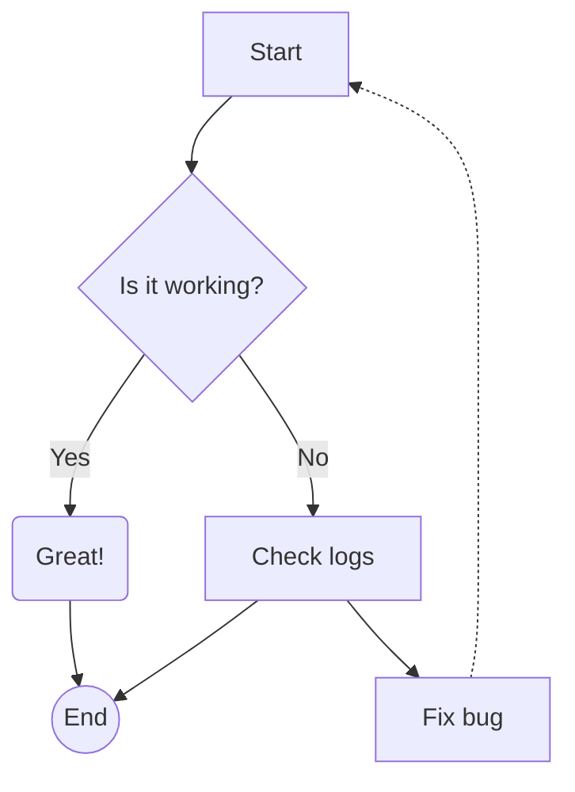
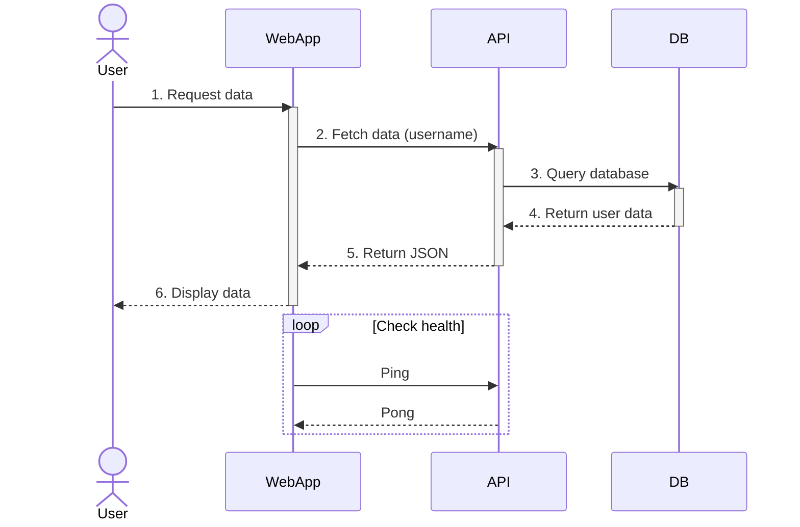
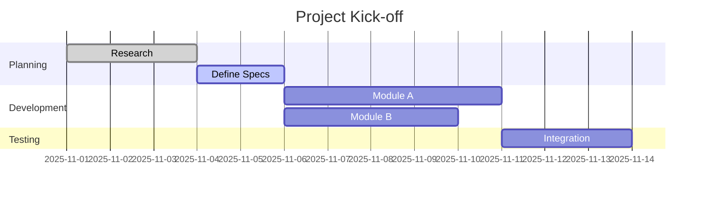
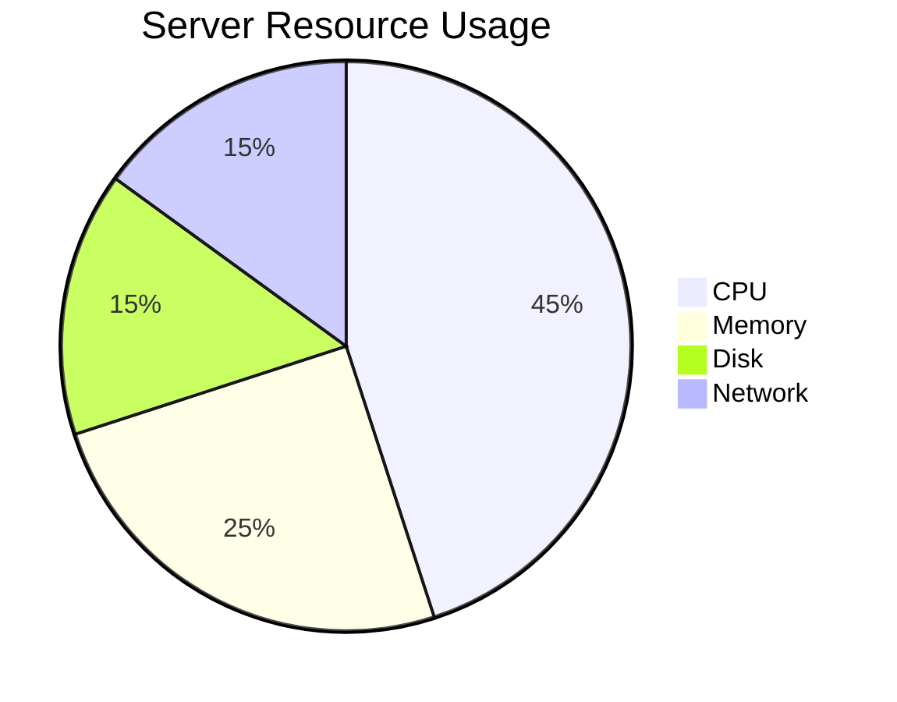
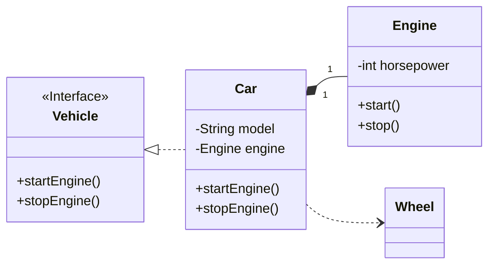
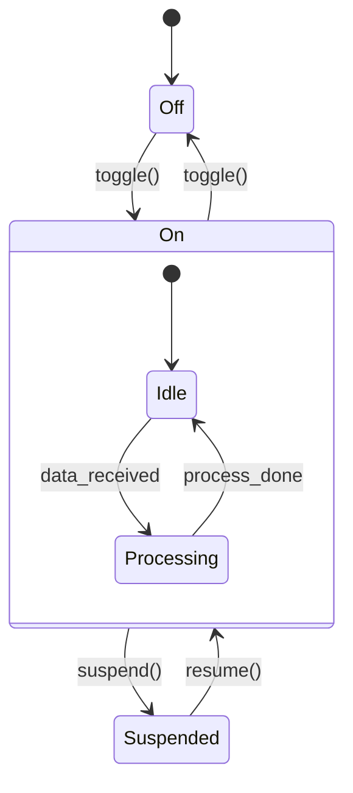
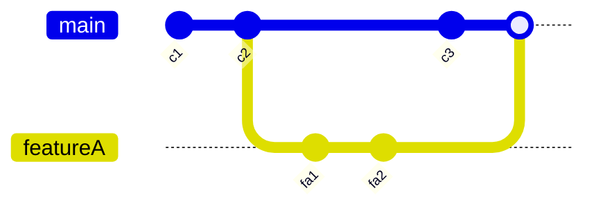
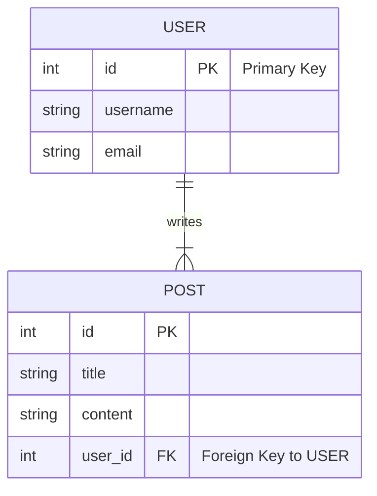

寫技術文件的時候常常需要一張圖：流程圖、時序圖、狀態機、排程。畫圖工具很多，但要在 Markdown 裡直接寫、版控能追蹤 diff 的，Mermaid 是我最順手的選擇。這篇把常用的幾種圖表語法整理成一份速覽，每種給一個最小可用的範例，加上我自己什麼時候會用它的筆記。本站的建置流程會用 [mmdr](https://github.com/1jehuang/mermaid-rs-renderer) 在建置期把每個 code block 渲染成 SVG（細節之前寫過：[不用 Chromium 渲染 Mermaid](/blog/mmdr-mermaid-without-chromium/)、[Astro 7 的 Markdown pipeline](/blog/astro-7-markdown-pipeline/)），所以這篇文章裡的每一張圖都是真的被渲染出來的，不是裝飾用的死圖。

## graph：流程圖

最常用的一種。`graph TD` 由上到下（`LR` 是由左到右），節點用方括號放文字，`{}` 是菱形判斷點，`-->` 畫實線箭頭，`-.->` 是虛線。要在箭頭上標籤就寫 `-- Yes -->`。

流程有分支、有回圈、有判斷的時候用這種。要注意的是行尾分號可寫可不寫，混著寫不會出錯，但同一篇裡統一一下比較好看。

## sequenceDiagram：時序圖

`actor` 是人形圖示，`participant` 是方框；`->>` 實線箭頭、`-->>` 虛線回傳；`activate`/`deactivate` 畫出生命週期長條；`loop` 包住重複的往返。

描述幾個服務之間的訊息往返，時序圖比流程圖精確得多。寫 API 文件或設計文件時我第一個想到的就是它。注意 `activate`/`deactivate` 要成對，寫漏一個整張圖就渲染不出來。

## gantt：甘特圖

`dateFormat` 指定日期格式，`section` 分組，每行任務的格式是「名稱 :狀態, id, 起始, 持續天數」；狀態有 `done`、`active`，不寫就是未開始。`after des2` 表示接在某個任務之後，`after des3 and des4` 則是兩個都完成才開始。

排程依賴關係複雜的專案才值得畫甘特圖；兩三個任務的話列個清單反而清楚。

## pie：圓餅圖

語法最簡單的一種，`"標籤" : 數值` 一行一筆。拿來呈現組成比例很直接，但類別多於六七個的時候圖例會很擠，那種資料適合改用條列或表格。

## classDiagram：類別圖

成員放在 `class` 區塊裡，`+`/`-` 是公開/私有；`<<Interface>>` 這種雙角括號是構造型標記。關係符號：`<|..` 實作（虛線三角）、`*--` 組合（實心菱形）、`..>` 依賴（虛線箭頭），引號裡的數字是多重性。

設計階段要跟人討論物件結構時很好用，從程式碼長出來的類別圖用工具生成比較快，手寫 Mermaid 適合小而清楚的示意。

## stateDiagram-v2：狀態機

`[*]` 是起點和終點，`-->` 加上事件名稱表示轉移條件；`state X { ... }` 可以巢狀定義複合狀態。

寫 protocol 或有明確狀態列舉的元件時，狀態機圖能直接對照程式碼裡的 enum 和轉移函式，檢查漏掉的邊特別有感。記得用 `-v2` 結尾的 `stateDiagram-v2`，舊版語法渲染出來的樣式差很多。

## gitGraph：Git 歷史示意

`commit` 建提交、`branch`/`checkout` 開分支並切過去、`merge` 合併回來。

寫 Git workflow 說明、向人解釋 rebase/merge 差異的時候，用 gitGraph 畫出提交拓樸比文字描述好懂一個量級。

## erDiagram：實體關係圖

實體名稱全大寫，屬性一行一個（`型別 名稱 PK/FK`），實體之間的關係線用鴉爪記號：`||--|{` 是一對多。

設計資料庫 schema 的草稿階段用 ER 圖對齊認知，之後再落到 migration。屬性後面雙引號裡可以放註解，會顯示在圖上。

## 離線練習場：mermaid.live

上面這些語法想邊寫邊看結果，[mermaid.live](https://mermaid.live) 是官方的線上編輯器，左邊貼語法右邊即時渲染，改錯會直接標紅。我通常在 playground 裡把圖調好，再貼回 Markdown，比在文章建置裡反覆試錯快。各種圖的完整語法文件在 [mermaid.js.org](https://mermaid.js.org/intro/)，每種圖型一頁，上面的範例都只是每種語法的子集。

一個提醒：Mermaid 官方語法更新很快，但渲染器未必跟得上——本站用 mmdr 這個純 Rust 的渲染器在建置期出圖，它支援的圖型是官方語法的常見子集，這篇文章裡每個範例都實際渲染驗證過。如果你也要把 Mermaid 放進建置流程，最保險的做法是跟我一樣，每個圖都先在 playground 或本機 render 一次確認能出圖再寫進文章。
