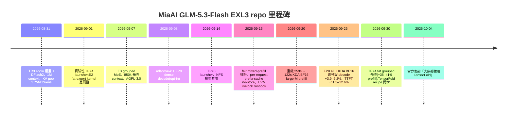
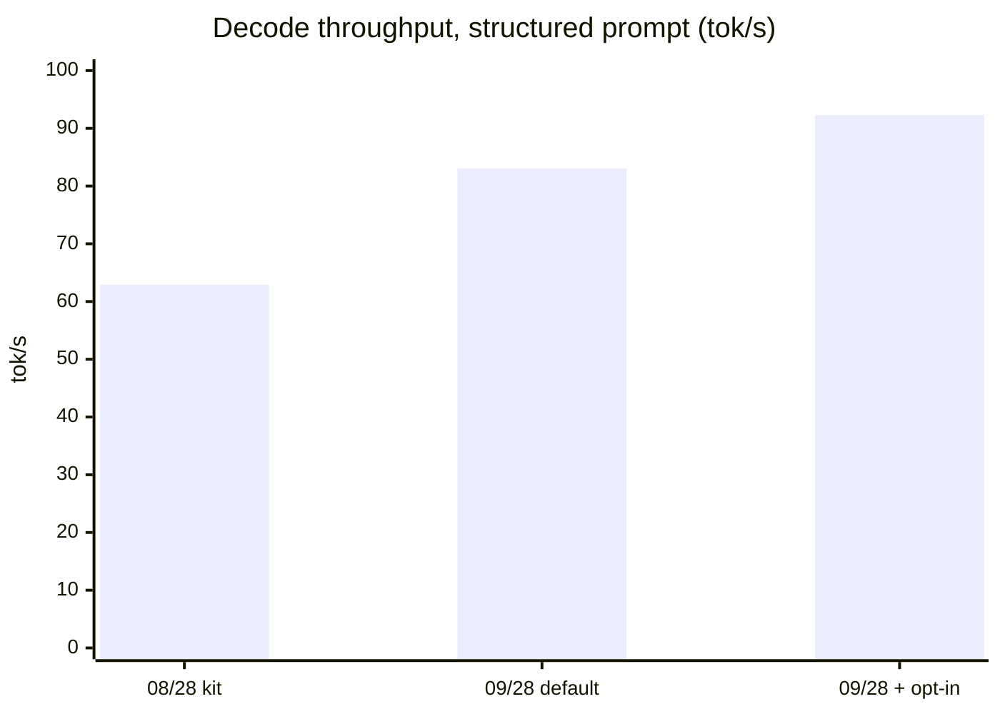
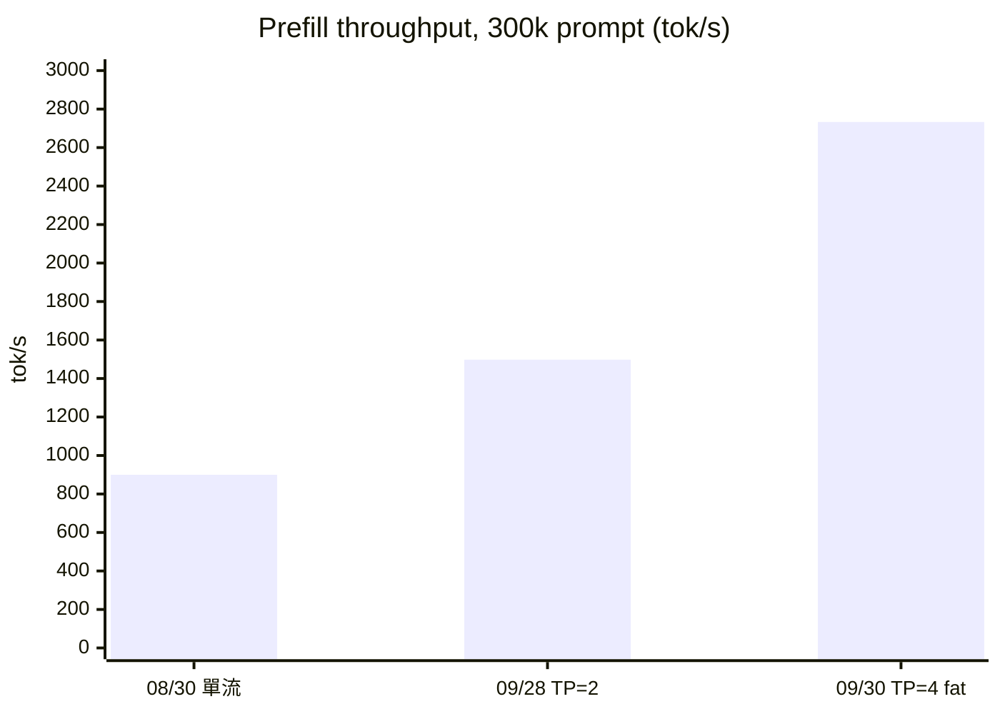

> [前作](/blog/exl3-glm-local-deploy/)寫完之後收到回饋:「在這之後 mia 該 repo 還有不少提升,可以寫一個進步調查。」這就是那篇調查。

八月底我部署 GLM-5.3-Flash-EXL3 時,結論是「decode 香、prefill 痛」,並預言最後大概會走向「EXL3 留給聊天、NVFP4 留給灌文件」的雙軌制。之後我斷斷續續看著 [MiaAI-Lab/GLM-5.3-Flash-EXL3-2x-DGX-Sparks](https://github.com/MiaAI-Lab/GLM-5.3-Flash-EXL3-2x-DGX-Sparks) 從 2026-08-31 到現在又合了 461 個 commit(含 merge,GitHub API 實數)。這篇是我對照 [8 月 31 日版的 README](https://github.com/MiaAI-Lab/GLM-5.3-Flash-EXL3-2x-DGX-Sparks/blob/72a0388571/README.md) 和[現在的 README](https://github.com/MiaAI-Lab/GLM-5.3-Flash-EXL3-2x-DGX-Sparks/blob/main/README.md) 與 [CHANGELOG](https://github.com/MiaAI-Lab/GLM-5.3-Flash-EXL3-2x-DGX-Sparks/blob/main/CHANGELOG.md) 的整理。先說結論:prefill 的痛被硬生生磨掉了一大半,而雙軌制的答案,是 repo 自己開了第二條軌道。

## 時間線

## 數字的前後對比

**Decode。** 8/28 版 README 的 sparkDash 數字是 ×1 stream 62.9 tok/s、×4 aggregate 146.5;實驗室 bench 是 structured 65.1、prose 27.1。9/28 版同一套協議下 default 是 prose 36.1、structured 83.0、code 54.6;打開 opt-in 的 speed boost(dense-h3:H3/6-bpw 配對)變成 37.5 / 92.3 / 55.5。協議細節有改動,不能直接畫等號,但 structured 從 65 到 83–92 這一級是實打實的。另外幾條 opt-in 路徑各有斬獲:adaptive draft length 在 prose 上 +13–21%,cooperative decode MoE 在 structured 上 +7–9%,SM121 thin-decode kernel 一次 A/B/A2 量到 +8–15%——但作者誠實地標了「數值研究無定論」所以維持 opt-in,這種剋制在社群 repo 裡很少見。

**Prefill。** 這才是重點。8/30 前後,單流 300k prompt 大約 840–941 tok/s(TTFT 320–356 秒);9/28 的 TP=2 預設已經是 1,411 / 1,511 / 1,498 tok/s(8k/32k/96k),TP=4 上 fat grouped MoE 轉預設後是 1,772 / 2,422 / 2,733——貢獻者量到 +35/38/41%。技術上主要靠兩件事:E2/E3 的 fat-expert grouped kernel(EXL3 權重不解碼、直接走 grouped GEMM),和 KDA BF16 large-M prefill 路徑(M>512 時改用保留的 BF16 投影權重,每 rank 約多 3.3 GiB)。也就是說,prefill 慢不是被「治好」,是被「墊高」——靠 kernel 和加機器,而不是靠 NVFP4 的 tensor core。

**工程修補的面子裡全是效能。** 9/20 的一批 commit 把 `./start.sh restart` 從 259 秒砍到 122 秒:影片佔位 `.pth` 不再每次 import vLLM、NVIDIA JIT cache 持久化、跳過被丟棄的 CUDA-graph dry-capture、kill-first 平行停止。9/15 一天之內合了 fair mixed-prefill 排班(decode-floor,10 月 1 日整合到 v7)、per-request prefix-cache no-store(多 client 共用一台 server 時彼此的 prefix 不再互相污染)、還有 [GB10 UVM livelock runbook](https://github.com/MiaAI-Lab/GLM-5.3-Flash-EXL3-2x-DGX-Sparks/blob/main/docs/uvm-livelock-gb10.md)——8 月底那種「GPU 空轉、EngineCore 100% CPU」的 deadlock,現在至少有名字和劇本了。

**併發與 context。** 八月底是 `MAX_NUM_SEQS 8`、1M ctx 但 KV pool 1.75M tokens;現在 TP=2 預設 850k、pool 1.23M,但 TensorFold recipe 那邊是 4 併發、完整 1,048,576 context、約 2.9M tokens 的共用 FP8 KV pool,還有 PARALLEL=8 的選項(8 併發時 prose aggregate 130.8 tok/s)。同一台雙 Spark 硬體,服務形狀完全不同了。品質端也不是只靠信仰:repo 採用了 malaiwah 的 teacher-logit KLD 面板(4bpw 0.0246 vs 官方 FP8 0.0206 vs NVFP4 0.0605),後續每個改預設的 PR 都要附 numerics 檢查,9/26 那次 FP8 all + KDA BF16 轉預設就明確寫了「無品質損失」。

## TensorFold:另一條軌道

9 月 30 日,MiaAI 開了 [GLM-5.3-Flash-EXL3-2x-DGX-Sparks-TensorFold](https://github.com/MiaAI-Lab/GLM-5.3-Flash-EXL3-2x-DGX-Sparks-TensorFold)。這次不是在 vLLM 上疊 patch,而是**把整條 serve stack 重寫**:自家新引擎 [TensorFold](https://github.com/ashhart/TensorFold) 加上一百多個模型專用 patch,配他們自己重校準的 [4bpw EXL3 權重](https://huggingface.co/Mia-AiLab/GLM-5.3-Flash-EXL3-4bpw-TensorFold)(~176 GB)和 DFlash2/DSpark drafter。這套的數字更兇:prefill 幾乎水平——8k 到 65k 都是 1,940–1,980 tok/s,262k 還有 1,641,連 981k needle 都能用 1,015 tok/s 灌完(TTFT 967 秒,但 1M 一次到底);decode ×1 prose 60.4、×4 aggregate 108.8、TTFT 170ms;還有 prompt reuse——64k prompt 重送從 34 秒變 0.07 秒。品質端給了 GSM8K 98.8%、HumanEval 95.7%,模型卡上也有誠實的 precision trade-off 聲明。10 月 4 日他們乾脆把原 repo 的 README 開頭改成「大家都該用 TensorFold」,並把預設權重指向 TensorFold pack。

更野的是 [3× Spark 的 TensorFold](https://github.com/MiaAI-Lab/GLM-5.3-EXL3-3x-DGX-Sparks-TensorFold):2.75bpw、273 GiB 的**完整版 GLM-5.3**(不是 Flash),每台 Spark 只放約 86 GiB,靠 context parallelism 開 500k 窗口,prefill 8k 時 601 tok/s(修之前是 448)。前作裡「FP8 權重 306 GiB 兩台都吃不下」的天花板,就這樣被第三台機器繞過去了。

## 重新評估前作的結論

**「prefill 是結構性的痛」——對了一半。** 結構性沒錯:EXL3 至今沒有 tensor core 路徑,胖 kernel 和 BF16 路徑只是把曲線抬到可忍受,981k prompt 要 16 分鐘 TTFT 這件事本質沒變。但「不是調參能救」被推翻了一半:從 900 到 2,700 tok/s 是 3 倍,很多工作負載的 prefill 佔比就這樣掉到可以忽略。

**「雙軌制」——repo 用行動回答了,但答案不是 NVFP4。** 我預期的雙軌是「EXL3 聊天、NVFP4 灌文件」,實際發生的是「vLLM recipe 保守穩、TensorFold 激進快」的雙軌。NVFP4 那條線反而是別人(tonyd2wild 的 [NVFP4+DFlash2 kit](https://github.com/tonyd2wild/GLM-5.3-Flash-NVFP4-DFlash2-2x-DGX-Spark))在推。8 月底的 KLD 面板也早有伏筆:NVFP4 的 KLD 0.0605 對 EXL3 4bpw 的 0.0246,品質上 NVFP4 反而是輸的。

工程文化也值得一提:UVM livelock 有專門 [runbook](https://github.com/MiaAI-Lab/GLM-5.3-Flash-EXL3-2x-DGX-Sparks/blob/main/docs/uvm-livelock-gb10.md)、degenerate engine 有 boot canary、每個預設改動都附量測收據、量不到就寫 inconclusive。缺點也得講:opt-in 選項爆炸、TP=4 的 DFlash hang 之類的坑仍在滾動處理,而且 TensorFold 的 patch 數量之多,維護成本恐怕不低。

## 附記:EXL3 這個格式本身

跟蹤下來越覺得 EXL3 是個很有意思的量化格式，值得單獨講兩句。它是 [exllamav3](https://github.com/turboderp-org/exllamav3) 的實作，核心是 QTIP 式的 trellis 編碼：權重不是逐個存，而是用小 codebook＋索引的組合去逼近，所以 2–8 bpw 這種傳統 GPTQ/AWQ 撐不住的極低位元區間，它還能維持可用的品質——這篇裡所有數字的基礎都是這件事。更關鍵的是它是 weight-only 而且寬度可以逐 tensor 混搭：routed experts 壓到 4 bpw，attention、shared expert、embedding 留 BF16，KDA 投影還另外保留一份 BF16 給大 M 的 prefill 路徑。MiaAI 這兩個月的最佳化（fat-expert grouped kernel、KDA BF16 large-M）全都建立在「權重格式是 EXL3、但哪些 tensor 用哪種寬度由我決定」這個彈性上。代價當然也有：trellis 走不了 Blackwell tensor core 的 FP4 路徑，prefill 的結構性天花板就是從這裡來的。EXL3 對 NVFP4，本質是「彈性與品質」對「硬體原生路徑」的取捨。

## 收尾

如果今天重新部署,我會直接上 TensorFold recipe;原本的 vLLM recipe 變成「想待在 vLLM 生態」時的選項。八月底那個「decode 香、prefill 痛」的世界,兩個月後變成「decode 更香、prefill 從痛變成貴」——要快,加機器;要省,忍 prefill。至於我那個雙軌制預言?實現了,只是兩條軌都是 EXL3。

延伸閱讀:[TensorFold 2× Spark recipe](https://github.com/MiaAI-Lab/GLM-5.3-Flash-EXL3-2x-DGX-Sparks-TensorFold)、[3× Spark 完整版 GLM-5.3](https://github.com/MiaAI-Lab/GLM-5.3-EXL3-3x-DGX-Sparks-TensorFold)、[CHANGELOG 全記錄](https://github.com/MiaAI-Lab/GLM-5.3-Flash-EXL3-2x-DGX-Sparks/blob/main/CHANGELOG.md)。
