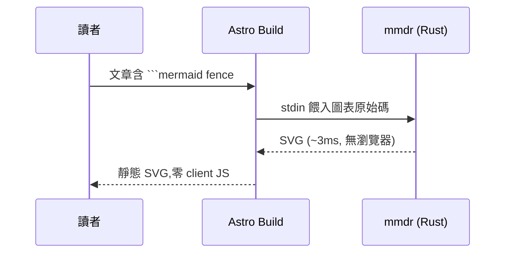

為什麼要殺掉 Chromium?官方 `rehype-mermaid` 在 build 時透過 Playwright 開 headless 瀏覽器跑 `mermaid.render()`——因為 mermaid 需要真實 DOM 做文字量測。但這台機器沒有 Chromium,而且我也不想要一個 300MB 的依賴只為了畫流程圖。

## 1. 候選:Rust 原生渲染器

| 工具 | crate | 特色 |
|---|---|---|
| **mmdr** | `mermaid-rs-renderer` | 23 種圖表、themeVariables、`--configFile`、AUR 有包 |
| mmrs | `mermaid-rs-cli` | SVG/PNG/ASCII 輸出 |

兩者都是純 Rust、零瀏覽器依賴。本站選 `mmdr`(AUR 裝好即用):

```bash
$ paru -S mmdr-bin   # 或 cargo install mermaid-rs-renderer
$ echo 'flowchart LR; A-->B' | mmdr -i - -t dark -e svg
```

## 2. 自訂 rehype 插件

核心邏輯只有三步:找到 `pre > code.language-mermaid`、把程式碼餵給 `mmdr` 的 stdin、用回傳的 SVG 取代整個 `<pre>`:

```ts
import { execFileSync } from 'node:child_process';

const svg = execFileSync('mmdr', ['-i', '-', '-t', 'dark', '--configFile', theme, '-e', 'svg'], {
	input: source,
	encoding: 'utf8',
});
parent.children[index] = { type: 'raw', value: `<figure class="mermaid-figure">${svg}</figure>` };
```

完整實作在 `src/plugins/rehype-mmdr.ts`,失敗時保留原 code block 並警告——**build 不會因為一張圖壞掉而中斷**。

## 3. 配色:讓 mermaid 融入 Lain 深淵

`mermaid-dark.json` 用 themeVariables 對齊站上的 design tokens:

```json
{
	"themeVariables": {
		"background": "#0d1017",
		"primaryColor": "#151a24",
		"primaryTextColor": "#e8eef5",
		"primaryBorderColor": "#d4af37",
		"lineColor": "#6b7686"
	}
}
```

效果:節點底 `#151a24`、邊框金 `#d4af37`、連線灰 `#6b7686`——跟站上的卡片完全同調。

## 4. 驗證



build 產物是純 SVG——RSS reader 裡看得到、不需要 JS、離線可讀。

## 常見問題

- **`fontSize` 要數字不是字串** — `"15px"` 會報 `invalid type: string, expected f32`,寫 `15`
- **圖表語法 mmdr 不支援** — 該專案還在活躍開發,不支援的圖會 fallback 成 code block(插件設計如此)
- **中文標籤** — mmdr 內建字體快取,CJK 量測正常

## 參考資料

- [mmdr / mermaid-rs-renderer](https://crates.io/crates/mermaid-rs-renderer)
- [mmrs / mermaid-rs-cli](https://crates.io/crates/mermaid-rs-cli)
- [rehype-mermaid(瀏覽器方案的對照組)](https://github.com/remcohaszing/rehype-mermaid)
