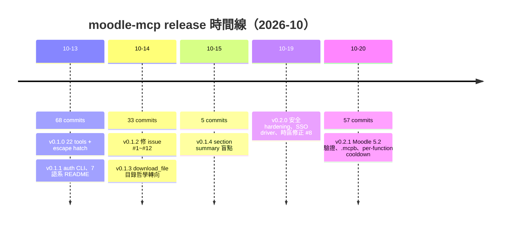

## 動機：chatbot 進不了 Moodle

我一直在等一個工具，結果它不存在，只好自己寫。我的課程生活全部在 Moodle 上：作業、PDF、討論區、成績。但一個泛用的 chatbot 對 Moodle 無能為力——想問「這週有什麼 due」，我要開五個瀏覽器分頁一頁頁看；要讓 agent 讀作業 PDF，得自己下載再手動上傳；討論區內容只能複製貼上。

[moodle-mcp](https://github.com/G36maid/moodle-mcp) 是我給這個問題的答案：一個用 Rust、基於官方 MCP SDK [rmcp](https://crates.io/crates/rmcp) 寫的 MCP server，透過 stdio 讓 LLM agent 直接使用真實的 Moodle Web Services。單一 static binary，[文件站](https://moodle.ntnu.cc)由 mdBook 生成。它把 agent 以你的身份登入，20 個型別化 tools 覆蓋整個學生流程，agent 自己鏈接呼叫——完全不用開瀏覽器。

整個專案的第一個 commit 在 2026-10-13，到 10-20 為止：8 天、163 個 commits、7 個 release。以下以 release 日期為章節，誠實記錄這八天——包括踩過的坑。

## 2026-10-13：首日衝刺（v0.1.0 + v0.1.1）

第一天我什麼都想給。[v0.1.0](https://github.com/G36maid/moodle-mcp/releases/tag/v0.1.0) 一次帶了 22 個 MCP tools，覆蓋課程、作業、論壇、檔案、訊息、通知與使用者，外加一組 escape hatch：`call_ws_function` + `list_functions`，能打到 token 有權限的每一支 web-service function。當天驗證過的基準是 Moodle 3.7，設計目標是 4.x/5.x——版本之間 response 形狀的差異必須持續吸收，這是我在 AGENTS.md 裡寫死的規則。

有一條規則值得特別講：**永遠不寫 stdout**。stdio MCP 的 stdout 就是 JSON-RPC 協議流，任何一條 `println!` 調試輸出都會污染協議、讓 client 當場斷線。所有 log 一律走 stderr 的 tracing。這聽起來像常識，但 Rust 圈寫慣了 `println!` 的人第一次做 stdio server 幾乎都會踩到。

同日的 [v0.1.1](https://github.com/G36maid/moodle-mcp/compare/v0.1.0...v0.1.1) 補上互動式 `auth` 子命令——密碼遮罩輸入，走官方 mobile app 同款的 `/login/token.php` 流程——以及繁中、簡中、日、西、德、法、葡（巴西）七種語系的 README。首日 68 個 commits，大概是我這輩子單日最高產的一天。

## 2026-10-14：社群回報的一天（v0.1.2 + v0.1.3）

v0.1.2 是修 [issue #1](https://github.com/G36maid/moodle-mcp/issues/1) 到 #12 的一天。別人真的開始用它，然後每個假設都被戳一遍：

- `download_file` 遇到不存在的目錄直接噴 `No such file or directory`（#1）；`get_notifications` 預設只回「已讀」的通知，沒人看得到新通知（#2）；成績顯示 Moodle 內部的 `-1.00000` 哨兵值（#3）；`search_users` 少送了 API 要求的參數、空查詢會掛到 timeout（#4）。
- 最關鍵的是 #5：`download_file` 和 `fetch_file` 會把 HTML 登入頁面當成檔案內容存下來。這帶出一個值得深講的原理段。

**pluginfile.php 的 token 改寫。** Moodle 的檔案都從 `pluginfile.php` 服務，但它的身份驗證是 session cookie——對一個只握有 web-service token 的 CLI agent 來說是死路。Moodle mobile app 的做法是允許把 token 當 query 參數帶上。所以我的 server 會把工具回傳的 `pluginfile.php` URL 改寫成帶 token 的版本，並且偵測回應是登入頁或錯誤 JSON 而非真正的檔案。這裡的安全界線畫得很硬：token 只注入**同站**的 Moodle URL，改寫後的重導向一旦離開 Moodle host 就停——絕不讓你的 token 跟著重導向流到別人的伺服器。

- #6 修了 Moodle 4.5+ 附件連結讀取的欄位變更；#7 最有趣：**並行的 `fetch_file` 可能回傳別的檔案內容**。原本的 fetch ticket 是從可預測的來源推導的，兩個並行請求會互搶。修法是用 atomic counter 推導 ticket——一個 `AtomicU64::fetch_add` 就解決的競態，但它在多租戶機器上就是正確性問題。
- 另外還有 `upload_file` 要攤開 `upload.php` 的 per-file 錯誤而不是謊報成功（#9）、線上文字作業的 HTML 標籤改渲染成 markdown（#12），以及 `MOODLE_READ_ONLY` / `MOODLE_DISABLE_TOOLS` 兩個環境變數（#10）。這天也[發佈上了 crates.io](https://crates.io/crates/moodle-mcp)：`cargo install moodle-mcp`。

同日的 v0.1.3 是一次漂亮的哲學轉向：0.1.2 讓 `download_file` 自動建立缺失的父目錄，隔天我反悔了。參照官方 filesystem server 的「明確動作」慣例，下載應該失敗、並在錯誤訊息裡指出缺了哪個目錄、建議先建立或改存既有目錄——**不替 agent 代勞建立目錄結構**。錯誤訊息要帶修法，這是整個專案的鐵則。

## 2026-10-15：section summary 盲點（v0.1.4）

只有 5 個 commits 的一天，但 #13 戳中一個結構性盲點：`get_course_overview` 只看 modules，而老師常常把課綱、說明寫在 **section summary** 或 module description 裡——agent 於是「看得到檔案，看不到課程的敘事」。這種 bug 不會在任何測試裡出現，因為它取決於老師怎麼使用 Moodle；只有真的拿自己的課表跑一輪才看得出來。修正後這些內容都進總覽了，同時 surfacing 了 section/module 的可用性限制與隱藏狀態，受限項目不再假裝自由可用。教訓：不要用自己的使用習慣假設所有老師都把內容放 modules。

## 2026-10-19～20：安全 hardening 週（v0.2.0 + v0.2.1）

第二週的主題從「能用」轉向「安全」。[v0.2.0](https://github.com/G36maid/moodle-mcp/compare/v0.1.4...v0.2.0)（10-19）一口氣：

- **整站重導向的 auth 修復**：遷移 host 的學校（moodle.example.edu → moodle3.example.edu）會用一個裸 303 回答舊 origin，之後每個請求都會落到首頁而非你要的頁面。現在 auth 跟著整站重導向走。
- **per-school SSO driver**：`src/sso/` 一個檔案一個 PR，auth 依 host 分派——有維護中的 driver 的學校，直接用同樣的憑證重播該校的登入鏈（不用瀏覽器、不用貼 token），取得後先驗證再顯示；其他學校走憑證模式。NTUST 的 IdentityServer portal 是[實測驗證](https://moodle.ntnu.cc/docs/security.html)過的。同時移除了 `auth --open`： Security-keys-page 流程在所有調查過的學校都不可用。
- **escape hatch 改 opt-in**：`list_functions` 更名為 `list_ws_functions`，且整組移出預設 tool surface——server 現在預設只列 20 個 tools，`MOODLE_ENABLE_WS_FUNCTION=true` 才開放。一個能寫入的 raw call 應該是深思熟慮後的選擇。
- **boolean env 嚴格解析**：`MOODLE_READ_ONLY=ture` 這種 typo 過去會靜默 fallback、**順手關掉你的安全開關**。現在 boolean 變數只接受 `true/false/1/0/yes/no/on/off`（不分大小寫），其他值在啟動時直接拒絕。
- **外部 review 抓到 4 個缺陷**：token 所在的重導向鏈可能跌回 plain http、SSO driver 的 callback POST 沒套和密碼 POST 同款的 https guard、`auth` 印出的 `export` 行對帶特殊字元的 token 沒做 quote-safe、`MOODLE_TIMEOUT_SECS` 打錯字會靜默變成預設值。四個都修了，外加一個會因 RustSec advisory 而失敗的 `cargo-audit` CI job。
- **時區修正 #8**，由 [@thc1006](https://github.com/G36maid/moodle-mcp/compare/v0.1.4...v0.2.0) 貢獻：0.1.2 的偵測讀的是 user preference，但 Moodle 把時區存在 user record 裡，stock 站台因此一路 fallback 到 UTC。現在依序讀站台的強制時區 →使用者 profile 時區 →站台預設。
- **TOCTOU 的正解是不碰磁碟**：`fetch_file` 為文件轉換寫的可預測暫存檔，在多用戶機器上是 symlink 攻擊面。修法不是把暫存檔名弄得更隨機，而是整個轉換改在記憶體內完成——少一次磁碟來回，攻擊面直接歸零。

[v0.2.1](https://github.com/G36maid/moodle-mcp/compare/v0.2.0...v0.2.1)（10-20，這天 57 個 commits）收尾：tool surface 在自架的 Moodle 5.2.4 上驗證——支援範圍兩端都現場檢查過（3.7、4.5 線上站台，5.2 自架）；capped list tools 回報 `has_more` 讓 model 分得清「全部」和「最新的 N 筆」；release 附上 `.mcpb` bundle 供 Claude Desktop/Code 一鍵安裝；429/503 cooldown 改為 per web-service function，一個被限流的端點不再癱瘓所有工具；escape hatch 改為 fails closed——token 的 enabled-function 清單載入失敗時，`call_ws_function` 拒絕呼叫而不是未驗證就送出；時區探測改為與服務並行，不再延遲 MCP `initialize` handshake。

## 設計哲學：八天之後

回頭看，這些 releases 的取捨其實一直指向同一組原則：

- **Draft-first**：write tools 的描述寫明「WRITE operation — confirm with the user before calling」；上傳先進私有草稿區，`submit_assignment` 只在你明說時 finalize。
- **Quiz 故意不做**。考試不該是 agent 的工作，這是價值判斷不是能力缺口。
- **Fails closed**：驗證資訊載不到就拒絕呼叫，而不是樂觀送出。
- **錯誤訊息帶修法**：每個錯誤都用白話指出下一步——建立目錄、開 web service、問管理員要 token。
- **不碰 stdout、tool 描述用結構化散文**：目的在前，只寫真的會混淆的配對，最後才是 ID 鏈。read tools 設 `read_only_hint = true`，附加性寫入設 `destructive_hint = false`，讓 client 端能據此畫出確認對話框。

寫日誌的過程讓我重新確認一件事：這八天最值錢的不是 commit 數，而是每一條 issue 教會我的事——別人怎麼用工具，和你假設的永遠不一樣。

最後是數字：8 天、163 個 commits、7 個 release、預設 20 個 tools（+ 2 個 opt-in 的 escape hatch）、Moodle 3.7 → 5.2 驗證。專案在 [GitHub](https://github.com/G36maid/moodle-mcp)、[crates.io](https://crates.io/crates/moodle-mcp)、[MCP registry](https://registry.modelcontextprotocol.io)（`io.github.G36maid/moodle-mcp`），完整文件在 [moodle.ntnu.cc](https://moodle.ntnu.cc)。API 的細節都參考 [Moodle Web Services 文件](https://moodledev.io/docs/apis)。

如果你也受困於「chatbot 進不了 LMS」，`cargo install moodle-mcp`，然後問 agent 一句「這週有什麼 due」。它答得出來了。
