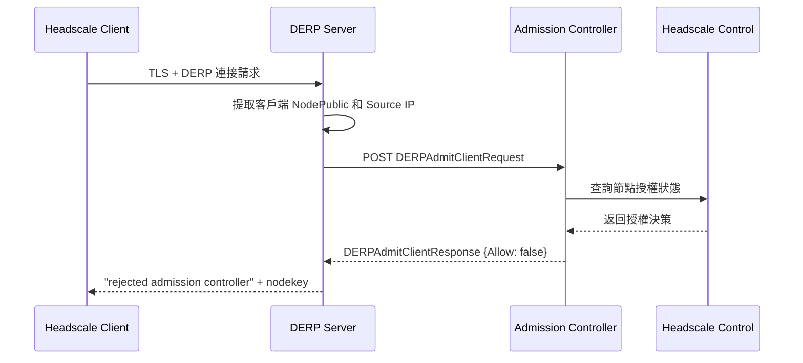

去年實習期間我接到的其中一個任務，是替公司自建的 Headscale 網路補上 DERP 中繼。DERP server 架起來其實很快，`derper` 一行指令就跑起來了——但跑起來之後我才意識到一個尷尬的問題：**任何知道我這台 DERP IP 位址的人，都可以把我的 server 加進他自己的 DERP map，把他們的流量倒進來。** 這不是開玩笑，Tailscale 官方文件在 Custom DERP Servers 那頁就明白寫著這個警告。等於我免費幫陌生人營運中繼站，頻寬帳單倒是記在我頭上。

這篇就來整理當時研究出來的解法：derper 內建的 admission controller 機制，以及怎麼把它對接到 Headscale 的節點資料上。文末那張 sequenceDiagram 是當時的原始筆記，這裡逐段把它拆開講清楚。

## 1. 先立名詞：DERP 與 admission controller

DERP（Designated Encrypted Relay for Packets）是 Tailscale 架構裡的中繼伺服器：當兩個節點打洞失敗、無法直連時，流量就改走 DERP 轉發。因為流量本身是端對端加密的，DERP 看不到內容，但頻寬是實實在在被吃掉的。在 Headscale 的世界裡，control plane 換成了自架的 headscale，但 DERP map 的邏輯不變——你可以完全自架 DERP region。

「admission controller」（准入控制器）這個詞是 derper 源碼裡的正式用語，不是我發明的比喻。它在 `cmd/derper/derper.go` 裡對應 `--verify-client-url` 這個 flag，註解原文就寫著「an admission controller URL for permitting client connections」：derper 在接受一條新連線之前，會把客戶端的資訊 POST 到這個 URL，問它「這個人可以進來嗎」，由它回覆允許與否。

## 2. derper 的兩種驗證方式

derper 原生提供兩層驗證，取捨不同：

```console
# 方式一：同機 tailscaled 查證
derper --hostname derp.example.com --verify-clients

# 方式二：外部 admission controller
derper --hostname derp.example.com \
  --verify-client-url https://admit.example.com/derp-admit \
  --verify-client-url-fail-open=false
```

`--verify-clients` 要求 derper 和 `tailscaled` 跑在同一台機器上，derper 透過本機 socket 問 tailscaled「這個 node key 在不在你的 tailnet 裡」（源碼裡是 `WhoIsNodeKey`）。這對 Tailscale 官方 SaaS 是順手的，但我們的 control plane 是 Headscale，本機 tailscaled 根本不認識那些節點，這條路走不通。

於是只剩 admission controller 這條路：驗證邏輯完全外包給一個 HTTP endpoint，愛查什麼就查什麼——對我來說，最自然的資料源就是 Headscale 自己的 API。

## 3. 協定長什麼樣

這個「問句」和「答句」在上游 `tailcfg/derpmap.go` 裡有正式定義，不是內部自造的協定：

```jsonc
// tailcfg.DERPAdmitClientRequest —— derper POST 出去的 body
{
  "NodePublic": "nodekey:xxxxxxxx",  // 客戶端宣稱的節點公鑰
  "Source": "203.0.113.7"            // derper 看到的來源 IP
}

// tailcfg.DERPAdmitClientResponse —— controller 回 200 + 這個 body
{
  "Allow": false
}
```

幾個行為細節值得記下來，全部可以在 [`derp/derpserver/derpserver.go`](https://github.com/tailscale/tailscale/blob/main/derp/derpserver/derpserver.go) 的 `verifyClient` 函式裡對照到：

- derper 給 admission controller 的**超時是 5 秒**；
- **controller 掛掉時預設 fail-open**（`--verify-client-url-fail-open` 預設 `true`），也就是 controller 連不上就放行，log 會寫 "admission controller unreachable; allowing client"；
- 回傳非 200、或 `Allow: false`，連線就會被拒絕。

fail-open 這點第一眼看會覺得違反直覺——驗證服務掛了怎麼反而是「全部放行」？推測是為了可用性優先：中繼是可用性敏感的元件，controller 短暫故障不該癱瘓整個 DERP。但如果你的威脅模型裡「未授權白嫖」是主要風險，就該像我上面指令那樣明確加上 `--verify-client-url-fail-open=false`，寧可拒絕服務也不放進未驗證的連線。

## 4. 逐段解讀當時的筆記圖



逐段對照源碼：

- **TLS + DERP 連接請求**：DERP 走 HTTPS（443），TLS 握手完成後才開始 DERP 自己的協定握手。derper 先送 server key，客戶端回送自己的節點公鑰（`recvClientKey`）。
- **提取 NodePublic 和 Source IP**：公鑰來自協定握手，Source IP 來自 TCP 連線本身（`remoteAddr`），兩者都不可由客戶端單方面偽造——這也是為什麼驗證要用這個組合。
- **POST DERPAdmitClientRequest**：就是第 3 節那個 JSON。
- **查詢節點授權狀態 → 返回授權決策**：這兩步是 controller 自己的自由發揮，上游不管你怎麼查。我的做法是拿 node key 去 Headscale API 對。
- **回覆 `Allow: false` → 連線被砍**：要誠實修正一點——實際上拒絕時 derper 是在**伺服器端** log 出 `client <nodekey> rejected: admission controller: ... not allowed`，然後直接切斷連線；客戶端那頭只會看到連線莫名消失，並不會收到這麼友善的錯誤訊息。圖裡把它畫成客戶端收到訊息，是當時筆記簡化了。

## 5. Controller 怎麼對接 Headscale

我的 controller 本體很小：收到 request 後，用 Headscale 的 REST API 列出節點，比對 `nodeKey`，再檢查金鑰是否過期：

```console
curl -sH "Authorization: Bearer $HEADSCALE_API_KEY" \
  https://headscale.example.com/api/v1/node \
  | jq -r '.nodes[] | [.nodeKey, .expiry] | @tsv'
```

Headscale API 走 Bearer token 認證（先用 `headscale apikeys create` 產生金鑰），每個節點都帶有 `nodeKey` 與 `expiry` 欄位。判準很樸素：**node key 存在於名冊中、且未過期，就 `Allow: true`；否則 `false`。** 更進一步還可以比對 Source IP 與節點註冊的位址是否一致，只是當時的 PoC 沒做到那麼細。

順帶一提，這張 mermaid 圖後來能直接排進部落格，是靠 `mmdr` 在 build 時渲染成 SVG，不用拉 Chromium——細節見[先前那篇 mermaid 渲染管線](/blog/mmdr-mermaid-without-chromium/)。

## 小結

這套機制給我的評價：**設計乾淨，預設危險。** 把驗證外包成一個簡單的 JSON HTTP 協定，controller 想接什麼後端都行，這點很好；但 fail-open 預設、以及客戶端收不到明確拒絕原因，都是實際部署時要自己補的洞。對自架 Headscale + DERP 的人來說，寫一個幾十行的 admission controller 換來「中繼不再被白嫖」，CP 值非常高，值得做。

延伸資料：Tailscale 的 [Custom DERP Servers 文件](https://tailscale.com/kb/1118/custom-derp-servers/)、[`DERPAdmitClientRequest` 定義](https://github.com/tailscale/tailscale/blob/main/tailcfg/derpmap.go)、[derper 的 flag 定義](https://github.com/tailscale/tailscale/blob/main/cmd/derper/derper.go)、[Headscale API 文件](https://github.com/juanfont/headscale/blob/main/docs/ref/api.md)。
