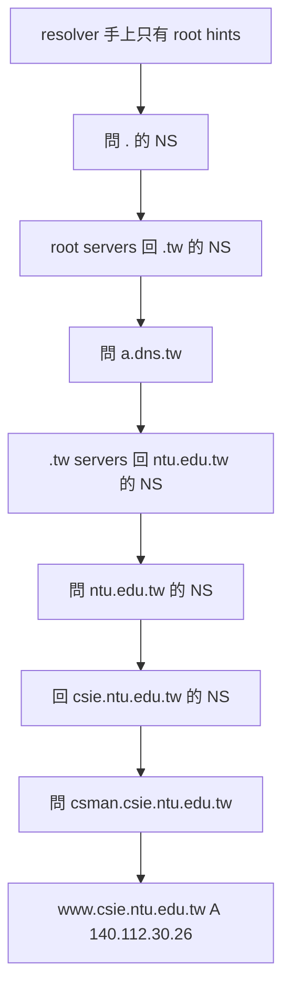

這篇文章改寫自 2024 年 4 月的操作筆記。當時的緣起是想弄一個 DNS 管理介面：手上有一個 zone 需要長期維護，直接改 zone file 每次要登機器、重載服務，一旦有其他人也要動記錄，介面就成了必需品。市面上現成的 DNS 管理面板不少，但多數綁特定商用後端；自己刻一個 web 介面又懶。最後選的組合是 PowerDNS authoritative 當 DNS 伺服器本體，資料放 SQLite（gsqlite3 後端），再用 PowerDNS-Admin 當網頁管理層——全部開源、全部跑在同一台小機器上就夠。

在動手之前，先跑了 `dig +trace` 觀察真實世界的 DNS 是怎麼運作的，這段也放進來當熱身。文中所有指令都是在 Ubuntu 22.04（WSL1 環境）上執行的原始記錄。

## 0. 熱身：dig +trace 觀察 DNS 遞迴查詢

在架自己的 DNS 之前，先看清楚別人的 DNS 是怎麼運作的。`dig +trace` 會從 root name servers 開始，一路模擬「遞迴解析器往上追」的完整路徑，把中間的 NS 委派全部印出來。底下是真的追蹤 `www.csie.ntu.edu.tw` 的結果（2026 年重新跑過一次，長這樣）：

```text
;; QUESTION SECTION:
;www.csie.ntu.edu.tw.           IN      A

;; ANSWER SECTION:
www.csie.ntu.edu.tw.    600     IN      A       140.112.30.26

;; Query time: 20 msec
;; SERVER: 127.0.0.53#53(127.0.0.53) (UDP)
;; WHEN: Thu Nov 19 10:00:00 CST 2026
;; MSG SIZE  rcvd: 76
```

完整輸出很長（root 的 NS 列表、中間層的委派、簽名記錄全部會印），重點是這四段委派：

- `.` → `a.root-servers.net.` 到 `m.root-servers.net.`，全球 13 台 root name servers（由任何一台隨機選一台開始問，完整名單見 [IANA 的 root servers 頁面](https://www.iana.org/domains/root/servers)）
- `.` → `.tw`：`a.dns.tw.` 到 `h.dns.tw.` 加 `anytld.apnic.net.`
- `.tw` → `ntu.edu.tw.`：該校網域的 NS
- `ntu.edu.tw.` → `csie.ntu.edu.tw.`：系所自己的 NS，最後由它回答 `www.csie.ntu.edu.tw. 600 IN A 140.112.30.26`

整條查詢鏈畫成圖會像這樣：



如果加上 `+dnssec`，輸出裡會多出 `RRSIG`、`DS`、`NSEC3` 這些記錄——`.tw` 和 `.edu.tw` 都已經簽署 DNSSEC，解析器可以逐層驗證回應沒有被竄改。`edu.tw` 用 NSEC3 是為了避免 NSEC 那種「可以枚舉整個 zone」的副作用，這點在架自己的 DNS 時也會遇到：要開 DNSSEC，簽章金鑰和 KSK/DNSKEY 記錄的管理是額外的功。

跑完這段再開始架自己的 DNS，對「哪一層負責回答什麼」會有具體的手感。

## 1. PowerDNS authoritative + gsqlite3 後端

[PowerDNS authoritative](https://doc.powerdns.com/authoritative/) 的後端選擇很多：BIND zone file、gmysql、gpgsql、lmdb、gsqlite3 都可以。實驗環境我選 gsqlite3，理由很直接：

- 資料就一個 `.sqlite3` 檔案，備份等於 `cp` 一個檔案，破壞了刪掉重建也快
- 不用多跑一個 DB server process，查詢 overhead 低
- 一次只服務幾個 zone 的場景，SQLite 的單寫入限制根本不會碰到

代價也先講清楚：多個 pdns instance 不能共用同一個 SQLite 檔案做主從同步，gsqlite3 的 [官方文件](https://doc.powerdns.com/authoritative/backends/generic-sqlite3.html) 明說換掉資料庫檔案必須先停 pdns 再重啟，rsync 直接同步一個執行中的 SQLite 檔是行不通的。哪天要真的上線做多機 HA，應該換 gmysql/gpgsql 當後端、資料庫層面做同步，SQLite 就留給單機小場景。另外官方文件的 backend 能力表裡，gsqlite3 對 DNSSEC、DNS Update、API 讀寫都支援（截至 PowerDNS 4.9），做實驗綽綽有餘。

### 1.1 安裝

```bash
sudo apt-get update
sudo apt-get install pdns-server pdns-backend-sqlite3
```

### 1.2 設定 pdns.conf

編輯 `/etc/powerdns/pdns.conf`，把 `launch` 換成 gsqlite3（檔案裡如果本來有別的 `launch=` 行要拿掉，否則會和預設的 bind 後端打架）：

```ini
launch=gsqlite3
gsqlite3-database=/var/lib/powerdns/pdns.sqlite3
```

### 1.3 建立 SQLite 資料庫

```bash
sudo mkdir /var/lib/powerdns
sudo sqlite3 /var/lib/powerdns/pdns.sqlite3 < /usr/share/doc/pdns-backend-sqlite3/schema.sqlite3.sql
sudo chown -R pdns:pdns /var/lib/powerdns
```

第三行的 `chown` 不可省：pdns 服務是以 `pdns` 使用者跑的，資料庫檔案若是 root 擁有，pdns 啟動後會打不開檔案直接 crash，錯誤訊息只有一行 "gsqlite3: connection failed" 之類的話，不會明說是權限問題。

### 1.4 啟動與確認

```bash
sudo systemctl start pdns
sudo systemctl status pdns
```

### 1.5 用 pdnsutil 建立 zone 與記錄

[pdnsutil](https://doc.powerdns.com/authoritative/manpages/pdnsutil.1.html) 是 PowerDNS 自帶的 CLI 工具，可以直接操作後端資料庫。先用一個 example.com 測試：

```bash
sudo -u pdns pdnsutil create-zone example.com ns1.example.com
# Creating empty zone 'example.com'
# Also adding one NS record
sudo -u pdns pdnsutil add-record example.com '' MX '25 mail.example.com'
# New rrset:
# example.com. 3005 IN MX 25 mail.example.com
sudo -u pdns pdnsutil add-record example.com. www A 192.0.2.1
# New rrset:
# www.example.com. 3005 IN A 192.0.2.1
```

用 dig 驗證（指向 127.0.0.1，讓查詢打到自己這台 pdns）：

```bash
$ dig +short www.example.com @127.0.0.1
192.0.2.1

$ dig +short example.com MX @127.0.0.1
25 mail.example.com
```

有回應就代表 gsqlite3 後端讀寫都通了。

### 1.6 踩雷一：UDP socket 已被佔用

第一個地雷：`systemctl start pdns` 之後 status 一直顯示 failed，log 裡反覆出現 `binding to UDP socket: Address already in use`。53 埠被別的服務佔走了——在桌面版 Ubuntu 上通常是 systemd-resolved 在 `127.0.0.53:53` 上偵聽（WSL1 環境也可能是其他 resolver），pdns 搶不到就起不來。

最不動腦的解法是讓 pdns 換一個 port 當測試用（正式對外的 DNS 一定要 53，這招只適合本機實驗）：

```bash
sudo vim /etc/powerdns/pdns.conf
# 加上
local-port=5300
```

改完 `sudo systemctl restart pdns` 就能起來。之後 dig 查詢要加上 `#5300`，例如：

```bash
dig +short www.example.com @127.0.0.1 -p 5300
```

Stack Overflow 上也有人討論 [這個錯誤訊息](https://www.reddit.com/r/sysadmin/comments/jac1mu/powerdns_error_unable_to_bind_udp_socket_to/)，正式環境的正解是把 systemd-resolved 的 DNSStubListener 關掉（或只留 `127.0.0.53` 給本機自己查），把 53 讓給 pdns。

### 1.7 踩雷二：WSL1 沒有 systemd

第二個地雷更有趣：這台測試機其實是 WSL1 上的 Ubuntu 22.04，而 WSL1 沒有 systemd，所以 `systemctl` 一律噴 `System has not been booted with systemd as init system (PID 1). Can't operate.`，`sudo systemctl start pdns` 根本動不了。

解法有兩條路。一是直接前台跑 pdns server：

```bash
cd /usr/sbin
./pdns_server --daemon=no --guardian=no --loglevel=9
```

前台跑的好處是所有 log 直接印在 terminal，除錯時反而清楚。要用這招的話記得先 `sudo -s`，不然權限不夠綁 53 埠（或沿用上一節的 5300 設定就不用 root）。

二是升級 WSL 到支援 systemd 的版本——微軟的 [WSL systemd 文件](https://learn.microsoft.com/zh-tw/windows/wsl/systemd) 說明這需要 WSL2 + `/etc/wsl.conf` 加 `systemd=true`。但 WSL1 沒有官方升級路徑到 WSL2 還保留同一個檔案系統的做法（`wsl --set-version` 需要重灌），所以我當時選了前台跑，等之後環境換了再說。

前台跑在這個場景完全夠用，畢竟是測試性質；但如果要長期服務，還是該有 systemd 管理生命週期，不然 ssh 斷線 pdns 就跟著死了（tmux 可以撐，但不是正解）。

## 2. PowerDNS HTTP API

PowerDNS-Admin 透過 PowerDNS 的 [HTTP API](https://doc.powerdns.com/authoritative/http-api/) 操作資料，所以接下來要把 API 打開。編輯 `pdns.conf`：

```ini
api=yes
api-key=changeme
# Needed before 4.1.0
webserver=yes
```

`api-key` 請換成自己產生的長隨機字串，這組 key 拿到的人可以直接改你的所有 DNS 記錄，等同 zone 的 root 權限。`webserver=yes` 在 4.1.0 之前是必要的，之後版本開 `api=yes` 會自動起 web server，但留著也無妨。

重啟 pdns 之後，先用 curl 測一下 API 通不通：

```bash
# List zones
curl -H 'X-API-Key: changeme' http://127.0.0.1:8081/api/v1/servers/localhost/zones | jq .

# Create new zone "example.org" with nameservers ns1.example.org, ns2.example.org
curl -X POST --data '{"name":"example.org.", "kind": "Native", "masters": [], "nameservers": ["ns1.example.org.", "ns2.example.org."]}' -H 'X-API-Key: changeme' http://127.0.0.1:8081/api/v1/servers/localhost/zones | jq .

# Show the new zone
curl -H 'X-API-Key: changeme' http://127.0.0.1:8081/api/v1/servers/localhost/zones/example.org. | jq .

# Add a new record to the new zone (would replace any existing test.example.org/A records)
curl -X PATCH --data '{"rrsets": [ {"name": "test.example.org.", "type": "A", "ttl": 86400, "changetype": "REPLACE", "records": [ {"content": "192.0.5.4", "disabled": false } ] } ] }' -H 'X-API-Key: changeme' http://127.0.0.1:8081/api/v1/servers/localhost/zones/example.org. | jq .
```

有印出 JSON 就是 API 正常運作。這段 curl 先跑過的好處是：等下 PowerDNS-Admin 接不上時，可以直接二分問題是出在 pdns 端還是 admin 端。

補一個小雷：一開始我用 `-X POST --data` 測試時，`jq` 印不出東西以為 API 壞了，其實是 JSON 欄位名稱拼錯（`changetype` 寫成 `changeType` 之類的小事），API 會直接回 422 但 curl 不加 `-v` 看不到 status code。要除 API 的錯，`-v` 加上去看 HTTP response code 最快。

## 3. PowerDNS-Admin

[PowerDNS-Admin](https://github.com/PowerDNS-Admin/PowerDNS-Admin) 是 Python Flask 寫的 web 介面，提供網頁上的 zone 與記錄管理、多使用者、記錄歷史等功能，透過上一節的 HTTP API 和 pdns 溝通。

我這邊選擇直接在 local 安裝，不使用 Docker——當時想看的其實是它內部怎麼跟 pdns API 互動，Docker image 一包裝下去就什麼都看不到了，這是個人偏好，不是什麼最佳實踐。要快的人直接上 Docker 會省很多時間。

按照 wiki 操作：

- [General installation](https://github.com/PowerDNS-Admin/PowerDNS-Admin/blob/master/docs/wiki/install/General.md)
- [Installing PowerDNS-Admin on Ubuntu or Debian based systems](https://github.com/PowerDNS-Admin/PowerDNS-Admin/blob/master/docs/wiki/install/Running-PowerDNS-Admin-on-Ubuntu-or-Debian.md)

### 3.1 安裝相依套件

```bash
sudo apt install -y python3-dev git libsasl2-dev libldap2-dev python3-venv libmariadb-dev pkg-config build-essential curl libpq-dev
```

（後面 `libmariadb-dev`、`libpq-dev` 是 Flask app 對 MariaDB/PostgreSQL 的 connector 需要的 build 依賴，就算最後 admin 自己的資料庫用 SQLite，裝上也不吃虧。）

### 3.2 安裝 Node.js 與 yarn

PowerDNS-Admin 的前端資源需要 Node.js 和 yarn 來編譯。當時 wiki 建議的版本是 Node 14：

```bash
curl -sL https://deb.nodesource.com/setup_14.x | sudo bash -
sudo apt install -y nodejs
```

```bash
curl -sL https://dl.yarnpkg.com/debian/pubkey.gpg | gpg --dearmor | sudo tee /usr/share/keyrings/yarnkey.gpg >/dev/null
echo "deb [signed-by=/usr/share/keyrings/yarnkey.gpg] https://dl.yarnpkg.com/debian stable main" | sudo tee /etc/apt/sources.list.d/yarn.list
sudo apt update && sudo apt install -y yarn
```

（這段是 2024 年當時的做法，2026 年回頭看 Node 14 已經 EOL 很久，setup script 的安裝方式也換了，文末 update 有整理。）

### 3.3 建立 virtualenv 與安裝依賴

```bash
git clone https://github.com/PowerDNS-Admin/PowerDNS-Admin.git /opt/web/powerdns-admin
cd /opt/web/powerdns-admin
python3 -m venv ./venv
source ./venv/bin/activate
pip install --upgrade pip
pip install -r requirements.txt
```

### 3.4 設定檔與資料庫遷移

複製設定檔，改 `SECRET_KEY` 為自己產生的長隨機字串（Flask 的 session 加密用，[Flask 文件](https://flask.palletsprojects.com/en/1.1.x/config/#SECRET_KEY) 有說明）：

```bash
cp configs/development.py configs/production.py
vim configs/production.py
export FLASK_CONF=../configs/production.py
```

進行資料庫遷移（PowerDNS-Admin 自己的使用者/歷史紀錄資料庫，跟 pdns 的 SQLite 是兩回事）：

```bash
export FLASK_APP=powerdnsadmin/__init__.py
flask db upgrade
```

產生前端資源文件：

```bash
yarn install --pure-lockfile
flask assets build
```

### 3.5 執行

```bash
./run.py
```

進 `http://127.0.0.1:9191` 可以看到登入畫面，第一次要先註冊帳號。登入後到 Settings 裡填入 pdns 的 API URL（`http://127.0.0.1:8081`）和上一節的 `api-key`，測試連線成功就接上了。

我把 `./run.py` 放在 tmux 裡掛著跑，順便可以盯著 log 看所有發生的變化（誰登入了、改了什麼記錄都會印出來），要轉正式服務才會去寫 systemd unit 或 gunicorn。

### 3.6 在管理介面上建 zone 與記錄

介面接上之後，實測走一遍流程：先建立一個 zone（以 `nasa.csie.tw` 為例），然後用介面新增三種記錄：

1. **TXT 記錄**：在 zone 主頁新增 `verification` 的 TXT、TTL 60、內容 `"I LOVE NASA"`，狀態設 Active。TXT 用途很廣，SPF/DKIM 郵件驗證、domain ownership 驗證都是靠它，這裡只是拿來確認介面真的把記錄寫進 pdns。
2. **NS 記錄（子域委派）**：在同一個 zone 加 `sub` 的 NS 記錄指向 `subns.nasa.csie.tw.`。這是把 `sub.nasa.csie.tw` 委派給另一台 nameserver 的做法，跟頂層 `.tw` 委派給 `ntu.edu.tw` 是同一套機制——DNS 的階層就是一層層 NS 記錄疊出來的。
3. **A 記錄**：到剛才委派出去的 zone 裡，加 `@` 的 A 記錄指向 `10.1.6.88`，讓 `subns.nasa.csie.tw` 自己有位址。

每步都用 dig 驗證：

```bash
dig +short TXT verification.nasa.csie.tw @127.0.0.1 -p 5300
dig +short NS sub.nasa.csie.tw @127.0.0.1 -p 5300
dig +short A subns.nasa.csie.tw @127.0.0.1 -p 5300
```

介面上按一按、dig 馬上查得到，代表 PowerDNS-Admin → HTTP API → pdns → SQLite 這條鏈路整條通了。對照第 0 節的 dig +trace，現在輪到我們自己的 zone 被這樣查詢了。

## 4. 個人評價

跑完這一輪的感想：

- **PowerDNS + gsqlite3 做單機 DNS 後端非常順**：從 apt install 到 dig 查得到記錄，扣掉踩雷大概半小時內搞定。踩的兩個雷（53 被佔用、WSL1 沒 systemd）都不是 PowerDNS 本身的問題，但 log 的錯誤訊息都算清楚，Google 一下都有解。
- **PowerDNS-Admin 是當時唯一像樣的 PowerDNS web 介面**，功能確實完整（多使用者、LDAP、記錄歷史），但安裝步驟真的長：Python venv + Node + yarn + flask db upgrade + assets build，一路下來依賴版本互相卡。對一個「想要個 DNS 管理介面」的需求來說，安裝成本偏高，換環境重裝一次會很煩。
- **介面與 pdns 是鬆耦合**，靠 HTTP API 溝通。好處是 admin 掛掉不影響 DNS 服務本身（dig 查詢完全不經過它）；壞處是 API key 管理多一層，兩邊版本升級要各自顧。
- 當時的場景是「幾個 zone、自己用」——這種場景下 PowerDNS-Admin 的多使用者、LDAP 整合都用不上，其實有點殺雞用牛刀。但既然是學習目的，把整條鏈路自己走過一次是值得的。

## 2026 update

- **Node 14 早已 EOL**（2023-04 結束支援），`setup_14.x` 的 nodesource 安裝腳本也不建議再用了。PowerDNS-Admin 現在的[安裝文件](https://docs.powerdns-admin.org/)主要建議 Docker；如果一定要本機裝，用 Node 18+ 即可，前端編譯指令沒變太多。
- **WSL 已經是 WSL2 時代**，微軟從 WSL 0.67.2+ 起內建支援 systemd（`/etc/wsl.conf` 加 `systemd=true` 即可），第 1.7 節的前台跑法在今天的 WSL2 上已不需要，直接 `systemctl` 就好。
- **PowerDNS-Admin 專案狀況**：2024 年前後這個專案有一段時間維護近乎停滯，社群一度討論是否改用 [Poweradmin](https://github.com/poweradmin/poweradmin) 等 PHP 系的替代品；2025 年起 PowerDNS-Admin 又有新的維護者接手活躍開發中（2026 年 11 月仍有新 commit 和 release），算是有救回來。要不要押寶它長期維護，見仁見智；真的要上線前先看 repo 的最近 commit 日期。
- **gsqlite3 後端在 PowerDNS 4.9+ 依然支援**，官方 backend 列表沒有要移除的跡象，本篇的 pdns 設定到今天仍然可用。
- 當年測試時 zone 名稱舉例用了 `nasa.csie.tw`，那是實驗用的假域名，請換成自己真正有權威的 zone。

## References

- [IANA root servers](https://www.iana.org/domains/root/servers)
- [PowerDNS authoritative documentation](https://doc.powerdns.com/authoritative/)
- [PowerDNS Generic SQLite3 backend](https://doc.powerdns.com/authoritative/backends/generic-sqlite3.html)
- [Basic setup: configuring database connectivity](https://doc.powerdns.com/authoritative/guides/basic-database.html)
- [PowerDNS HTTP API](https://doc.powerdns.com/authoritative/http-api/)
- [pdnsutil man page](https://doc.powerdns.com/authoritative/manpages/pdnsutil.1.html)
- [PowerDNS-Admin (GitHub)](https://github.com/PowerDNS-Admin/PowerDNS-Admin)
- [PowerDNS-Admin General installation](https://github.com/PowerDNS-Admin/PowerDNS-Admin/blob/master/docs/wiki/install/General.md)
- [PowerDNS-Admin on Ubuntu or Debian](https://github.com/PowerDNS-Admin/PowerDNS-Admin/blob/master/docs/wiki/install/Running-PowerDNS-Admin-on-Ubuntu-or-Debian.md)
- [PowerDNS-Admin official docs](https://docs.powerdns-admin.org/)
- [WSL systemd support (Microsoft Learn)](https://learn.microsoft.com/zh-tw/windows/wsl/systemd)
- [Unable to bind UDP socket 討論 (r/sysadmin)](https://www.reddit.com/r/sysadmin/comments/jac1mu/powerdns_error_unable_to_bind_udp_socket_to/)
- [Flask SECRET_KEY 設定](https://flask.palletsprojects.com/en/1.1.x/config/#SECRET_KEY)

相關文章：[在 NAS 裡虛擬化防火牆：FreeBSD、TrueNAS Core 與 OPNsense 的踩雷實錄](/blog/bsd-nas-opnsense-nested-virt/)、[10TB 硬碟到手先驗貨：SMART 檢測實錄](/blog/10tb-hdd-smart-checkup/)
