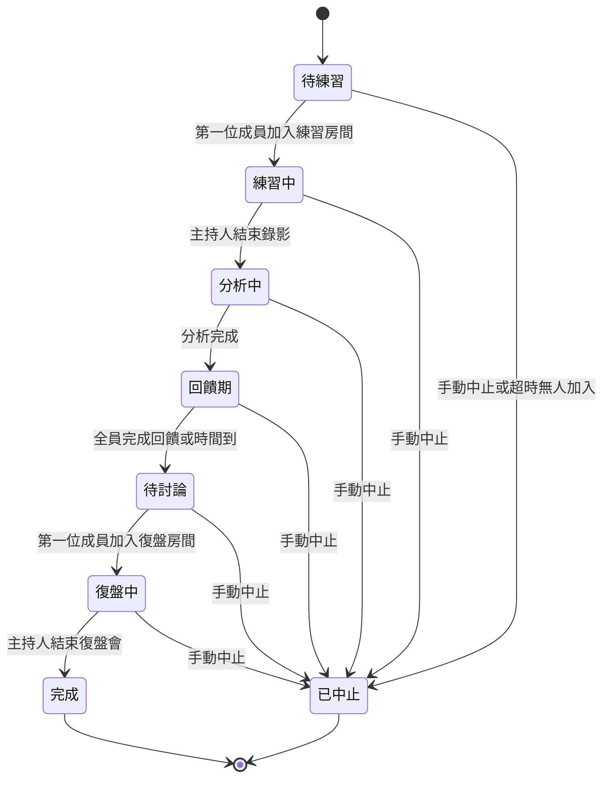
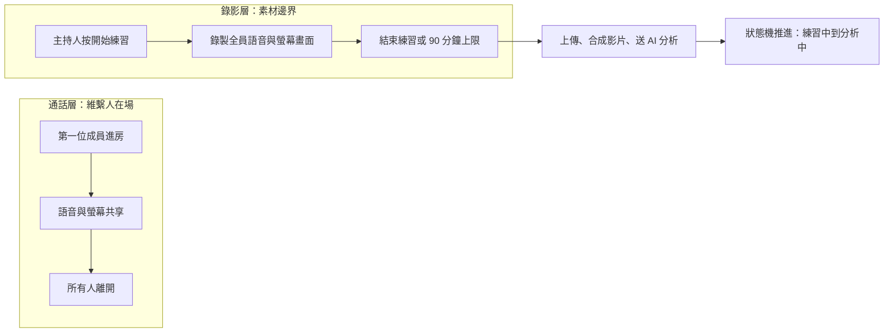

> 本文整理自 2026-04 的課程專案 handoff 技術文件（HackMD 原稿），2026-11 整理成文。原文是給後端團隊的規格書，本文補上當時的決策脈絡。

## 一份從規格反推的文件

Talkuma 是一個日語口說練習的 Web App：使用者組成公會，公會長排定練習場次，成員進 WebRTC 房間做對話或報告練習，練習過程錄影送分析，之後在復盤會討論。產品端先寫好完整的設計規格，我的任務是把規格反推成後端可動工的技術架構，寫成 handoff 文件交接給後端團隊。

動工順序上，資料模型和狀態機排最前，API 清單最後。理由很實際：API 只是資料模型與狀態轉換的讀寫介面。如果倒過來先設計 endpoint，很容易被「前端畫面上要什麼」牽著走，長出一堆純搬運表格的接口；等到寫狀態機才發現某個轉換缺欄位、某個觸發條件查不到資料。先把「真相放哪裡」（資料模型）與「誰在什麼條件下可以改真相」（狀態機）談定，API 清單最後是自己長出來的。

資料模型最後收斂成 15 個 entity，這裡挑幾個講。Activity（活動）固定對應兩個 Session：練習與復盤，復盤時間自動配在練習 +7 天——使用者只是「排定一次練習」，後端實際建立一整組。PracticeConfig 把對話與報告兩種模式的差異收進同一張表：對話練習的抽選題在練習當下才從題庫抽出，報告練習指定兩位報告者。PresenterRotation 只存「上次報告的活動 ID」一個欄位，就足以建議「最久沒報告的成員」。題庫 TopicBank 的 hints 用 JSON 存推薦詞彙與文法句型，附日語能力難度標記。認證只走第三方 OAuth（Google 為主、GitHub 與 Discord 備選），不做自帳密，流程照 [oauth.net](https://oauth.net/2/) 的標準；從邀請連結註冊的人建號後自動加入對應公會。

## 活動狀態機：整個系統的心臟

公會層級的活動有七個常規狀態加一個終態，畫成狀態圖如下：

這張圖裡最容易在實作時走樣的是幾個邊角。

第一，「練習中 → 分析中」的觸發條件是主持人結束錄影，不必等通話結束。狀態機的推進和通話生命週期是脫鉤的；不寫死的話很容易被順手寫成「大家掛斷才推進」，降級時程就跟著亂。

第二，已中止是終態，而且任何非終態都有出口通往它。觸發來源有兩個：公會長手動中止，以及系統自動中止（待練習超過預定時間還沒人進房）。中止後不可重開，要練就得重排新活動。中止畫成每個非終態共用的出口，是因為只掛在少數狀態上時，實作幾乎必然漏掉某個入口。

第三，降級機制。回饋期的截止點直接定義成復盤會的開始時間：復盤開始的瞬間，還沒完成會後回饋的成員，系統從 AI 初版分析裡自動幫他挑復盤題目。群體流程不能被最慢的人無限卡住，也沒把沒做完的人丟掉，而是給一個最低限度的自動補完。

另外個人層級還有一個小狀態機：會後回饋的未開始／進行中／已完成，只在回饋期內有效。前端要把兩層狀態合併顯示，例如公會狀態為回饋期、個人進度為已完成時，顯示成「待討論」。這種把兩個狀態機拼成使用者看得懂的字串的規則，最常被兩邊各自實作然後對不起來，所以對照表直接寫進文件。

## WebRTC 兩層房間：錄影和通話為何切開

通訊規格刻意做減法：語音通話（2–6 人）和螢幕共享必須有，鏡頭視訊直接不做。口說練習需要的是聲音和題目畫面，鏡頭的頻寬、儲存與隱私成本不划算，進房前的設備預檢也因此只需要測麥克風和連線品質。

練習房間切成兩層，生命週期各自獨立：

為什麼這樣切？錄影層承載的是有商業意義的邊界事件：結束錄影代表素材定稿，要送分析、觸發狀態機推進；通話層只是維繫人在場，練習前後的寒暄都算在裡面。兩層綁在一起，「結束練習」就得等於掛斷所有人的電話，成員被迫離場；通話遲遲不散，狀態機又卡在練習中。切開之後，錄影結束時通話照常繼續，成員可以留下閒聊，狀態機的觸發條件也乾淨地落在錄影層的邊界上。

90 分鐘硬上限是錄影的保險絲，同時框住三件事：錄影檔的大小與上傳時間、逐句分析時間戳的上界、AI 分析的成本上限。錄影結束後的流程是上傳、合成影片、送分析，上傳失敗要自動重試；持續失敗就通知公會長並把活動標記為異常——狀態機此時已推進，必須給分析中一個出口，否則活動會永遠卡死在那裡。瀏覽器端的錄製用的是 [MediaRecorder API](https://developer.mozilla.org/en-US/docs/Web/API/MediaRecorder_API)，通訊層的標準依據是 [W3C WebRTC 規格](https://www.w3.org/TR/webrtc/)與 [RFC 8829](https://datatracker.ietf.org/doc/html/rfc8829)，實作期最好查的是 MDN 的 [WebRTC API 文件](https://developer.mozilla.org/en-US/docs/Web/API/WebRTC_API)。

復盤房間簡單得多：只有語音，無錄影，但有 follow mode（主持人控制全員畫面焦點）與片段回放（回放練習錄影的特定時段）。主持人機制一併定死：第一位進房者自動擔任，離開時轉移給在場最久的成員。

## LLM 回饋：人肉 fallback，但 schema 先定

回饋系統拆成兩個獨立但互補的部分。初版分析系統處理錄影：語音辨識（逐字稿、時間戳、說話者辨識）、錯誤偵測、逐句標記信心度、產出初版修正建議。AI Chatbot 負責對話：使用者在會後回饋頁或復盤房間點逐字稿中的句子，補充意圖、迭代修正建議。

現實的資源限制是初版分析一時做不出來，所以文件裡明寫：前期由人工跑這條 pipeline。這個決定有一個重要配套，也是我認為整份文件最值得學的一條——人工產出的格式必須與未來的 AI 版本完全一致。逐句分析的 SentenceAnalysis 資料結構先把關鍵欄位定死：

| 欄位 | 說明 |
|---|---|
| transcript、timestamp | 逐字稿與錄影內的起訖時間 |
| confidence | AI 信心度標記 |
| correction | 修正建議，可被 Chatbot 迭代更新 |
| correction_version | 初版或 Chatbot 迭代後的版本號 |

只要人工階段照這個結構餵資料，回饋頁、復盤選題、降級機制這些下游不會察覺上游是人是機器；等 AI 版本就緒，抽換上游即可，下游一行不用動。correction_version 也讓「初版建議」與「和 Chatbot 聊完之後的版本」可以並存、可以回溯。

Chatbot 的行為規則同樣務實。對話歷史不保留，關閉瀏覽器就清空——每次對話都是 LLM API 成本，過程沒有留存的必要；但對話產出的修正結論，透過 [MCP](https://modelcontextprotocol.io/) 即時寫回後端的 correction 欄位。聊天的過程可以丟，聊出來的結論必須落庫。MCP 在這裡的角色，就是讓模型以工具呼叫把「更新某句的修正建議」打回後端，這種用法我另外寫過一篇 [MCP 程式碼執行模式](/blog/mcp-code-execution-mode/)。另一個細節：復盤第二階段的 Chatbot 是共享畫面，對話狀態要綁在活動而非使用者身上。

## 通知：三層管道按事件性質分配

通知是三層管道，按事件性質獨立分配、不互斥。站內通知是基底，所有事件都走；Web Push 只給時效性事件（分析完成、回饋期將截止、場次前 30 分鐘提醒），因為瀏覽器授權率不可控，只能當加值管道，不能當可靠管道；Email 是兜底，處理關鍵事件（加入申請結果、場次變更與中止、成員被移除）與拉回提醒；拉回類事件——公會停滯、註冊後沒加入公會、邀請連結將到期——則三管齊下。

Notification entity 只存 event_type、payload（JSON）與 redirect_url，管道分發邏輯放事件層；之後要加第四種管道（例如行動推播）只需改分發層。Web Push 的授權與訂閱機制見 [MDN 的 Push API 文件](https://developer.mozilla.org/en-US/docs/Web/API/Push_API)。

## 寫完之後看這份文件

以課程專案的規模來說，這份 handoff 的協作效果比預期好。後端拿到資料模型可以直接建表、對狀態轉換寫測試，前端可以照 API 清單 mock，雙方會議的時間從「這個欄位叫什麼名字」轉移到「狀態轉換的邊界條件對不對」。散落各處的業務規則（加入公會上限、邀請連結七天失效、啟動錄影需兩人在場等）另彙整成一張清單，後端不用讀整份規格找漏網。

文件末尾那份「開發階段待定義項目」清單，是我現在回頭看最喜歡的部分。它列了七項當時沒有答案的東西：拉回提醒的天數、待練習自動中止的門檻、降級選題的優先級、錄影合成的延遲等。寫規格最忌諱假裝都想清楚了；把「還沒決定」逐項指名，開發途中撞到時，團隊知道這是預期中的討論，而非需求漏寫。MVP 邊界也白紙黑字：停滯公會不處理、Chatbot 免費額度不進 MVP。

要說檢討的話，降級機制的「系統自動選題」邏輯整個留到開發階段，事後看那是最影響體驗的一塊，當場至少該給初版規則；錄影合成延遲影響使用者多快能開始回饋，也只標了待定義。這兩項若重寫一次，我會逼自己先填數字，哪怕之後再改。

最後聲明證據等級：這個專案停留在課程階段，架構沒有真的上線服役，文中取捨是設計當下的判斷而非實測結論。同樣把設計文件整理成架構教學的寫法，可以參考之前那篇 [Rust 後端架構教學](/blog/rusty-bbs-architecture/)。
