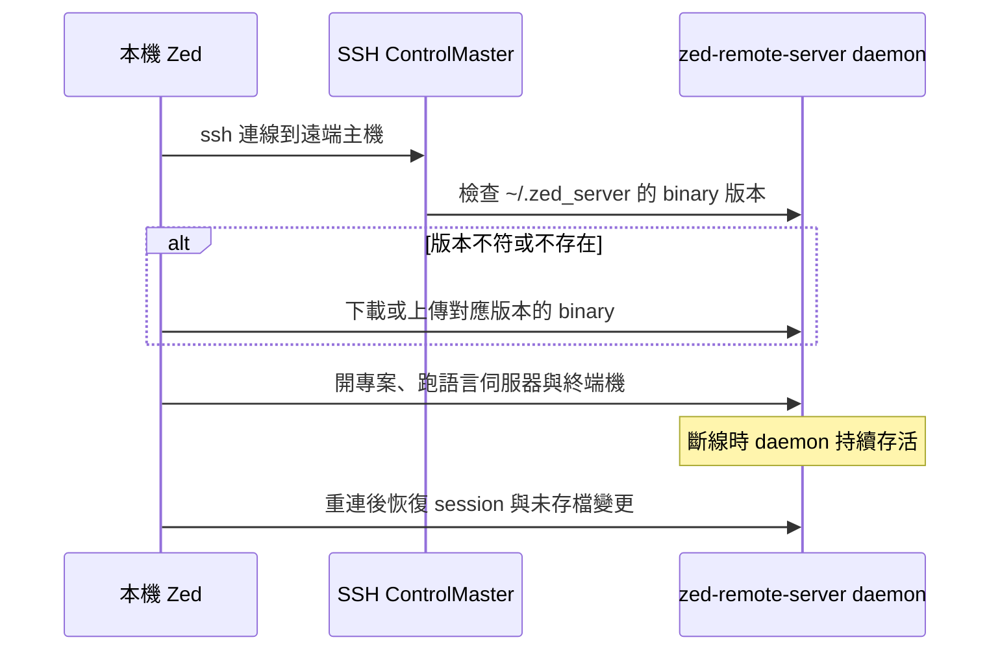

> 本文擴寫自 2026-05-13 的 Facebook 貼文,於 2026-10-24 補上調查與圖表。

最近推坑朋友們用 Zed,發現大家極度依賴 VS Code 的 Remote SSH——雖然我一直很討厭它吃伺服器效能、響應又慢。也因此,他們在 Zed 遇到的痛點幾乎全集中在 Remote 場景:

- **無法開啟專案外文件**:存取被限制在當前 workspace 範圍內,想順手看一下 `~/.vimrc` 或機器上的其他設定檔,不行。
- **LSP 跳轉受限**:Jump to Definition 沒辦法跳到遠端上其他依賴或底層程式碼,鏈路斷在 workspace 邊界。

對他們來說這不是小毛病,是「馬上就不會用」等級的問題。而這兩個痛點,其實都源於底層架構的差異與開發優先級。

## 兩種架構:完整 headless server vs 單一 binary

VS Code Remote 的做法,是把整個 VS Code 的後端搬上遠端:[VS Code Server](https://code.visualstudio.com/docs/remote/vscode-server) 是一個跑在標準(非 Electron)Node.js 上的完整 headless server,Remote Extension Host 也坐在裡面——所有 workspace extension、語言伺服器、偵錯器、終端機全部在遠端執行,本機只剩 UI。官方文件甚至建議遠端主機準備 2 GB RAM 與雙核 CPU。等於你在遠端跑了一整顆(沒有畫面的)VS Code。

Zed 的 SSH remote 則是一個[單一 binary 的最小實作](https://zed.dev/docs/remote-development):本機 Zed 負責 UI、跟語言模型對話、用 Tree-sitter 做語法高亮;連線時透過 SSH ControlMaster 到遠端,在 `~/.zed_server/` 放一支 `zed-remote-server-{channel}-{version}`,版本必須跟本機 Zed 完全一致。官方 Linux 版遠端 server 用 musl 靜態編譯,不依賴 glibc,所以可以跑在老發行版、甚至 Nix 這種 share-nothing 系統上。server 以 daemon 存活,斷線重連時語言伺服器不用重開,未存檔的變更也會備份在本機。

## 優缺點對照

**VS Code Server(完整 headless node server)**

- 優:功能完整。extension host 就在遠端,完整 IntelliSense、偵錯、所有 workspace extension 都能用;開專案外文件、跨依賴跳轉自然也不是問題——因為「整個 VS Code」就在遠端。
- 缺:資源佔用大、響應慢(我自己的體感);從 VS Code 1.99 起要求 glibc ≥ 2.28,老系統得自己弄 sysroot;[Remote 擴充套件與其元件並非開源](https://code.visualstudio.com/docs/remote/faq),也不能拿 VS Code Server 來打造自己的服務。

**Zed remote server(單一 binary 最小實作)**

- 優:資源佔用小、部署簡單,一支 musl 靜態 binary 幾乎不挑發行版;daemon 模式斷線恢復快;SSH 協作對 collab guest 完全透明。
- 缺:最小實作意即功能面窄——workspace 之外的檔案存取、跨依賴的 LSP 跳轉都受限,版本還跟本機嚴格綁定。

## Trade-off:資源佔用 vs 功能完整度

兩邊的選擇其實是同一條軸線的兩端。VS Code 的「完整後端上遠端」買到了功能完整度,代價是遠端主機要養一整個 Node.js runtime 加上 extension host,還要處理 glibc 相容性;Zed 的「最小實作」買到了輕量與可攜,代價就是朋友們抱怨的那兩個痛點——架構上還沒把 workspace 邊界外的存取打通,而不是單純沒做 UI 按鈕。

## 為什麼 Zed 這樣選

Zed 的核心賣點是效能,remote server 從協作(collab)架構長出來:官方部落格提過,為了讓 SSH 專案也能多人協作,他們把 `Project` 拆成本機/遠端等模式分別啟用,兩人協作在 SSH 上會有至少四個節點參與同步。先以最小實作把骨幹跑通(SSH remoting 從 v0.159 起正式上線,舊的經由 Zed 伺服器轉發的模式已在 v0.157 移除),再逐步補齊周邊功能,對一個小團隊是合理路徑。

## 個人評價

作為有貢獻過 Zed remote 相關程式碼的人——先前做 [FreeBSD port](/blog/zed-freebsd-port/) 的過程中,也處理過 zed-remote-server 的平台支援問題——這次當面看完其他人的實際體驗,對自己在貢獻的東西有了新的看法:我知道總有一天會完成,但是現在沒有支援,某些人馬上就不會用了。

架構取捨在開發者嘴裡是 trade-off,在使用者眼裡只有「能用/不能用」。單一 binary 的輕量很漂亮,但如果跨依賴跳轉與專案外檔案存取不到位,VS Code Server 那顆「肥 server」就依然是多數人的預設答案。希望 Zed 把 workspace 邊界這塊補起來的那天早點到。

## 延伸閱讀

- 站內:[用 AUR 思維替 Zed Editor 做非官方 FreeBSD port](/blog/zed-freebsd-port/)——含 zed-remote-server 的 FreeBSD 支援討論
- 站內:[用 mmdr 取代 Chromium:Astro 裡零瀏覽器的 Mermaid 管線](/blog/mmdr-mermaid-without-chromium/)——本文圖表的渲染管線
- [Zed Remote Development 文件](https://zed.dev/docs/remote-development)
- [SSH Remoting is Here!— Zed Blog](https://zed.dev/blog/remote-development)
- [zed-industries/zed 的 remote 相關程式碼](https://github.com/zed-industries/zed/blob/main/crates/remote/src/transport/ssh.rs)
- [Remote Development using SSH — VS Code Docs](https://code.visualstudio.com/docs/remote/ssh)
- [VS Code Server 與 Remote Extension Host 架構說明](https://code.visualstudio.com/api/advanced-topics/remote-extensions)
